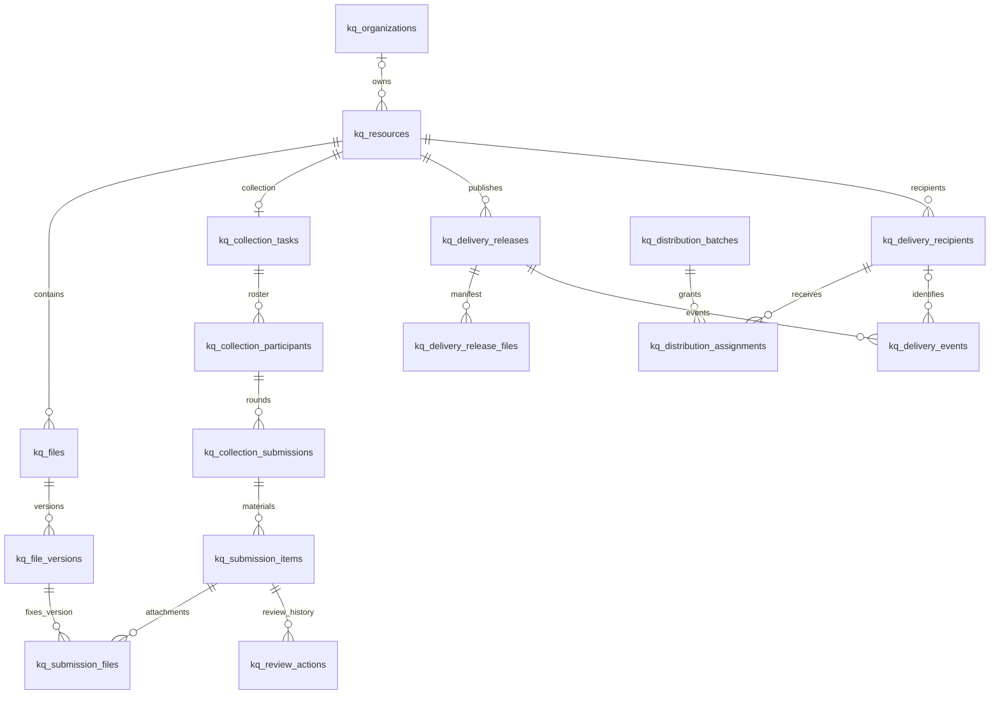

# v4 数据库拟议设计

版本日期：2026-10-29。状态：待评审草案。

## 设计口径

本文件是 **待评审的 v4 扩展目标模型**，不是自动迁移脚本。项目已将当前已实现功能接入 21 张关系业务表；这里的 44 张拟议表是在现有基础上继续规范化和扩展，按阶段使用，不要求首期一次建完。既有审计表继续保留，不重复计入 44 张；兼容快照也可在回滚窗口结束后另行评估归档。

技术基线为 MySQL 8.0.16+ / InnoDB / utf8mb4_bin，沿用当前 mysql2 与应用结构。ID 使用可承接历史标识的 VARCHAR(120)，写入 UTC DATETIME(3)，接口仍可返回 ISO 时间；大整数和字节数在 JS 中避免超出安全整数范围。配置、任务要求与版本快照使用 JSON，名单、轮次、文件关联、验收、事件和授权使用关系表。

产品形态保持电脑网页管理、手机网页提交与领取。没有独立小程序、App 专属数据模型；跨端共用身份、任务与权限。

## 核心关系

图为核心关系概览；所有字段与 86 条单列/组合外键见下方字典和 SQL。集合任务 ID 等于 collection 类型 resource ID，关系有类型约束的一端仍由应用检查资源 kind。

## 核心事务与约束

1. **租户与角色**：所有资源读写先检查所有者/团队与当前成员资格；组合外键防止串任务/资源，但无法替代租户鉴权。品牌团队 ID 不等于资源归属团队 ID。
2. **提交与补交**：锁定 participant 行分配 round_no；草稿用 row_version 做 CAS。正式提交固定本轮要求、答案和文件关联；补交创建新轮，保留历史。缺项/齐件、业务验收、安全扫描分开。
3. **审核**：锁定 item/submission，写 review_actions 并更新当前业务状态、参与人进度和 outbox。退回必须写原因；通过后内容锁定，换文件重新审核。
4. **分发与版本**：发布前核对全部收件身份和固定版本；锁定 resource 冻结映射、创建 release、授权与 outbox；同事务保证单一当前版本。下载开始后固定文件版本，撤销阻止后续访问。
5. **回执**：绑定 recipient + release，确认前校验本人验证状态与访问资格，用 dedupe_key 防重。新版不能继承旧版确认；无身份的访问不得标成实名回执。
6. **物理文件**：字节先写临时区、检查并原子发布，再提交引用；失败保留可对账状态，不能误删可能已提交的文件。清理要先标记 purge_pending，再删除字节、最后写 purged 并核算容量；事务不能回滚磁盘操作。
7. **期限与恢复**：业务有效期、分享有效期、物理保留期独立。回收站和版本按实际存储占容量，恢复不自动开放旧链接。
8. **条件/材料引用**：JSON 内 material_key、字段引用、条件循环、多人分工范围及 schema 版本由服务端验证，不是数据库 FK。分发 release 文件成员、批注可见范围、复用客户范围也需业务校验。
9. **提醒与集成**：提醒发送前重查状态、限频。Outbox 与业务状态同事务；投递至少一次，事件 ID、幂等键、租约、重试和死信必须配套。
10. **预检与 AI**：作业记录输入版本、规则/模型、同意依据与保留期；确定性错误、无法判断和低置信度分开。完整语义索引、全文/向量引擎选型和媒体转换流水线另做专项设计。

## ADR 摘要（均为 Proposed，待开发评审）

| 决策 | 建议 | 取舍与备选 |
| --- | --- | --- |
| ADR-DB-01 存储模式 | 沿用 MySQL，按业务域渐进关系化 | 继续大快照改动少但事务和查询受限；换 PostgreSQL 有额外迁移成本，当前无必要 |
| ADR-DB-02 变化定义 | 表单/清单/条件以版本 JSON 保存，执行数据分表 | 全部 EAV/字段表增加连接和迁移复杂度；需要字段级分析时再拆 |
| ADR-DB-03 不可变版本 | 逻辑文件、物理版本和整包发布分开 | 增加容量与生命周期成本，换来可靠回执与旧稿追溯 |
| ADR-DB-04 一致性 | MySQL 事务 + Outbox，后台任务用租约 | 需要工作进程与重试运维；首版不强加 MQ/Redis/微服务 |
| ADR-DB-05 复用 | 先复制到目标资源并记录授权 | 增加真实容量，避免共享路径误删；对象去重和引用计数后续另评审 |

## 迁移与回滚顺序

1. 备份业务快照、审计日志和实际文件，记录 snapshot revision、文件数量、字节数及内容校验；保留旧程序可读的导出。
2. 在隔离空白库执行拟议 DDL，只做结构验证。清理历史空值、重复联系方式、孤儿 ID、超长审计 ID，建立旧 ID/数组文件索引到新稳定 ID 的映射。
3. 先迁移账号/组织/文件资源基础；新旧适配层需按业务域确定唯一权威来源。不要让旧快照和新表同时无协调写入同一实体。
4. 选择低峰维护窗口或写入暂停，确定切换水位后回填、核对并切换该域。若用双写，必须另实现持久变更日志、事务边界、重放和对账；本包不提供这些运行时代码。
5. 逐步启用收集名单/草稿/审核，再交付版本和回执；其他模块按试点进入。校验人数、轮次、文件引用、授权、订单金额和存储容量。
6. 回滚前先停写、导出新表切换后产生的数据并按既定兼容映射回放；新字段与新业务记录未回放前，不能直接把旧 metadata.json 当作最新数据恢复。
7. 观察期保留原快照和字节备份；稳定后再归档旧权威数据。没有要求删除现有表，也没有在本次变更中操作现有数据库。

## 未在本包中完成的工程工作

将当前兼容元数据装配逐步替换为 per-entity Repository/DAO、生产容量/并发测量、生产备份恢复演练、线上权限回归、索引压测、向量检索架构均需开发评审。本包 SQL 的结构验证结果不代表这些工作完成。

## v4 需求到数据表的映射

| 需求 | 方向 | 当前代码与增量边界 | 拟议目标表 |
| --- | --- | --- | --- |
| C01 | 模板与自定义字段 | 已有字段配置、条件校验和本地结构复用；云端模板库需补充 | `kq_collection_templates`, `kq_collection_tasks` |
| C02 | 清单与提交提示、内容预检 | 已有基础材料项、命名和缺项汇总；细化规则与内容预检需扩展 | `kq_collection_tasks`, `kq_submission_items`, `kq_submission_files`, `kq_background_jobs` |
| C03 | 应交名单与精准催办 | 已有按稳定身份计算提交人数；名单导入与精准催办未见对应持久化流程 | `kq_collection_participants`, `kq_reminder_jobs` |
| C04 | 个人入口与自助修改 | 已有前端草稿/续传基础；服务端业务草稿、个人材料修改与轮次需扩展 | `kq_collection_submissions`, `kq_collection_participants`, `kq_submission_items` |
| C05 | 人工验收与退回补交 | 现有 reviewStatus 为安全扫描；独立人工业务验收需新增 | `kq_review_actions`, `kq_submission_items` |
| C06 | 规则命名与结构化打包 | 已有材料命名、按提交人打包；最终版本选择和异步导出需深化 | `kq_background_jobs`, `kq_submission_files`, `kq_file_versions` |
| C07 | 周期收集与通知汇总 | 周期生成与通知汇总按后续设计 | `kq_recurrence_rules`, `kq_outbox_events`, `kq_reminder_jobs` |
| C08 | 手机扫描与跨设备补交 | 手机扫描/同一草稿接力按增量试点设计 | `kq_handoff_sessions`, `kq_collection_submissions`, `kq_background_jobs` |
| D01 | 主动确认收到 | 已有下载次数与被下载通知；实名主动确认需扩展 | `kq_delivery_events`, `kq_delivery_recipients`, `kq_delivery_releases` |
| D02 | 访问与下载看板 | 已有总下载计数；逐人、逐版本事件需扩展 | `kq_delivery_events` |
| D03 | 原链接换稿、版本与批注 | 不可变文件版本、整包发布、版本定位批注按后续设计 | `kq_files`, `kq_file_versions`, `kq_delivery_releases`, `kq_delivery_release_files`, `kq_file_annotations` |
| D04 | 批量定向分发 | 已有配对预览、幂等发布和账号逐文件授权；外部验证领取不是现有能力 | `kq_distribution_batches`, `kq_distribution_assignments`, `kq_delivery_recipients` |
| T01 | 项目与标签 | 项目/标签持久化实体按规划新增 | `kq_projects`, `kq_tags`, `kq_resource_tags` |
| T02 | 团队品牌 | 已实现组织 branding、Logo 与版本化展示 | `kq_organizations` |
| T03 | 固定团队收件入口 | 已有团队专属路径；独立模板/项目/负责人路由入口需扩展 | `kq_intake_portals` |
| T04 | 误删恢复 | 已有个人/团队回收站字段与恢复逻辑；关系化时迁移生命周期 | `kq_resources`, `kq_file_versions` |
| T05 | 团队审核与交接 | 已有组织所有权交接与成员权限；收集协作审核范围需补充 | `kq_ownership_handovers`, `kq_organization_members`, `kq_resource_permissions`, `kq_review_actions` |
| T06 | 客户材料复用与到期更新 | 按长期客户需求设计，暂不当作现有功能 | `kq_material_library_entries`, `kq_material_reuses` |
| F01 | 企业访问与审计导出 | 已有审计落库和团队基础权限；细分范围和资源级导出需深化 | `kq_resource_permissions`, `kq_resources`, `kq_background_jobs` |
| F02 | 仅预览与身份水印 | 已有类型预览；受控原件访问与身份水印需独立实现 | `kq_resources`, `kq_delivery_recipients`, `kq_background_jobs` |
| F03 | Webhook 与开放 API | 按后续系统集成设计 | `kq_webhook_endpoints`, `kq_outbox_events`, `kq_webhook_deliveries`, `kq_api_credentials` |
| F04 | AI 辅助任务与内容处理 | 按需结果与任务外壳已设计；语义索引另作选型 | `kq_background_jobs`, `kq_collection_templates` |

## 逐表字段字典

### kq_users · 用户

模块：账号与团队；建议阶段：基础规范化；来源/用途：metadata.users。

保留现有外部账号标识，不重新分配用户 ID。

| 字段 | 类型与约束 | 含义 | 单列外键 |
| --- | --- | --- | --- |
| id | VARCHAR(120) NOT NULL PRIMARY KEY | 沿用现有用户 ID，区分大小写 | — |
| username | VARCHAR(160) NOT NULL | 账号展示名，不作为授权凭据 | — |
| nickname | VARCHAR(80) NOT NULL | 昵称 | — |
| email | VARCHAR(254) NULL | 规范化邮箱，绑定验证后写入 | — |
| phone | VARCHAR(40) NULL | 规范化手机号码 | — |
| status | VARCHAR(20) NOT NULL DEFAULT 'active' | active / disabled | — |
| profile_json | JSON NOT NULL | 头像、登录来源、登录方式等现有资料 | — |
| plan_json | JSON NOT NULL | 个人套餐与起止时间快照，沿用现有权益语义 | — |
| created_at | DATETIME(3) NOT NULL | 创建时间，UTC | — |
| updated_at | DATETIME(3) NOT NULL | 更新时间，UTC | — |

索引/约束：

- `INDEX ix_user_email (email)`
- `INDEX ix_user_phone (phone)`

业务约束：不假设现有历史联系方式全局唯一；迁移前先检查重复。外部登录不新增本地密码字段。

### kq_organizations · 团队

模块：账号与团队；建议阶段：基础规范化；来源/用途：metadata.organizations。

组织拥有团队套餐与品牌配置。

| 字段 | 类型与约束 | 含义 | 单列外键 |
| --- | --- | --- | --- |
| id | VARCHAR(120) NOT NULL PRIMARY KEY | 现有组织 ID | — |
| slug | VARCHAR(80) NOT NULL | 团队专属路径 | — |
| name | VARCHAR(80) NOT NULL | 团队名 | — |
| owner_user_id | VARCHAR(120) NOT NULL | 当前所有者 | kq_users.id |
| plan_json | JSON NOT NULL | 组织套餐与有效期，不随所有权转让丢失 | — |
| branding_json | JSON NOT NULL | 品牌开关、名称、说明、Logo 引用与修订号 | — |
| row_version | BIGINT UNSIGNED NOT NULL DEFAULT 0 | 并发控制版本 | — |
| created_at | DATETIME(3) NOT NULL | 创建时间 | — |
| updated_at | DATETIME(3) NOT NULL | 更新时间 | — |

索引/约束：

- `UNIQUE KEY uq_org_slug (slug)`
- `INDEX ix_org_owner (owner_user_id)`

### kq_organization_members · 团队成员与入团状态

模块：账号与团队；建议阶段：基础规范化；来源/用途：organizations[].members[]。

保留邀请、申请、审核和正式成员状态。

| 字段 | 类型与约束 | 含义 | 单列外键 |
| --- | --- | --- | --- |
| id | VARCHAR(120) NOT NULL PRIMARY KEY | 成员记录 ID | — |
| organization_id | VARCHAR(120) NOT NULL | 所属组织 | kq_organizations.id |
| user_id | VARCHAR(120) NULL | 绑定账号，待邀请联系人可为空 | kq_users.id |
| identity_key | VARCHAR(200) NOT NULL | user:ID 或已规范化联系人的稳定摘要 | — |
| role | VARCHAR(20) NOT NULL | owner / admin / member | — |
| status | VARCHAR(20) NOT NULL | invited / requested / active / removed | — |
| contact_snapshot_json | JSON NOT NULL | 邀请目标、显示名、来源及申请说明快照 | — |
| invitation_token_hash | CHAR(64) CHARACTER SET ascii COLLATE ascii_bin NULL | 邀请凭据摘要 | — |
| expires_at | DATETIME(3) NULL | 邀请到期时间 | — |
| requested_at | DATETIME(3) NULL | 申请时间 | — |
| reviewed_at | DATETIME(3) NULL | 处理时间 | — |
| joined_at | DATETIME(3) NULL | 入团时间 | — |
| created_at | DATETIME(3) NOT NULL | 记录创建时间 | — |

索引/约束：

- `UNIQUE KEY uq_member_identity (organization_id, identity_key)`
- `INDEX ix_member_user (user_id, status)`

业务约束：组织所有者、owner 成员角色与交接结果必须在同一事务更新，保证仅有一个有效所有者。

### kq_ownership_handovers · 所有权交接

模块：账号与团队；建议阶段：基础规范化；来源/用途：organizations[].ownershipHandovers[]。

保存发起、接收、取消和失效记录。

| 字段 | 类型与约束 | 含义 | 单列外键 |
| --- | --- | --- | --- |
| id | VARCHAR(120) NOT NULL PRIMARY KEY | 交接 ID | — |
| organization_id | VARCHAR(120) NOT NULL | 组织 | kq_organizations.id |
| from_user_id | VARCHAR(120) NOT NULL | 原所有者 | kq_users.id |
| to_user_id | VARCHAR(120) NOT NULL | 接收者 | kq_users.id |
| status | VARCHAR(20) NOT NULL | pending / accepted / declined / canceled / expired / invalidated | — |
| initiated_at | DATETIME(3) NOT NULL | 发起时间 | — |
| expires_at | DATETIME(3) NOT NULL | 待接收有效期 | — |
| resolved_at | DATETIME(3) NULL | 处理时间 | — |
| resolved_by_user_id | VARCHAR(120) NULL | 操作人 | kq_users.id |
| reason | VARCHAR(240) NULL | 处理原因 | — |

索引/约束：

- `INDEX ix_handover_pending (organization_id, status, expires_at)`

### kq_auth_sessions · 登录会话

模块：账号与团队；建议阶段：基础规范化；来源/用途：metadata.sessions。

替代全量快照中的登录会话。

| 字段 | 类型与约束 | 含义 | 单列外键 |
| --- | --- | --- | --- |
| id | VARCHAR(120) NOT NULL PRIMARY KEY | 内部会话 ID，不能直接用作 Cookie 凭据 | — |
| token_hash | CHAR(64) CHARACTER SET ascii COLLATE ascii_bin NOT NULL | Cookie 随机令牌摘要 | — |
| user_id | VARCHAR(120) NOT NULL | 账号 | kq_users.id |
| provider_credential_ciphertext | MEDIUMTEXT NULL | 确需保留的上游凭据密文与密钥版本封装 | — |
| created_at | DATETIME(3) NOT NULL | 创建时间 | — |
| expires_at | DATETIME(3) NOT NULL | 过期时间 | — |
| revoked_at | DATETIME(3) NULL | 撤销时间 | — |

索引/约束：

- `UNIQUE KEY uq_session_token (token_hash)`
- `INDEX ix_session_user (user_id, expires_at)`
- `INDEX ix_session_expiry (expires_at)`

业务约束：上游凭据使用应用现有加密体系迁移；文档不包含任何真实令牌或密钥。

### kq_verification_codes · 绑定与身份验证挑战

模块：账号与团队；建议阶段：基础规范化；来源/用途：metadata.verificationCodes。

保留验证码哈希与尝试次数；新增领取验证按场景隔离。

| 字段 | 类型与约束 | 含义 | 单列外键 |
| --- | --- | --- | --- |
| id | VARCHAR(120) NOT NULL PRIMARY KEY | 挑战 ID | — |
| scene | VARCHAR(40) NOT NULL | bind / claim / handoff，当前代码仅 bind | — |
| target_type | VARCHAR(20) NOT NULL | email / phone | — |
| target_digest | CHAR(64) CHARACTER SET ascii COLLATE ascii_bin NOT NULL | 规范化目标的带密钥摘要 | — |
| target_ciphertext | TEXT NULL | 必要时加密保存发送目标 | — |
| code_hash | CHAR(64) CHARACTER SET ascii COLLATE ascii_bin NOT NULL | 验证码摘要 | — |
| attempts | SMALLINT UNSIGNED NOT NULL DEFAULT 0 | 验证尝试次数 | — |
| expires_at | DATETIME(3) NOT NULL | 有效期 | — |
| consumed_at | DATETIME(3) NULL | 消费时间 | — |
| created_at | DATETIME(3) NOT NULL | 创建时间 | — |

索引/约束：

- `INDEX ix_challenge_target (target_digest, scene, expires_at)`
- `INDEX ix_challenge_expiry (expires_at)`

### kq_upgrade_orders · 套餐订单

模块：账号与团队；建议阶段：基础规范化；来源/用途：metadata.upgradeOrders。

业务订单独立保存，支付成功处理保持幂等。

| 字段 | 类型与约束 | 含义 | 单列外键 |
| --- | --- | --- | --- |
| id | VARCHAR(120) NOT NULL PRIMARY KEY | 订单内部 ID | — |
| order_no | VARCHAR(80) NOT NULL | 本地业务订单号 | — |
| user_id | VARCHAR(120) NOT NULL | 购买账号 | kq_users.id |
| organization_id | VARCHAR(120) NULL | 若订单直接对应团队 | kq_organizations.id |
| plan_id | VARCHAR(40) NOT NULL | 套餐标识 | — |
| amount_minor | BIGINT UNSIGNED NULL | 金额最小货币单位；未确定价格为空 | — |
| currency | CHAR(3) NOT NULL DEFAULT 'CNY' | 币种 | — |
| status | VARCHAR(30) NOT NULL | 沿用现有订单状态；迁移时明确状态映射 | — |
| provider | VARCHAR(40) NOT NULL | 支付提供方 | — |
| provider_order_no | VARCHAR(120) NULL | 第三方订单号 | — |
| plan_snapshot_json | JSON NOT NULL | 套餐、权益天数与来源快照 | — |
| provider_payload_json | JSON NULL | 脱敏支付响应，不保存支付密码 | — |
| query_credential_ciphertext | TEXT NULL | 有保留期限的查单凭据密文 | — |
| created_at | DATETIME(3) NOT NULL | 创建时间 | — |
| updated_at | DATETIME(3) NOT NULL | 更新时间 | — |
| paid_at | DATETIME(3) NULL | 支付成功时间 | — |

索引/约束：

- `UNIQUE KEY uq_order_no (order_no)`
- `UNIQUE KEY uq_provider_order (provider, provider_order_no)`
- `INDEX ix_order_user (user_id, created_at)`

业务约束：现有浮点金额转换为最小单位需明确币种、精度与舍入规则，迁移不得直接乘 100 后静默截断。

### kq_messages · 站内消息

模块：账号与团队；建议阶段：基础规范化；来源/用途：metadata.messages[userId][]。

保留现有消息分类、动作与已读状态。

| 字段 | 类型与约束 | 含义 | 单列外键 |
| --- | --- | --- | --- |
| id | VARCHAR(120) NOT NULL | 现有消息 ID，可能在不同账号重复 | — |
| user_id | VARCHAR(120) NOT NULL | 接收人 | kq_users.id |
| category | VARCHAR(30) NOT NULL | system / official / 业务分类 | — |
| event_type | VARCHAR(80) NULL | 事件类型 | — |
| title | VARCHAR(160) NOT NULL | 标题 | — |
| body | TEXT NOT NULL | 正文 | — |
| action_json | JSON NULL | actionUrl / actionType / actionId | — |
| created_at | DATETIME(3) NOT NULL | 创建时间 | — |
| read_at | DATETIME(3) NULL | 已读时间 | — |

索引/约束：

- `PRIMARY KEY (user_id, id)`
- `INDEX ix_message_unread (user_id, read_at, created_at)`

### kq_settings · 用户与系统配置

模块：账号与团队；建议阶段：基础规范化；来源/用途：notificationSettings / users[].fileCleanup / systemConfig。

小规模可变配置保留 JSON；系统配置与用户配置使用不同作用域。

| 字段 | 类型与约束 | 含义 | 单列外键 |
| --- | --- | --- | --- |
| scope_key | VARCHAR(160) NOT NULL | system 或 user:ID，服务端构造 | — |
| setting_key | VARCHAR(80) NOT NULL | notification / cleanup / runtime_config 等 | — |
| user_id | VARCHAR(120) NULL | 用户配置所属账号，系统配置为空 | kq_users.id |
| value_json | JSON NOT NULL | 配置值，沿用默认值与规范化规则 | — |
| row_version | BIGINT UNSIGNED NOT NULL DEFAULT 0 | 并发版本 | — |
| updated_at | DATETIME(3) NOT NULL | 更新时间 | — |

索引/约束：

- `PRIMARY KEY (scope_key, setting_key)`

### kq_account_records · 账号收发记录投影

模块：账号与团队；建议阶段：基础规范化；来源/用途：metadata.records[userId][]。

保留别名与历史入口，作为可重建列表投影。

| 字段 | 类型与约束 | 含义 | 单列外键 |
| --- | --- | --- | --- |
| user_id | VARCHAR(120) NOT NULL | 记录所属人 | kq_users.id |
| record_id | VARCHAR(180) NOT NULL | 沿用现有记录 ID | — |
| resource_id | VARCHAR(120) NULL | 可关联的业务资源 | kq_resources.id |
| scope | VARCHAR(40) NOT NULL | my_sent / my_collections 等现有视图范围 | — |
| alias | VARCHAR(160) NULL | 个人别名 | — |
| snapshot_json | JSON NOT NULL | 旧记录展示快照；管理令牌须脱敏或加密封装 | — |
| created_at | DATETIME(3) NOT NULL | 创建时间 | — |
| updated_at | DATETIME(3) NOT NULL | 更新时间 | — |

索引/约束：

- `PRIMARY KEY (user_id, record_id)`
- `INDEX ix_record_view (user_id, scope, updated_at)`

业务约束：投影中的文件统计、状态不能成为授权或容量计费的权威来源。

### kq_guest_usage · 游客使用量

模块：账号与团队；建议阶段：基础规范化；来源/用途：metadata.guestUsage。

保留游客额度累计，独立于登录账号。

| 字段 | 类型与约束 | 含义 | 单列外键 |
| --- | --- | --- | --- |
| guest_key_hash | CHAR(64) CHARACTER SET ascii COLLATE ascii_bin NOT NULL PRIMARY KEY | 游客稳定标识摘要 | — |
| bytes_used | BIGINT UNSIGNED NOT NULL DEFAULT 0 | 累计字节数 | — |
| uploads | BIGINT UNSIGNED NOT NULL DEFAULT 0 | 累计上传次数 | — |
| first_at | DATETIME(3) NOT NULL | 首次记录时间 | — |
| last_at | DATETIME(3) NOT NULL | 最近记录时间 | — |

索引/约束：

- `INDEX ix_guest_last (last_at)`

### kq_resources · 统一业务资源

模块：文件与交付；建议阶段：基础规范化；来源/用途：metadata.shares / metadata.collections。

分享、收集和团队文件统一所有权、项目、状态与回收站。

| 字段 | 类型与约束 | 含义 | 单列外键 |
| --- | --- | --- | --- |
| id | VARCHAR(120) NOT NULL PRIMARY KEY | 保留原资源 ID | — |
| kind | VARCHAR(30) NOT NULL | share / collection / team_file | — |
| title | VARCHAR(200) NOT NULL | 资源标题 | — |
| owner_user_id | VARCHAR(120) NULL | 登录所有者 | kq_users.id |
| owner_guest_hash | CHAR(64) CHARACTER SET ascii COLLATE ascii_bin NULL | 匿名所有者摘要，与账号所有者二选一 | — |
| organization_id | VARCHAR(120) NULL | 资源归属团队；品牌团队不等于归属团队 | kq_organizations.id |
| branding_organization_id | VARCHAR(120) NULL | 展示品牌的团队 | kq_organizations.id |
| project_id | VARCHAR(120) NULL | 后续所属项目 | kq_projects.id |
| status | VARCHAR(20) NOT NULL | active / closed / deleted | — |
| close_reason | VARCHAR(60) NULL | expired / manual / trash / trash_restore 等 | — |
| access_policy_json | JSON NULL | 域名、组织范围、预览类型、水印等声明；服务端实施 | — |
| manage_token_hash | CHAR(64) CHARACTER SET ascii COLLATE ascii_bin NULL | 匿名管理凭据摘要；账号资源仍需登录鉴权 | — |
| retention_until | DATETIME(3) NULL | 物理文件保留截止，与分享有效期分开 | — |
| deleted_at | DATETIME(3) NULL | 手动移入回收站时间 | — |
| deleted_by_user_id | VARCHAR(120) NULL | 删除操作者 | kq_users.id |
| trash_expires_at | DATETIME(3) NULL | 可恢复窗口截止 | — |
| row_version | BIGINT UNSIGNED NOT NULL DEFAULT 0 | 资源并发版本 | — |
| created_at | DATETIME(3) NOT NULL | 创建时间 | — |
| updated_at | DATETIME(3) NOT NULL | 更新时间 | — |

索引/约束：

- `INDEX ix_resource_owner (owner_user_id, status, updated_at)`
- `INDEX ix_resource_org (organization_id, status, updated_at)`
- `INDEX ix_resource_trash (status, trash_expires_at)`
- `UNIQUE KEY uq_manage_token (manage_token_hash)`
- `CHECK ((owner_user_id IS NOT NULL AND owner_guest_hash IS NULL) OR (owner_user_id IS NULL AND owner_guest_hash IS NOT NULL))`

业务约束：迁移匿名资源须补充稳定所有者标识。恢复仅恢复数据与归属，资源保持关闭，避免自动重开公开访问。

### kq_files · 逻辑文件

模块：文件与交付；建议阶段：基础规范化；来源/用途：shares[].files[] / collections[].submissions[].files[]。

分离用户看到的文件与物理版本，支持换稿。

| 字段 | 类型与约束 | 含义 | 单列外键 |
| --- | --- | --- | --- |
| id | VARCHAR(120) NOT NULL PRIMARY KEY | 新增稳定逻辑文件 ID，现有数组索引需建立映射 | — |
| resource_id | VARCHAR(120) NOT NULL | 所属业务资源 | kq_resources.id |
| display_name | VARCHAR(512) NOT NULL | 展示名称 | — |
| relative_path | TEXT NOT NULL | 安全相对路径，仅用于展示与整理 | — |
| latest_version_no | INT UNSIGNED NOT NULL DEFAULT 0 | 已成功发布的最新版本号缓存 | — |
| created_at | DATETIME(3) NOT NULL | 创建时间 | — |

索引/约束：

- `UNIQUE KEY uq_file_resource (id, resource_id)`
- `INDEX ix_file_resource (resource_id)`

### kq_file_versions · 不可变文件版本

模块：文件与交付；建议阶段：基础规范化；来源/用途：嵌套文件对象；版本号为拟新增。

每个版本对应一份物理内容，原版本不被新稿覆盖。

| 字段 | 类型与约束 | 含义 | 单列外键 |
| --- | --- | --- | --- |
| id | VARCHAR(120) NOT NULL PRIMARY KEY | 版本 ID | — |
| file_id | VARCHAR(120) NOT NULL | 逻辑文件 ID | — |
| resource_id | VARCHAR(120) NOT NULL | 资源 ID，用组合外键防止串资源 | — |
| version_no | INT UNSIGNED NOT NULL | 同一逻辑文件递增版本 | — |
| storage_backend | VARCHAR(30) NOT NULL DEFAULT 'local' | local 或后续对象存储适配器 | — |
| storage_key | TEXT NOT NULL | 后端内部位置，不作为公开 URL | — |
| storage_fingerprint | BINARY(32) NOT NULL | SHA256(backend + 分隔符 + storage_key)，应用计算 | — |
| storage_owner_key | VARCHAR(200) NOT NULL | 保留当前物理存储所有者语义 | — |
| original_name | VARCHAR(512) NOT NULL | 原文件名 | — |
| byte_size | BIGINT UNSIGNED NOT NULL | 实际字节数，按保留版本计容量 | — |
| mime_type | VARCHAR(160) NOT NULL | 检测或声明的 MIME | — |
| content_sha256 | BINARY(32) NULL | 内容完整性校验，不默认全局去重 | — |
| scan_status | VARCHAR(20) NOT NULL | unscanned / approved / blocked / failed，安全扫描专用 | — |
| scan_meta_json | JSON NULL | 扫描引擎、时间与结果 | — |
| storage_state | VARCHAR(20) NOT NULL DEFAULT 'present' | present / purge_pending / purged | — |
| uploaded_by_user_id | VARCHAR(120) NULL | 上传账号，匿名为空 | kq_users.id |
| created_at | DATETIME(3) NOT NULL | 版本创建时间 | — |
| purged_at | DATETIME(3) NULL | 实际删除字节时间 | — |

索引/约束：

- `UNIQUE KEY uq_file_version (file_id, version_no)`
- `UNIQUE KEY uq_version_resource (id, resource_id)`
- `UNIQUE KEY uq_storage_key (storage_fingerprint)`
- `INDEX ix_version_purge (storage_state, created_at)`
- `CHECK (version_no > 0)`

组合外键：

- `(file_id,resource_id) → kq_files(id,resource_id)`

业务约束：组合外键 (file_id, resource_id) → files(id, resource_id)。扫描通过不等于业务验收通过。

### kq_share_links · 分享入口与访问策略

模块：文件与交付；建议阶段：基础规范化；来源/用途：metadata.shares。

保留原分享链接，后续切换交付发布版本。

| 字段 | 类型与约束 | 含义 | 单列外键 |
| --- | --- | --- | --- |
| resource_id | VARCHAR(120) NOT NULL PRIMARY KEY | 分享资源 | kq_resources.id |
| public_token_hash | CHAR(64) CHARACTER SET ascii COLLATE ascii_bin NOT NULL | 公开入口令牌摘要 | — |
| pickup_code_hash | CHAR(64) CHARACTER SET ascii COLLATE ascii_bin NULL | 取件码带密钥摘要，输入限流仍需保留 | — |
| password_hash | VARCHAR(255) NULL | 提取密码的慢哈希封装 | — |
| access_mode | VARCHAR(30) NOT NULL | public / recipients / organization | — |
| expires_at | DATETIME(3) NULL | 链接过期时间 | — |
| download_limit | BIGINT UNSIGNED NULL | 下载总次数上限，空表示不限 | — |
| download_count | BIGINT UNSIGNED NOT NULL DEFAULT 0 | 成功下载计数 | — |
| row_version | BIGINT UNSIGNED NOT NULL DEFAULT 0 | 修改与次数控制版本 | — |
| created_at | DATETIME(3) NOT NULL | 创建时间 | — |

索引/约束：

- `UNIQUE KEY uq_share_token (public_token_hash)`
- `UNIQUE KEY uq_pickup_code (pickup_code_hash)`
- `INDEX ix_share_expiry (expires_at)`

业务约束：下载次数预留与完成结算仍需应用事务；保存摘要后无法从摘要恢复原链接，分享给所有者展示可另用受控加密字段或延续可计算公开 ID。

### kq_delivery_releases · 一次对外交付的版本

模块：文件与交付；建议阶段：交付闭环；来源/用途：D03；原分享文件集合深化。

整包文件发布快照，回执绑定此版本。

| 字段 | 类型与约束 | 含义 | 单列外键 |
| --- | --- | --- | --- |
| id | VARCHAR(120) NOT NULL PRIMARY KEY | 交付版本 ID | — |
| resource_id | VARCHAR(120) NOT NULL | 分享资源 | kq_resources.id |
| release_no | INT UNSIGNED NOT NULL | 整包版本号 | — |
| status | VARCHAR(20) NOT NULL | draft / published / superseded / revoked | — |
| manifest_digest | BINARY(32) NULL | 排序后的文件版本清单摘要 | — |
| created_by_user_id | VARCHAR(120) NULL | 发起人 | kq_users.id |
| created_at | DATETIME(3) NOT NULL | 创建时间 | — |
| published_at | DATETIME(3) NULL | 发布时间 | — |
| revoked_at | DATETIME(3) NULL | 撤销时间 | — |

索引/约束：

- `UNIQUE KEY uq_release_no (resource_id, release_no)`
- `UNIQUE KEY uq_release_resource (id, resource_id)`
- `INDEX ix_release_current (resource_id, status)`
- `CHECK (release_no > 0)`

业务约束：同一资源只能有一个当前 published 版本，由锁定 resources 行的发布事务保证。正在下载的请求固定原版本。

### kq_delivery_release_files · 交付版本文件清单

模块：文件与交付；建议阶段：交付闭环；来源/用途：D03 / D01。

固定整包版本包含哪些不可变文件版本。

| 字段 | 类型与约束 | 含义 | 单列外键 |
| --- | --- | --- | --- |
| release_id | VARCHAR(120) NOT NULL | 交付版本 | — |
| resource_id | VARCHAR(120) NOT NULL | 分享资源 | — |
| file_version_id | VARCHAR(120) NOT NULL | 固定文件版本 | — |
| sort_order | INT NOT NULL DEFAULT 0 | 显示顺序 | — |

索引/约束：

- `PRIMARY KEY (release_id, file_version_id)`

组合外键：

- `(release_id,resource_id) → kq_delivery_releases(id,resource_id)`
- `(file_version_id,resource_id) → kq_file_versions(id,resource_id)`

业务约束：组合外键分别限定 release 与 file_version 属于同一 resource。

### kq_delivery_recipients · 资源收件身份

模块：文件与交付；建议阶段：基础规范化；来源/用途：shares[].recipientUserIds / recipientContacts。

定向授权身份，可绑定账号或经验证外部身份。

| 字段 | 类型与约束 | 含义 | 单列外键 |
| --- | --- | --- | --- |
| id | VARCHAR(120) NOT NULL PRIMARY KEY | 收件授权 ID | — |
| resource_id | VARCHAR(120) NOT NULL | 分享资源 | kq_resources.id |
| principal_key | VARCHAR(200) NOT NULL | user:ID 或 external:摘要；姓名不能作为此键 | — |
| user_id | VARCHAR(120) NULL | 已绑定账号 | kq_users.id |
| external_identity_digest | CHAR(64) CHARACTER SET ascii COLLATE ascii_bin NULL | 外部身份带密钥摘要 | — |
| contact_ciphertext | TEXT NULL | 必要的联系方式密文 | — |
| display_name | VARCHAR(160) NULL | 发布时展示名快照 | — |
| verified_at | DATETIME(3) NULL | 外部身份验证时间；每次访问仍查会话 | — |
| revoked_at | DATETIME(3) NULL | 授权撤销时间 | — |
| created_at | DATETIME(3) NOT NULL | 创建时间 | — |

索引/约束：

- `UNIQUE KEY uq_recipient_principal (resource_id, principal_key)`
- `UNIQUE KEY uq_recipient_resource (id, resource_id)`
- `INDEX ix_recipient_user (user_id, revoked_at)`
- `CHECK ((user_id IS NOT NULL AND external_identity_digest IS NULL) OR (user_id IS NULL AND external_identity_digest IS NOT NULL))`

业务约束：当前批量分发要求匹配已绑定账号；外部验证领取是规划扩展，不表示已经支持。

### kq_collection_templates · 收集模板版本

模块：收集工作流；建议阶段：收集闭环；来源/用途：collectionTemplates；当前前端还使用 localStorage 结构复用。

版本化保存表单、材料清单、条件与整理规则。

| 字段 | 类型与约束 | 含义 | 单列外键 |
| --- | --- | --- | --- |
| id | VARCHAR(120) NOT NULL PRIMARY KEY | 模板版本 ID | — |
| template_key | VARCHAR(120) NOT NULL | 跨版本稳定模板标识 | — |
| owner_user_id | VARCHAR(120) NOT NULL | 模板所有者 | kq_users.id |
| organization_id | VARCHAR(120) NULL | 团队模板范围 | kq_organizations.id |
| version_no | INT UNSIGNED NOT NULL | 模板版本号 | — |
| name | VARCHAR(160) NOT NULL | 模板名称 | — |
| schema_json | JSON NOT NULL | 字段、材料项、样例、简单条件与命名规则，保留稳定 item key | — |
| created_at | DATETIME(3) NOT NULL | 版本创建时间 | — |
| archived_at | DATETIME(3) NULL | 停用时间 | — |

索引/约束：

- `UNIQUE KEY uq_template_version (template_key, version_no)`
- `INDEX ix_template_owner (owner_user_id, created_at)`
- `CHECK (version_no > 0)`

业务约束：schema_json 只保存变化频繁且随版本整体读取的定义；需按字段统计时再拆字段表。不能把当前本地模板等同云端跨设备模板。

### kq_collection_tasks · 收集任务

模块：收集工作流；建议阶段：收集闭环；来源/用途：metadata.collections。

承接现有任务，并固定要求快照。

| 字段 | 类型与约束 | 含义 | 单列外键 |
| --- | --- | --- | --- |
| id | VARCHAR(120) NOT NULL PRIMARY KEY | 等于所属 collection 资源 ID | kq_resources.id |
| template_version_id | VARCHAR(120) NULL | 来源模板版本 | kq_collection_templates.id |
| public_token_hash | CHAR(64) CHARACTER SET ascii COLLATE ascii_bin NOT NULL | 提交入口凭据摘要 | — |
| description | TEXT NOT NULL | 收集说明 | — |
| requirements_json | JSON NOT NULL | 材料项、表单字段、条件与命名要求快照 | — |
| requirements_version | INT UNSIGNED NOT NULL DEFAULT 1 | 任务要求修订号 | — |
| allowed_types_json | JSON NOT NULL | 允许格式集合 | — |
| max_file_bytes | BIGINT UNSIGNED NOT NULL | 单文件限制 | — |
| capacity_bytes | BIGINT UNSIGNED NULL | 任务实际容量限制 | — |
| deadline | DATETIME(3) NOT NULL | 提交截止时间 | — |
| roster_mode | VARCHAR(20) NOT NULL DEFAULT 'open' | open / roster | — |
| created_at | DATETIME(3) NOT NULL | 创建时间 | — |

索引/约束：

- `UNIQUE KEY uq_collection_token (public_token_hash)`
- `INDEX ix_collection_deadline (deadline)`
- `CHECK (requirements_version > 0)`
- `CHECK (max_file_bytes > 0)`

业务约束：材料和字段定义放快照 JSON；客户端 item key 在任务范围内唯一，由服务端校验引用、条件循环及必交规则。旧轮次保存采用时的要求快照。

### kq_collection_participants · 应交名单与参与身份

模块：收集工作流；建议阶段：收集闭环；来源/用途：C03 新增名单；现有 participantKey / submitterUserId 可迁移。

按稳定身份汇总进度，匿名按独立凭据绑定。

| 字段 | 类型与约束 | 含义 | 单列外键 |
| --- | --- | --- | --- |
| id | VARCHAR(120) NOT NULL PRIMARY KEY | 参与身份 ID | — |
| task_id | VARCHAR(120) NOT NULL | 任务 | kq_collection_tasks.id |
| principal_key | VARCHAR(200) NOT NULL | 账号 ID 或游客稳定摘要，不使用姓名去重 | — |
| business_key | VARCHAR(120) NULL | 名单业务编号，空代表开放收集的非名单项 | — |
| user_id | VARCHAR(120) NULL | 登录参与者 | kq_users.id |
| display_name | VARCHAR(160) NOT NULL | 姓名或展示名 | — |
| contact_ciphertext | TEXT NULL | 用于提醒的联系方式密文 | — |
| entry_token_hash | CHAR(64) CHARACTER SET ascii COLLATE ascii_bin NULL | 个人入口凭据摘要 | — |
| assignee_json | JSON NULL | 外部角色供材分工，仅存受控的材料 key 与身份范围 | — |
| requirements_snapshot_json | JSON NULL | 按本人答案计算后的本轮要求，可重算核对 | — |
| completion_state | VARCHAR(30) NOT NULL DEFAULT 'not_submitted' | not_submitted / incomplete / pending_review / returned / approved 缓存 | — |
| row_version | BIGINT UNSIGNED NOT NULL DEFAULT 0 | 防并发覆盖 | — |
| created_at | DATETIME(3) NOT NULL | 加入任务时间 | — |
| updated_at | DATETIME(3) NOT NULL | 最近变化 | — |

索引/约束：

- `UNIQUE KEY uq_participant_principal (task_id, principal_key)`
- `UNIQUE KEY uq_participant_business (task_id, business_key)`
- `UNIQUE KEY uq_participant_task (id, task_id)`
- `UNIQUE KEY uq_participant_entry (entry_token_hash)`
- `INDEX ix_participant_progress (task_id, completion_state)`

业务约束：进度是可重建缓存，统计分母来自应交名单；多次提交不重复计人数，查询仍检查具体任务授权。

### kq_collection_submissions · 个人草稿与提交轮次

模块：收集工作流；建议阶段：收集闭环；来源/用途：collections[].submissions[]；跨端草稿和轮次为扩展。

草稿可修改，正式提交固定轮次，退回补交新建下一轮。

| 字段 | 类型与约束 | 含义 | 单列外键 |
| --- | --- | --- | --- |
| id | VARCHAR(120) NOT NULL PRIMARY KEY | 提交或草稿 ID | — |
| task_id | VARCHAR(120) NOT NULL | 任务 | — |
| participant_id | VARCHAR(120) NOT NULL | 当前任务参与者 | — |
| round_no | INT UNSIGNED NOT NULL | 个人提交轮次 | — |
| status | VARCHAR(20) NOT NULL | draft / submitted / returned / approved / superseded | — |
| answers_json | JSON NOT NULL | 本轮表单答案 | — |
| requirements_snapshot_json | JSON NOT NULL | 采用时的完整定义与实际适用项 | — |
| idempotency_key | VARCHAR(200) NOT NULL | 提交幂等键 | — |
| row_version | BIGINT UNSIGNED NOT NULL DEFAULT 0 | 双端保存 CAS 版本 | — |
| submitted_at | DATETIME(3) NULL | 正式提交时间 | — |
| created_at | DATETIME(3) NOT NULL | 创建时间 | — |
| updated_at | DATETIME(3) NOT NULL | 更新时间 | — |

索引/约束：

- `UNIQUE KEY uq_submission_round (participant_id, round_no)`
- `UNIQUE KEY uq_submission_retry (task_id, participant_id, idempotency_key)`
- `UNIQUE KEY uq_submission_task (id, task_id)`
- `INDEX ix_submission_state (task_id, status, submitted_at)`
- `CHECK (round_no > 0)`

组合外键：

- `(participant_id,task_id) → kq_collection_participants(id,task_id)`

业务约束：组合外键 (participant_id, task_id) 限定同任务。正式提交后文件关联不可原位覆盖；审核改变状态而不改内容。每个参与者最多一份活动草稿由锁定 participant 行保证。

### kq_submission_items · 本轮逐项材料结果

模块：收集工作流；建议阶段：收集闭环；来源/用途：C02 / C04 / C05。

材料清单项与业务审核状态独立于文件安全扫描。

| 字段 | 类型与约束 | 含义 | 单列外键 |
| --- | --- | --- | --- |
| id | VARCHAR(120) NOT NULL PRIMARY KEY | 本轮材料项 ID | — |
| task_id | VARCHAR(120) NOT NULL | 任务 | — |
| submission_id | VARCHAR(120) NOT NULL | 提交轮次 | — |
| material_key | VARCHAR(64) NOT NULL | 任务快照内材料项 key | — |
| requirement_snapshot_json | JSON NOT NULL | 本项名称、必交、数量、格式、样例与条件快照 | — |
| completeness_state | VARCHAR(20) NOT NULL DEFAULT 'missing' | missing / partial / complete | — |
| review_state | VARCHAR(20) NOT NULL DEFAULT 'pending' | pending / approved / returned | — |
| review_due_at | DATETIME(3) NULL | 退回补交期限 | — |
| created_at | DATETIME(3) NOT NULL | 创建时间 | — |

索引/约束：

- `UNIQUE KEY uq_submission_material (submission_id, material_key)`
- `UNIQUE KEY uq_item_task (id, task_id)`
- `INDEX ix_item_review (task_id, review_state)`

组合外键：

- `(submission_id,task_id) → kq_collection_submissions(id,task_id)`

业务约束：组合外键 (submission_id, task_id) 限定同一任务；material_key 的快照存在性由服务端检查。

### kq_submission_files · 材料项文件关联

模块：收集工作流；建议阶段：收集闭环；来源/用途：collections[].submissions[].files[].materialId。

一个材料项可含多个固定文件版本。

| 字段 | 类型与约束 | 含义 | 单列外键 |
| --- | --- | --- | --- |
| item_id | VARCHAR(120) NOT NULL | 本轮材料项 | — |
| task_id | VARCHAR(120) NOT NULL | 任务，亦为文件 resource_id | — |
| file_version_id | VARCHAR(120) NOT NULL | 不可变文件版本 | — |
| sort_order | INT NOT NULL DEFAULT 0 | 文件顺序 | — |
| source_kind | VARCHAR(30) NOT NULL DEFAULT 'upload' | upload / handoff / library | — |

索引/约束：

- `PRIMARY KEY (item_id, file_version_id)`

组合外键：

- `(item_id,task_id) → kq_submission_items(id,task_id)`
- `(file_version_id,task_id) → kq_file_versions(id,resource_id)`

业务约束：通过组合外键使材料项与文件版本属于同一任务。复用其他资源文件时须建立目标资源的授权版本记录，禁止绕过此约束直接跨任务挂接。

### kq_review_actions · 材料验收历史

模块：收集工作流；建议阶段：收集闭环；来源/用途：C05 拟新增业务审核日志。

追加式保存每次通过或退回及当时文件快照。

| 字段 | 类型与约束 | 含义 | 单列外键 |
| --- | --- | --- | --- |
| id | VARCHAR(120) NOT NULL PRIMARY KEY | 验收动作 ID | — |
| item_id | VARCHAR(120) NOT NULL | 本轮材料项 | — |
| task_id | VARCHAR(120) NOT NULL | 任务 | — |
| reviewer_user_id | VARCHAR(120) NOT NULL | 审核人 | kq_users.id |
| decision | VARCHAR(20) NOT NULL | approved / returned | — |
| reason | TEXT NULL | 退回原因，通过时可选备注 | — |
| reviewed_files_digest | BINARY(32) NOT NULL | 当时文件版本集合摘要 | — |
| due_at | DATETIME(3) NULL | 补交截止 | — |
| idempotency_key | VARCHAR(200) NOT NULL | 防重复审核请求 | — |
| created_at | DATETIME(3) NOT NULL | 动作时间 | — |

索引/约束：

- `UNIQUE KEY uq_review_retry (item_id, idempotency_key)`
- `INDEX ix_review_item (item_id, created_at)`
- `CHECK (decision IN ('approved','returned'))`
- `CHECK (decision <> 'returned' OR (reason IS NOT NULL AND CHAR_LENGTH(TRIM(reason)) > 0))`

组合外键：

- `(item_id,task_id) → kq_submission_items(id,task_id)`

业务约束：审核动作、item 状态与人员进度在同一事务更新。退回缺少原因应被应用与数据库共同拒绝。

### kq_reminder_jobs · 精准催办队列

模块：收集工作流；建议阶段：收集闭环；来源/用途：C03 / C07 拟新增。

先落库再发送，发送前重新核对未完成状态。

| 字段 | 类型与约束 | 含义 | 单列外键 |
| --- | --- | --- | --- |
| id | VARCHAR(120) NOT NULL PRIMARY KEY | 催办任务 ID | — |
| task_id | VARCHAR(120) NOT NULL | 任务 | — |
| participant_id | VARCHAR(120) NOT NULL | 应催对象 | — |
| channel | VARCHAR(30) NOT NULL | in_app / email / 后续已接入渠道 | — |
| reason | VARCHAR(40) NOT NULL | missing / returned / approaching_deadline | — |
| payload_json | JSON NOT NULL | 文案与欠交项快照，不作为最终状态依据 | — |
| scheduled_at | DATETIME(3) NOT NULL | 计划发送时间 | — |
| status | VARCHAR(20) NOT NULL | pending / sending / sent / skipped / failed | — |
| attempts | INT UNSIGNED NOT NULL DEFAULT 0 | 尝试次数 | — |
| lease_until | DATETIME(3) NULL | 工作进程租约 | — |
| dedupe_key | VARCHAR(200) NOT NULL | 规则、对象与提醒周期组成的幂等键 | — |
| sent_at | DATETIME(3) NULL | 已发送时间 | — |
| last_error | TEXT NULL | 最近错误 | — |
| created_at | DATETIME(3) NOT NULL | 创建时间 | — |

索引/约束：

- `UNIQUE KEY uq_reminder_dedupe (dedupe_key)`
- `INDEX ix_reminder_schedule (status, scheduled_at)`
- `INDEX ix_reminder_person (task_id, participant_id)`

组合外键：

- `(participant_id,task_id) → kq_collection_participants(id,task_id)`

业务约束：租约与重试允许至少一次执行；发送前重查完成状态并限频，发送后保存渠道结果。短信/IM 只在真正接入后开启。

### kq_distribution_batches · 批量分发批次

模块：文件与交付；建议阶段：交付闭环；来源/用途：metadata.distributions 已有基础。

逐人映射、发布与撤销的批次记录。

| 字段 | 类型与约束 | 含义 | 单列外键 |
| --- | --- | --- | --- |
| id | VARCHAR(120) NOT NULL PRIMARY KEY | 沿用现有分发批次 ID | — |
| resource_id | VARCHAR(120) NOT NULL | 对应分享资源 | kq_resources.id |
| release_id | VARCHAR(120) NULL | 发布后固定交付版本 | — |
| owner_user_id | VARCHAR(120) NOT NULL | 发布者 | kq_users.id |
| idempotency_key | VARCHAR(200) NOT NULL | 沿用当前请求幂等键 | — |
| status | VARCHAR(20) NOT NULL | draft / published / revoked | — |
| mapping_digest | BINARY(32) NULL | 经确认配对的摘要 | — |
| created_at | DATETIME(3) NOT NULL | 创建时间 | — |
| frozen_at | DATETIME(3) NULL | 映射冻结时间 | — |
| revoked_at | DATETIME(3) NULL | 撤销时间 | — |

索引/约束：

- `UNIQUE KEY uq_distribution_retry (owner_user_id, idempotency_key)`
- `UNIQUE KEY uq_distribution_resource (id, resource_id)`

组合外键：

- `(release_id,resource_id) → kq_delivery_releases(id,resource_id)`

业务约束：已发布映射保持不可变，纠错通过撤销旧授权并新建发布版本完成；撤销无法收回已下载副本。

### kq_distribution_assignments · 逐人文件授权映射

模块：文件与交付；建议阶段：交付闭环；来源/用途：distributions[].rows[] / files[].distributionRecipientUserId。

按文件版本授权给具体收件身份，支持一人多份。

| 字段 | 类型与约束 | 含义 | 单列外键 |
| --- | --- | --- | --- |
| id | VARCHAR(120) NOT NULL PRIMARY KEY | 映射 ID | — |
| batch_id | VARCHAR(120) NOT NULL | 批次 | — |
| resource_id | VARCHAR(120) NOT NULL | 分享资源 | — |
| recipient_id | VARCHAR(120) NOT NULL | 此资源下的收件身份 | — |
| file_version_id | VARCHAR(120) NOT NULL | 具体文件版本 | — |
| business_key | VARCHAR(120) NOT NULL | 映射业务编号；不作为访问凭据 | — |
| source_snapshot_json | JSON NOT NULL | 原名单行、文件名与人工修正结果 | — |
| created_at | DATETIME(3) NOT NULL | 创建时间 | — |
| revoked_at | DATETIME(3) NULL | 授权撤销时间 | — |

索引/约束：

- `UNIQUE KEY uq_assignment_file (batch_id, recipient_id, file_version_id)`
- `INDEX ix_assignment_recipient (resource_id, recipient_id, revoked_at)`

组合外键：

- `(batch_id,resource_id) → kq_distribution_batches(id,resource_id)`
- `(recipient_id,resource_id) → kq_delivery_recipients(id,resource_id)`
- `(file_version_id,resource_id) → kq_file_versions(id,resource_id)`

业务约束：组合外键使 batch、recipient、file_version 属于同一 resource；发布事务还须检查文件确实在选定 release 中。

### kq_delivery_events · 访问、下载与主动回执

模块：文件与交付；建议阶段：交付闭环；来源/用途：现有下载计数；D01 / D02 增量。

逐事件保存，已下载与主动确认分开统计。

| 字段 | 类型与约束 | 含义 | 单列外键 |
| --- | --- | --- | --- |
| id | VARCHAR(120) NOT NULL PRIMARY KEY | 事件 ID | — |
| resource_id | VARCHAR(120) NOT NULL | 分享资源 | — |
| release_id | VARCHAR(120) NOT NULL | 事件对应的交付版本 | — |
| recipient_id | VARCHAR(120) NULL | 匿名访问可空；确认必须有经验证身份 | — |
| actor_user_id | VARCHAR(120) NULL | 已登录操作人 | kq_users.id |
| event_type | VARCHAR(30) NOT NULL | access / download_started / download_completed / confirmed | — |
| identity_level | VARCHAR(30) NOT NULL | anonymous / account / verified_external | — |
| dedupe_key | VARCHAR(200) NULL | 确认重试与下载结算幂等键 | — |
| details_json | JSON NULL | 请求级事件资料，敏感字段按保留期脱敏 | — |
| created_at | DATETIME(3) NOT NULL | 事件时间 | — |

索引/约束：

- `UNIQUE KEY uq_delivery_dedupe (dedupe_key)`
- `INDEX ix_delivery_timeline (resource_id, created_at)`
- `INDEX ix_delivery_receipt (recipient_id, release_id, event_type)`
- `CHECK (event_type <> 'confirmed' OR (recipient_id IS NOT NULL AND identity_level IN ('account','verified_external')))`

组合外键：

- `(release_id,resource_id) → kq_delivery_releases(id,resource_id)`
- `(recipient_id,resource_id) → kq_delivery_recipients(id,resource_id)`

业务约束：确认资格还需核对当前授权、验证会话与 release 状态。download_completed 只代表服务端传输事件，不证明已读或文件已保存。

### kq_projects · 项目分组

模块：团队与扩展；建议阶段：第二期及储备；来源/用途：T01 新增实体。

个人或团队项目归类，不自动扩大已有资源权限。

| 字段 | 类型与约束 | 含义 | 单列外键 |
| --- | --- | --- | --- |
| id | VARCHAR(120) NOT NULL PRIMARY KEY | 项目 ID | — |
| owner_user_id | VARCHAR(120) NOT NULL | 创建或负责人 | kq_users.id |
| organization_id | VARCHAR(120) NULL | 团队范围 | kq_organizations.id |
| name | VARCHAR(160) NOT NULL | 项目名 | — |
| client_key | VARCHAR(120) NULL | 同团队内稳定客户编号，不使用姓名做身份 | — |
| status | VARCHAR(20) NOT NULL DEFAULT 'active' | active / archived | — |
| created_at | DATETIME(3) NOT NULL | 创建时间 | — |
| updated_at | DATETIME(3) NOT NULL | 更新时间 | — |

索引/约束：

- `INDEX ix_project_org (organization_id, status)`
- `INDEX ix_project_owner (owner_user_id, status)`

### kq_tags · 标签

模块：团队与扩展；建议阶段：第二期及储备；来源/用途：T01。

标签在个人或团队作用域内唯一。

| 字段 | 类型与约束 | 含义 | 单列外键 |
| --- | --- | --- | --- |
| id | VARCHAR(120) NOT NULL PRIMARY KEY | 标签 ID | — |
| scope_key | VARCHAR(160) NOT NULL | user:ID 或 org:ID，由服务端生成 | — |
| name | VARCHAR(80) NOT NULL | 标签名 | — |
| created_at | DATETIME(3) NOT NULL | 创建时间 | — |

索引/约束：

- `UNIQUE KEY uq_tag_name (scope_key, name)`

业务约束：scope_key 是逻辑作用域，不是外键；创建与关联时必须检查账号或团队归属。

### kq_resource_tags · 资源标签关联

模块：团队与扩展；建议阶段：第二期及储备；来源/用途：T01。

同一资源可有多个标签。

| 字段 | 类型与约束 | 含义 | 单列外键 |
| --- | --- | --- | --- |
| resource_id | VARCHAR(120) NOT NULL | 资源 | kq_resources.id |
| tag_id | VARCHAR(120) NOT NULL | 标签 | kq_tags.id |
| created_at | DATETIME(3) NOT NULL | 关联时间 | — |

索引/约束：

- `PRIMARY KEY (resource_id, tag_id)`
- `INDEX ix_tag_resources (tag_id, resource_id)`

业务约束：服务端验证标签作用域与资源所属账号/团队一致。

### kq_resource_permissions · 内部审核与外部供材授权

模块：团队与扩展；建议阶段：第二期及储备；来源/用途：T05 / C01 深化 / F01。

针对资源与材料范围授权，撤权即时生效。

| 字段 | 类型与约束 | 含义 | 单列外键 |
| --- | --- | --- | --- |
| id | VARCHAR(120) NOT NULL PRIMARY KEY | 授权 ID | — |
| resource_id | VARCHAR(120) NOT NULL | 业务资源 | kq_resources.id |
| principal_key | VARCHAR(200) NOT NULL | user:ID / participant:ID / verified_external:摘要 | — |
| user_id | VARCHAR(120) NULL | 内部账号授权可关联 | kq_users.id |
| permission | VARCHAR(40) NOT NULL | view / submit / review / download / manage | — |
| scope_json | JSON NOT NULL | all 或限定的材料 key；空不代表全部 | — |
| granted_by_user_id | VARCHAR(120) NOT NULL | 授权人 | kq_users.id |
| expires_at | DATETIME(3) NULL | 授权有效期 | — |
| revoked_at | DATETIME(3) NULL | 撤权时间 | — |
| created_at | DATETIME(3) NOT NULL | 授予时间 | — |

索引/约束：

- `UNIQUE KEY uq_permission (resource_id, principal_key, permission)`
- `INDEX ix_permission_user (user_id, revoked_at)`

业务约束：此表记录当前授权；授权变动追加既有审计日志。principal_key 的类型、组织成员关系与材料范围由服务端校验，外键不替代鉴权。

### kq_intake_portals · 固定团队收件入口

模块：团队与扩展；建议阶段：第二期及储备；来源/用途：T03。

长期 URL 路由到当前模板、项目与接收人。

| 字段 | 类型与约束 | 含义 | 单列外键 |
| --- | --- | --- | --- |
| id | VARCHAR(120) NOT NULL PRIMARY KEY | 入口 ID | — |
| organization_id | VARCHAR(120) NOT NULL | 团队 | kq_organizations.id |
| slug | VARCHAR(100) NOT NULL | 团队内固定入口路径 | — |
| template_version_id | VARCHAR(120) NOT NULL | 默认模板版本 | kq_collection_templates.id |
| project_id | VARCHAR(120) NULL | 默认项目 | kq_projects.id |
| assignee_user_id | VARCHAR(120) NOT NULL | 接收负责人 | kq_users.id |
| routing_json | JSON NULL | 字段路由、开放方式与容量策略 | — |
| status | VARCHAR(20) NOT NULL | active / closed | — |
| created_at | DATETIME(3) NOT NULL | 创建时间 | — |
| updated_at | DATETIME(3) NOT NULL | 更新时间 | — |

索引/约束：

- `UNIQUE KEY uq_portal_slug (organization_id, slug)`

业务约束：入口有效期与文件保留期不同；负责人离开或套餐失效需显式关闭/交接，不能继续路由给无权限账号。

### kq_recurrence_rules · 周期收集规则

模块：团队与扩展；建议阶段：第二期及储备；来源/用途：C07。

周期调度保存时区与每期独立任务。

| 字段 | 类型与约束 | 含义 | 单列外键 |
| --- | --- | --- | --- |
| id | VARCHAR(120) NOT NULL PRIMARY KEY | 周期规则 ID | — |
| owner_user_id | VARCHAR(120) NOT NULL | 负责人 | kq_users.id |
| organization_id | VARCHAR(120) NULL | 团队 | kq_organizations.id |
| template_version_id | VARCHAR(120) NOT NULL | 模板版本 | kq_collection_templates.id |
| timezone | VARCHAR(80) NOT NULL DEFAULT 'Asia/Shanghai' | 业务时区 | — |
| schedule_json | JSON NOT NULL | 周/月规则、截止偏移与名单来源 | — |
| status | VARCHAR(20) NOT NULL | active / paused / retired | — |
| next_run_at | DATETIME(3) NULL | 下一次 UTC 触发时间 | — |
| last_period_key | VARCHAR(80) NULL | 上次生成的业务周期 | — |
| created_at | DATETIME(3) NOT NULL | 创建时间 | — |

索引/约束：

- `INDEX ix_recurrence_due (status, next_run_at)`

业务约束：实际创建使用 outbox 的 dedupe_key=recurrence:规则:周期 幂等，并在事件 payload 固定新 task_id；上一期状态不得带入下一期。

### kq_handoff_sessions · 电脑手机接力会话

模块：团队与扩展；建议阶段：第二期及储备；来源/用途：C08。

只授权指定草稿/材料项，上传后经确认合并。

| 字段 | 类型与约束 | 含义 | 单列外键 |
| --- | --- | --- | --- |
| id | VARCHAR(120) NOT NULL PRIMARY KEY | 接力 ID | — |
| token_hash | CHAR(64) CHARACTER SET ascii COLLATE ascii_bin NOT NULL | 短期接力码摘要 | — |
| task_id | VARCHAR(120) NOT NULL | 任务 | — |
| submission_id | VARCHAR(120) NOT NULL | 当前草稿 | — |
| item_id | VARCHAR(120) NULL | 指定材料项，可空表示草稿授权范围 | — |
| expected_row_version | BIGINT UNSIGNED NOT NULL | 发起时草稿 CAS 版本 | — |
| status | VARCHAR(30) NOT NULL | pending / uploaded / merged / canceled / expired | — |
| staged_files_json | JSON NULL | 待确认的临时文件引用；不含永久公开地址 | — |
| expires_at | DATETIME(3) NOT NULL | 短有效期 | — |
| revoked_at | DATETIME(3) NULL | 撤销时间 | — |
| created_at | DATETIME(3) NOT NULL | 创建时间 | — |

索引/约束：

- `UNIQUE KEY uq_handoff_token (token_hash)`
- `INDEX ix_handoff_expiry (status, expires_at)`

组合外键：

- `(submission_id,task_id) → kq_collection_submissions(id,task_id)`
- `(item_id,task_id) → kq_submission_items(id,task_id)`

业务约束：组合外键限定 submission/item 同一 task；应用进一步保证 item 属于此 submission。合并使用 CAS，冲突交用户处理；接力码不代表整个账号权限。

### kq_material_library_entries · 客户材料库版本

模块：团队与扩展；建议阶段：第二期及储备；来源/用途：T06。

同一团队与客户范围内的可复用材料版本。

| 字段 | 类型与约束 | 含义 | 单列外键 |
| --- | --- | --- | --- |
| id | VARCHAR(120) NOT NULL PRIMARY KEY | 材料库版本 ID | — |
| organization_id | VARCHAR(120) NOT NULL | 所属团队 | kq_organizations.id |
| client_key | VARCHAR(120) NOT NULL | 团队内稳定客户标识 | — |
| material_key | VARCHAR(80) NOT NULL | 材料类型 | — |
| source_resource_id | VARCHAR(120) NOT NULL | 来源资源 | — |
| source_file_version_id | VARCHAR(120) NOT NULL | 来源固定版本 | — |
| business_valid_from | DATETIME(3) NULL | 业务生效时间 | — |
| business_valid_until | DATETIME(3) NULL | 业务到期时间 | — |
| authorized_by_user_id | VARCHAR(120) NOT NULL | 确认复用授权的人 | kq_users.id |
| status | VARCHAR(20) NOT NULL | active / revoked / retired | — |
| created_at | DATETIME(3) NOT NULL | 登记时间 | — |

索引/约束：

- `INDEX ix_library_client (organization_id, client_key, material_key)`
- `INDEX ix_library_expiry (status, business_valid_until)`

组合外键：

- `(source_file_version_id,source_resource_id) → kq_file_versions(id,resource_id)`

业务约束：来源文件保留期独立管理；复用前检查权限、业务到期、实际字节存在。禁止跨团队/客户默认复用。

### kq_material_reuses · 材料复用采用记录

模块：团队与扩展；建议阶段：第二期及储备；来源/用途：T06。

历史任务固定当时采用的材料版本。

| 字段 | 类型与约束 | 含义 | 单列外键 |
| --- | --- | --- | --- |
| id | VARCHAR(120) NOT NULL PRIMARY KEY | 复用记录 ID | — |
| library_entry_id | VARCHAR(120) NOT NULL | 所采用材料库版本 | kq_material_library_entries.id |
| task_id | VARCHAR(120) NOT NULL | 目标任务 | — |
| item_id | VARCHAR(120) NOT NULL | 目标材料项 | — |
| target_file_version_id | VARCHAR(120) NOT NULL | 复制到目标资源的独立不可变版本 | — |
| confirmed_by_user_id | VARCHAR(120) NOT NULL | 本次采用确认人 | kq_users.id |
| authorization_snapshot_json | JSON NOT NULL | 团队、客户、有效期与授权确认快照 | — |
| created_at | DATETIME(3) NOT NULL | 采用时间 | — |

索引/约束：

- `UNIQUE KEY uq_reuse_target (item_id, target_file_version_id)`

组合外键：

- `(item_id,task_id) → kq_submission_items(id,task_id)`
- `(target_file_version_id,task_id) → kq_file_versions(id,resource_id)`

业务约束：首版按物理复制与实际容量计费，避免共享对象误删与计费复杂度；未来内容寻址去重需另设计引用计数，不能直接共享路径。

### kq_file_annotations · 定位批注

模块：团队与扩展；建议阶段：第二期及储备；来源/用途：D03 深化。

批注始终归属具体文件版本与可见范围。

| 字段 | 类型与约束 | 含义 | 单列外键 |
| --- | --- | --- | --- |
| id | VARCHAR(120) NOT NULL PRIMARY KEY | 批注 ID | — |
| resource_id | VARCHAR(120) NOT NULL | 资源 | — |
| file_version_id | VARCHAR(120) NOT NULL | 不可变版本 | — |
| reply_to_id | VARCHAR(120) NULL | 回复目标，同一文件版本 | — |
| author_user_id | VARCHAR(120) NOT NULL | 作者 | kq_users.id |
| visibility | VARCHAR(20) NOT NULL | internal / external | — |
| anchor_json | JSON NOT NULL | PDF 页码与坐标、图片相对坐标等 | — |
| body | TEXT NOT NULL | 批注正文 | — |
| status | VARCHAR(20) NOT NULL | open / resolved | — |
| created_at | DATETIME(3) NOT NULL | 创建时间 | — |
| resolved_at | DATETIME(3) NULL | 解决时间 | — |

索引/约束：

- `UNIQUE KEY uq_annotation_version (id, file_version_id)`
- `INDEX ix_annotation_file (file_version_id, visibility, status)`

组合外键：

- `(file_version_id,resource_id) → kq_file_versions(id,resource_id)`
- `(reply_to_id,file_version_id) → kq_file_annotations(id,file_version_id)`

业务约束：回复组合外键限定同文件版本；新版本不会继承旧批注已解决状态。视频与 Office 差异未默认纳入此结构的处理能力。

### kq_background_jobs · 导出、预检、扫描与 AI 作业

模块：团队与扩展；建议阶段：第二期及储备；来源/用途：C02 / C06 / C08 / F04。

统一可重试作业外壳；结果带输入版本与规则版本。

| 字段 | 类型与约束 | 含义 | 单列外键 |
| --- | --- | --- | --- |
| id | VARCHAR(120) NOT NULL PRIMARY KEY | 作业 ID | — |
| resource_id | VARCHAR(120) NULL | 业务资源 | kq_resources.id |
| requested_by_user_id | VARCHAR(120) NULL | 发起人 | kq_users.id |
| job_type | VARCHAR(40) NOT NULL | export / precheck / ocr / scan_pdf / summary / naming / search_index | — |
| input_json | JSON NOT NULL | 固定文件版本、规则与模型版本、输入摘要、外部处理许可依据 | — |
| status | VARCHAR(20) NOT NULL | pending / running / succeeded / failed / canceled | — |
| result_json | JSON NULL | 按项实际值、要求值、置信度或导出存储引用 | — |
| dedupe_key | VARCHAR(200) NOT NULL | 输入版本与作业规则组合幂等键 | — |
| attempts | INT UNSIGNED NOT NULL DEFAULT 0 | 重试次数 | — |
| lease_until | DATETIME(3) NULL | 工作进程租约 | — |
| expires_at | DATETIME(3) NULL | 临时结果保留截止 | — |
| last_error | TEXT NULL | 失败原因 | — |
| created_at | DATETIME(3) NOT NULL | 创建时间 | — |
| updated_at | DATETIME(3) NOT NULL | 更新时间 | — |

索引/约束：

- `UNIQUE KEY uq_job_dedupe (dedupe_key)`
- `INDEX ix_job_worker (status, lease_until)`
- `INDEX ix_job_resource (resource_id, created_at)`

业务约束：AI/预检结果不等于验收。job payload 内的资源版本需逐项鉴权；语义检索索引在选定引擎、模型、权限过滤方案后另设计，本表不是向量数据库。

### kq_webhook_endpoints · Webhook 订阅配置

模块：团队与扩展；建议阶段：第二期及储备；来源/用途：F03。

订阅业务事件与签名密钥版本。

| 字段 | 类型与约束 | 含义 | 单列外键 |
| --- | --- | --- | --- |
| id | VARCHAR(120) NOT NULL PRIMARY KEY | 订阅 ID | — |
| organization_id | VARCHAR(120) NOT NULL | 所属团队 | kq_organizations.id |
| url | TEXT NOT NULL | 经过服务端校验的 HTTPS 接收地址 | — |
| events_json | JSON NOT NULL | 订阅事件类型集合 | — |
| signing_secret_ciphertext | TEXT NOT NULL | 签名密钥密文及密钥版本 | — |
| status | VARCHAR(20) NOT NULL | active / paused / revoked | — |
| created_at | DATETIME(3) NOT NULL | 创建时间 | — |
| updated_at | DATETIME(3) NOT NULL | 更新时间 | — |

索引/约束：

业务约束：发送时重新检查目标地址与网络边界；禁止把任意 URL 当作安全内网调用能力。密钥轮换保留有限兼容期。

### kq_outbox_events · 事务事件发件箱

模块：团队与扩展；建议阶段：第二期及储备；来源/用途：F03 / 周期任务 / 通知可靠性。

业务提交与事件写入同一 MySQL 事务，避免提交后漏通知。

| 字段 | 类型与约束 | 含义 | 单列外键 |
| --- | --- | --- | --- |
| id | VARCHAR(120) NOT NULL PRIMARY KEY | 事件 ID | — |
| organization_id | VARCHAR(120) NULL | 所属团队 | kq_organizations.id |
| resource_id | VARCHAR(120) NULL | 业务资源 | kq_resources.id |
| event_type | VARCHAR(80) NOT NULL | submission.created / review.approved / delivery.confirmed 等 | — |
| aggregate_version | BIGINT UNSIGNED NOT NULL | 对象状态版本 | — |
| payload_json | JSON NOT NULL | 受控事件快照，不嵌入管理令牌 | — |
| dedupe_key | VARCHAR(200) NOT NULL | 业务操作幂等键 | — |
| status | VARCHAR(20) NOT NULL | pending / expanded / failed | — |
| created_at | DATETIME(3) NOT NULL | 事件创建时间 | — |
| processed_at | DATETIME(3) NULL | 已生成投递记录时间 | — |

索引/约束：

- `UNIQUE KEY uq_outbox_dedupe (dedupe_key)`
- `INDEX ix_outbox_pending (status, created_at)`

### kq_webhook_deliveries · Webhook 投递尝试

模块：团队与扩展；建议阶段：第二期及储备；来源/用途：F03。

按事件与订阅去重，保留重试与人工处理依据。

| 字段 | 类型与约束 | 含义 | 单列外键 |
| --- | --- | --- | --- |
| id | VARCHAR(120) NOT NULL PRIMARY KEY | 投递 ID | — |
| event_id | VARCHAR(120) NOT NULL | 事务事件 | kq_outbox_events.id |
| endpoint_id | VARCHAR(120) NOT NULL | 接收订阅 | kq_webhook_endpoints.id |
| status | VARCHAR(20) NOT NULL | pending / sending / succeeded / failed / dead_letter | — |
| attempts | INT UNSIGNED NOT NULL DEFAULT 0 | 总尝试次数 | — |
| attempt_log_json | JSON NULL | 受大小和保留期限制的响应摘要与历史尝试 | — |
| next_attempt_at | DATETIME(3) NOT NULL | 下一次尝试时间 | — |
| lease_until | DATETIME(3) NULL | 工作进程租约 | — |
| last_http_status | SMALLINT UNSIGNED NULL | 最后响应码 | — |
| last_error | TEXT NULL | 最近错误摘要 | — |
| delivered_at | DATETIME(3) NULL | 成功时间 | — |
| created_at | DATETIME(3) NOT NULL | 创建时间 | — |

索引/约束：

- `UNIQUE KEY uq_webhook_event (event_id, endpoint_id)`
- `INDEX ix_webhook_retry (status, next_attempt_at)`

业务约束：至少一次投递，接收方按 event_id 幂等；响应正文限长且脱敏，不能无限增长在 attempt_log_json。

### kq_api_credentials · 开放 API 凭据

模块：团队与扩展；建议阶段：第二期及储备；来源/用途：F03。

团队作用域、资源权限与配额边界。

| 字段 | 类型与约束 | 含义 | 单列外键 |
| --- | --- | --- | --- |
| id | VARCHAR(120) NOT NULL PRIMARY KEY | 凭据 ID | — |
| organization_id | VARCHAR(120) NOT NULL | 团队 | kq_organizations.id |
| created_by_user_id | VARCHAR(120) NOT NULL | 创建人 | kq_users.id |
| name | VARCHAR(120) NOT NULL | 凭据名称 | — |
| token_hash | CHAR(64) CHARACTER SET ascii COLLATE ascii_bin NOT NULL | 高熵令牌摘要，原值仅首次展示 | — |
| scopes_json | JSON NOT NULL | 允许的操作和项目/资源范围 | — |
| expires_at | DATETIME(3) NULL | 到期时间 | — |
| revoked_at | DATETIME(3) NULL | 撤销时间 | — |
| last_used_at | DATETIME(3) NULL | 最近调用时间 | — |
| created_at | DATETIME(3) NOT NULL | 创建时间 | — |

索引/约束：

- `UNIQUE KEY uq_api_token (token_hash)`
- `INDEX ix_api_org (organization_id, revoked_at)`

业务约束：限流可先用数据库或现有单进程机制；跨实例 Redis 不是本次必选基础设施。
