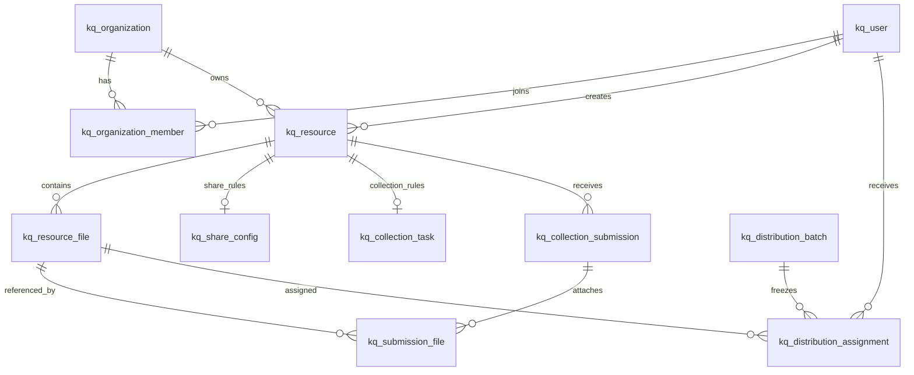

# 现有功能关系表设计

版本：2026-10-29。状态：21 张关系业务表已接入运行时；本机 MySQL 已完成快照回填和读写切换，`kunqiong_app_state` 保留用于恢复与对账。

## 设计范围

本方案只覆盖当前源码中已经存在的功能：账号与团队、团队成员和负责人交接、登录与联系方式验证、套餐订单、站内消息、收发记录、游客额度、分享文件、收集任务与提交、批量定向分发、个人/团队回收站、审计日志。

不把尚未实现的名单导入与催办、逐材料人工审核、文件不可变版本、交付回执、云端收集模板、Webhook、后台任务等纳入本版。收集材料清单和自定义字段以 JSON 保存，因为当前是随任务一起配置和读取，并没有独立字段级查询流程。

当前程序在启用关系模式时从 `kq_` 表读取业务数据，并在事务中按实体差异同步：未变化行不写入，新增行插入，变化行按稳定唯一键更新，删除只作用于本次快照中已不存在的行。父记录先写、子记录先删；revision 和表计数与数据一起原子提交。revision 冲突时先读取当前关系数据并合并，再同步变化行。首次启动从 `kunqiong_app_state.payload` 导入；导入完成后该快照保留为恢复来源，不再是业务读写权威。审计日志兼容旧表 `kunqiong_audit_log`，并镜像到 `kq_audit_log`。读写仍通过完整兼容元数据对象，容量边界和本机实测详见同目录 `01-当前实际数据库说明.md`。

## 设计约定

- 使用 MySQL 8.0、InnoDB、`utf8mb4`；表名和字段名小写加下划线，业务表统一 `kq_` 前缀。
- 每张表使用 `BIGINT UNSIGNED AUTO_INCREMENT` 作为内部主键 `id`。现有随机字符串 ID 保存在 `legacy_id`，迁移期间保持唯一并用于新旧记录映射。
- 统一使用 UTC `DATETIME(3)`；业务表记录 `gmt_create` 和 `gmt_modified`。追加式审计记录的 `gmt_modified` 创建后不更新。
- 唯一索引使用 `uk_`，普通索引使用 `idx_`。联系方式不直接加唯一约束，因为当前存量数据和绑定流程不能证明其全局唯一。
- 金额用 `DECIMAL(12,2)`，容量和文件大小用 `BIGINT UNSIGNED`；动态表单结构、答案及快照用原生 `JSON`，避免把可变配置拆成大量 EAV 行。
- 按阿里云常见 MySQL 表设计约定不在表间设置数据库外键或级联删除；由服务层在事务内校验关联、租户归属和权限。关系列仍必须有索引，物理删除由业务生命周期流程执行。
- 回收站资源用 `deleted_at` / `trash_expires_at` 标记；恢复清除此标记，过期后再执行文件和记录的清理。不要把普通关闭状态当成删除状态。
- `storage_key` 仅保存相对存储键，不保存可直接访问的绝对路径。物理文件仍在文件系统/对象存储；按 `storage_owner_key` 隔离目录并生成不可预测文件名，登录用户 ID 单独保存在可空的 `owner_user_id`，匿名文件使用访客摘要作为存储所有者键。内容哈希只用于校验或后续去重评估，不设唯一约束，避免跨用户误共享。
- 团队身份以 `kq_organization_member` 为准，用户偏好以 `kq_user_setting` 为准；适配层可组装旧接口里的当前团队角色和通知字段，数据库不保留重复权威值。
- 外部分享码、管理令牌和收集访问令牌在关系表中保存摘要；迁移时需生成摘要索引并改造按摘要查找，不能把旧明文令牌直接复制到新列。

## 表清单

| 模块 | 表 | 用途 |
| --- | --- | --- |
| 账号与团队 | `kq_user` | 用户账号、外部登录资料、套餐快照 |
| 账号与团队 | `kq_organization` | 团队、套餐和团队品牌 |
| 账号与团队 | `kq_organization_member` | 成员、邀请、入团申请及角色 |
| 账号与团队 | `kq_ownership_handover` | 团队负责人交接历史 |
| 账号与团队 | `kq_auth_session` | 登录会话与上游凭据密文 |
| 账号与团队 | `kq_verification_code` | 绑定邮箱/手机号的验证码挑战 |
| 账号与团队 | `kq_upgrade_order` | 套餐订单和支付状态 |
| 账号与团队 | `kq_message` | 用户站内消息及已读状态 |
| 配置与记录 | `kq_user_setting` | 用户通知和文件清理偏好 |
| 配置与记录 | `kq_system_setting` | 管理端系统配置 |
| 配置与记录 | `kq_account_record` | 收发记录列表投影，保留历史入口快照 |
| 配置与记录 | `kq_guest_usage` | 匿名访客额度汇总 |
| 文件与收集 | `kq_resource` | 分享/收集任务的所有权、团队归属和回收站状态 |
| 文件与收集 | `kq_resource_file` | 文件元数据及隔离存储键 |
| 文件与收集 | `kq_share_config` | 分享口令、有效期、下载限制及定向访问配置 |
| 文件与收集 | `kq_collection_task` | 收集任务规则、材料清单和自定义字段 |
| 文件与收集 | `kq_collection_submission` | 参与者提交及自定义字段答案 |
| 文件与收集 | `kq_submission_file` | 提交、材料项与文件的关联 |
| 定向分发 | `kq_distribution_batch` | 幂等发布批次和冻结状态 |
| 定向分发 | `kq_distribution_assignment` | 收件人到具体文件的授权映射 |
| 审计 | `kq_audit_log` | 结构化审计事件 |

## 核心关系

实体关系由 `resource_id`、`owner_user_id`、`organization_id` 等关联列表达。由于没有数据库外键，写入和迁移程序必须对每条关系执行存在性、类型一致性和租户归属校验。

## 关键约束与边界

1. **新旧 ID 映射**：导入时保留每个原业务 ID 到新 `id` 的映射。`legacy_id` 按源实体唯一；用户站内消息和收发记录的旧 ID 只在用户范围内唯一，因此对应约束为 `(user_id, legacy_id)`。API 可继续返回原 ID，待客户端和外部链接迁完后再单独评估切换。
2. **租户隔离**：资源读写必须同时验证 `owner_user_id` 或 `organization_id` 和当前会话/团队成员权限。仅有资源 ID 不构成授权。
3. **文件存储**：数据库事务先记录元数据状态，文件字节按用户隔离写入并原子落盘；失败文件需可清理。`storage_key` 唯一防路径碰撞，但 `content_sha256` 不唯一，不做跨用户物理去重。
4. **回收站**：软删除记录仍占存储容量。恢复前检查保留期限及字节是否存在；彻底删除需先标记待清理、删除字节、再清理关联记录，失败时保留可重试状态。
5. **收集字段**：`materials_json`、`custom_fields_json` 和 `field_values_json` 保存当前已支持的动态结构。服务端继续验证字段类型、必填、选项与条件；如果后续要按字段做跨任务统计，再评估单独关系表。
6. **定向分发**：幂等键按发布人唯一；发布成功后批次和逐文件授权映射不可静默改写。接收人读取时按授权映射过滤，不能只依赖页面隐藏。
7. **金额和容量**：金额读写按十进制定点数；文件字节使用无符号整数。Node.js 映射 BIGINT 时应配置为字符串或使用安全整数校验，不能静默丢精度。
8. **敏感信息**：会话令牌只存摘要；上游 API 凭据使用现有密钥体系加密；验证码只存哈希；分享口令只存哈希。DDL 和设计文档不承载真实令牌、密码或业务记录。

## 迁移建议

1. 先备份 `metadata.json` / `kunqiong_app_state`、审计数据和实际文件，记录快照修订号与文件数量、总字节、哈希抽样。
2. 在隔离空库执行同目录 `03-现有功能关系表设计.sql`，检查索引、唯一约束和字符集；不要在生产库直接执行。
3. 编写可重入导入程序，先导入用户、组织和成员，再导入资源、文件、收集提交、分发映射及投影记录；每一批次记录来源 ID 和校验统计。
4. 按领域逐步切换读写权威源。不能让旧快照与新表并行无协调写入；采用双写时必须具备变更日志、幂等重放和差异对账。
5. 对照用户、团队、成员、文件路径、分享访问规则、提交答案、分发收件人和回收站状态做迁移验收；保留回滚窗口后再归档旧快照。

当前实现仍将关系表数据装配成兼容元数据对象；每次业务保存会在单个事务中重建受管关系表记录。它没有逐实体增量 Repository 或细粒度写锁，写放大、持续写并发和多实例横向扩展仍需后续改进和压测。

## 项目建表命令

从项目根目录运行 `npm run db:schema:check` 可检查 SQL 文件与 21 张业务表定义，不连接数据库。配置好目标 MySQL 连接并显式运行 `npm run db:schema:apply`，或设置 `KUNQIONG_RELATIONAL_SCHEMA_ENABLED=true` 让服务启动时执行升级，项目会创建关系表及一张 `kq_schema_migration` 升级记录表；该记录表是迁移基础设施，不属于 21 张业务表。

升级命令使用数据库级互斥锁、迁移版本和 SHA-256 校验。创建过程中断后可重试；如果已有同名表的列或索引不匹配会停止。`db:schema:apply` 只增加/校验表结构；启用 `KUNQIONG_RELATIONAL_SCHEMA_ENABLED=true` 的服务首次启动会在事务中执行数据回填，状态标记与所有数据同事务提交。当前本机已完成回填；生产环境切换前仍须确认目标库并完成备份与停写安排。
