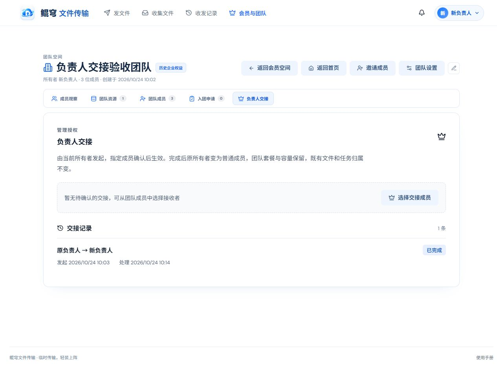

# 第二阶段 企业管理员／负责人交接验收说明

本次交付的是“负责人交接”这一项。完成本项用户验收后，再继续下一个功能。

## 已实现的操作规则

| 操作或情况 | 结果 |
| --- | --- |
| 当前所有者选择本团队有效成员发起交接 | 创建一条待确认交接，双方权限暂不变化 |
| 接收者接受并完成二次确认 | 接收者成为所有者，原所有者降为普通成员，更新双方所有登录会话 |
| 接收者拒绝 | 本次交接结束，角色保持不变，保留拒绝记录 |
| 发起者取消 | 本次交接结束，旧待办不能继续接受，允许重新发起 |
| 重复发起给相同成员或重复提交相同决定 | 复用现有待办／返回已完成结果，不重复转移 |
| 有待确认交接时再选其他接收者 | 拒绝，需要先取消或等待现有交接处理 |
| 接收者离开／被移出团队，或双方账号被停用／不存在 | 交接失效，记录原因，不能继续接受 |
| 超过 7 天未处理 | 在查看或处理交接时归档为已过期，旧请求不能接受 |
| 待确认期间解散团队 | 关闭交接待办并记录取消原因，组织删除后旧交接不可执行 |
| 普通成员或其他管理员发起所有权交接 | 拒绝；本项目的最高管理授权只允许当前所有者转交 |

交接仅改变团队的管理授权。团队 ID、专属链接、团队套餐与容量、团队文件和上传人归属保持原样；新所有者可以管理团队资源。个人分享和个人收集任务仍属于原账号，本次不会把个人文件或收集任务交给其他成员。现有团队空间的资源接口只包含团队文件分享，没有独立的团队收集任务负责人模型。

所有权转让直接在原有“团队成员”管理页完成：所有者从对应成员行发起，待确认状态、取消操作和交接历史也在同一页展示，不再设置单独的“负责人交接”页签。接收人可在自己的团队成员页或站内通知中接受／拒绝；关闭普通通知仍会收到交接待办。旧版 `/team?tab=handover` 链接会自动跳转到团队成员管理页或接收人的团队成员页。

## 立即体验

开发验收使用独立的临时目录、合成账号和示例文件，不连接真实账号、数据库或正式文件。

当前启动后的入口：<http://localhost:18047/__handover_demo>

如果入口已经关闭，在项目根目录执行：

```powershell
npx vite build
node scripts/serve-team-handover-demo.mjs
```

默认端口为 18047。需要更换端口时，在启动前设置 `$env:HANDOVER_DEMO_PORT = '18048'`。

验收入口提供“原负责人”“新负责人”“普通成员”三个合成身份。它们使用同一浏览器的 Cookie，切换后应刷新之前打开的页面；需要同时观察两个身份时，使用不同浏览器或隐私窗口。停止脚本后再次启动，会创建一套全新的验收数据。

## 人工验收步骤

### A 发起并确认交接

1. 从验收入口选择“以原负责人身份进入”。在原有“团队成员”页找到“新负责人”，点击该行皇冠按钮。
2. 确认弹窗应说明“对方接受后才生效”“套餐和容量保留”“7 天内确认”“确认前可取消”。先点取消，检查没有待办；再次发起交接。
3. 确认后仍留在“团队成员”页；成员列表上方显示“等待接收者确认”、双方名字、发起时间和有效期。原负责人仍有团队设置入口，不能同时发起第二条交接。
4. 从验收入口切换“新负责人”。在同一“团队成员”页应显示“待你确认”和“接受交接／拒绝交接”；此时还没有团队管理入口。
5. 点击接受，先点“再想想”，角色应保持原样；再次接受并确认。
6. 新负责人应获得团队设置、成员管理和团队资源管理权。切回原负责人并刷新，原负责人变为普通成员，不能继续修改团队名称或管理他人成员文件，仍可按普通成员规则访问团队文件。
7. 在“团队成员”页查看交接记录，核对双方、已完成状态、发起时间和处理时间；查看团队资源，示例文件和上传人不丢失，套餐／总容量不变。

### B 拒绝与取消

在全新的验收数据中测试，或者由当前所有者向另一位成员重新发起：

1. 发起交接，接收者选择拒绝并确认。双方角色不变，记录显示“已拒绝”。
2. 重新发起，所有者选择“取消本次交接”并确认。记录显示“已取消”，接收者刷新后不再出现接受按钮。
3. 在过期页面或旧消息上继续操作时，应提示已经处理／失效，不能反向覆盖决定。

### C 消息中心与越权

1. 重新发起一条待办，切到接收者，打开首页右上角消息中心。
2. 应显示交接消息、“接受交接”“拒绝交接”和“查看交接”；确认弹窗里点“再想想”后，消息面板仍保持打开。
3. 在处理期间连点确认按钮，只提交一次请求。成功后动作按钮消失，身份和结果提示更新；请求失败时显示服务端原因并恢复可操作状态。
4. 切到普通成员，不能看到其他人的交接待办，也不能通过接口替接收者确认；除当前所有者外不能发起交接。
5. 将页面切到手机宽度，检查说明可读、按钮完整、历史记录分页可操作，不出现新增横向溢出。

### D 异常场景的自动验收

账号停用、非成员、过期、服务器重启、双会话、响应丢失后的重试、接受／拒绝／取消并发等已由隔离脚本执行。无需修改真实账号或等待 7 天。

```powershell
npm run test:handover
node scripts/verify-team-suite.mjs
node scripts/verify-team-permissions.mjs
node scripts/verify-message-center.mjs
node scripts/verify-message-delete.mjs
node scripts/verify-team-entitlement-ui.mjs
```

`test:handover` 包括真实 HTTP 接口、真实 React 团队页和消息确认流程的专项测试。接口测试使用临时 JSON 存储；页面交互使用 JSDOM 挂载实际前端代码。

## 已执行的检查

| 检查 | 结果 |
| --- | --- |
| 新增交接接口专项 | 67 项通过 |
| 团队接口回归 | 187 项通过 |
| 团队权限回归 | 196 项通过 |
| 团队页交互回归（含交接） | 268 项通过 |
| 消息交接专项 | 19 项通过 |
| 原消息中心交互／删除持久化 | 15 项／17 项通过 |
| 套餐失效恢复页面 | 2 项通过 |
| 前端构建 | 通过，保留已有的 chunk 体积提示 |
| 真实浏览器 | 已通过桌面 1280px 与手机 390px 检查；确认后新负责人获得管理入口、原负责人失去管理入口；手机无横向溢出 |

自动化结果保存在 `.workbuddy/team-handover/`。交接 API 的请求和资源均为合成数据，运行不会接触真实团队。

已重启隔离验收站，当前入口是一套全新、尚未交接的数据，可从步骤 A 开始测试。浏览器未记录新的控制台警告或错误。

桌面验收截图：



手机待确认页面：[查看完整截图](verification/team-handover/mobile-pending.png)。

## 验收边界

本次验证覆盖单服务进程、JSON 持久化、同进程并发决定和服务重启。尚未对 MySQL 模式、跨多个服务实例的竞争写入或测试服部署做验收；现有整份元数据快照合并机制仍是多实例部署的约束。本次不将这些未经实测的场景标为通过。

负责人已停用且未提前完成交接时，本次待办失效并拒绝接管；不会绕过账号管理规则自动指定新所有者。管理员恢复账号后，可重新发起正常交接。

## 用户验收记录

- [ ] 发起前的说明准确，确认前原权限不变
- [ ] 接受后双方权限正确，套餐、文件和归属保持
- [ ] 拒绝、取消、历史记录符合预期
- [ ] 消息中心和手机端可正常操作
- [ ] 本项通过，可以开始下一项

用户验收结果：待填写。
