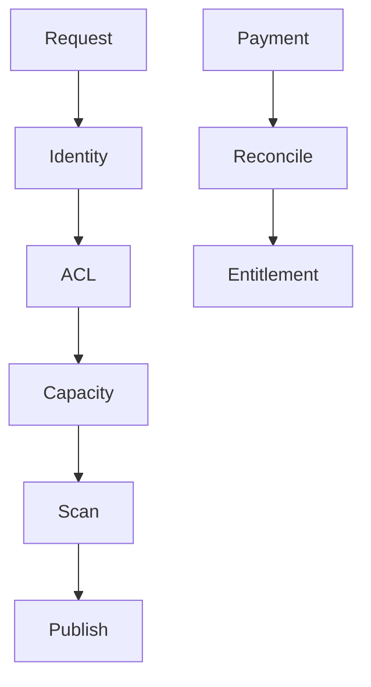

# audit-remediation - Plan

## Scope & Non-Goals

- Scope: admin credentials, Office HTML, sharing privacy and ACL, scanning, collection capacity, downloads and subscription lifecycle.
- Non-goals: local email and SMS configuration, unrelated UI or data changes.

## Acceptance Criteria

- [x] Missing administrator credentials disable password login.
- [x] Office previews remove unsafe links and active HTML.
- [x] Recipient and delivery data are private; directed access requires an authorized identity.
- [x] Uploaded bytes go through a scanner; unavailable scans never claim approval.
- [x] Anonymous collections enforce aggregate capacity, including chunk reservations.
- [x] Downloads use bounded memory and preserve password authorization.
- [x] Same-plan subscriptions renew and paid orders reconcile after dialog closure.
- [x] Focused tests, build, candidate review and runtime prerequisites are documented.

## Assumptions & Constraints

- No Git or CodeGraph index. Original affected files backed up to the task artifact directory.
- Real users and stored files must not be modified by tests; use isolated fixtures and fake services.
- Preserve existing logo, fixed header heights and mobile fixes.

## Baseline Tests

| Item | Command | Baseline result |
| --- | --- | --- |
| Build | npm run build | passed in preceding audit |
| Regression | bundled Node audit-regression.mjs | 251/252; absent user in outdated rate-limit fixture |
| Repro | bundled Node audit-behavior.mjs | directed access, disclosure, scanning, quota and renewal defects reproduced |

## Diagram

## Task Checklist

| ID | Task | Owner | Deps | Done |
| --- | --- | --- | --- | --- |
| T1 | Boundary investigation and fixtures | main + read-only investigator | - | [x] |
| T2 | Admin, HTML and sharing boundaries | main | T1 | [x] |
| T3 | Scanner and capacity | main | T1 | [x] |
| T4 | Bounded-memory download workflow | main | T2 | [x] |
| T5 | Subscription lifecycle | main | T1 | [x] |
| T6 | Focused validation and fresh candidate review | main + read-only reviewer | T2,T3,T4,T5 | [x] |
| T7 | Runtime verification and documentation | main | T6 | [x] |

## Sub-agent Registry

| Task ID | Agent Ref | Status | Integration | Owned Files | Checkpoint / Next Action | Updated |
| --- | --- | --- | --- | --- | --- | --- |
| T1 | boundary_investigator | completed | integrated | none (read-only) | ACL, scanner and reservations traced; findings incorporated | 2026-10-08 16:15 |
| T6 | session_boundary_candidate_review | completed | integrated | none (read-only) | No concrete upload-session bypass or regression found | 2026-10-08 16:57 |

## Risks & Rollback

| Risk | Impact | Mitigation | Rollback |
| --- | --- | --- | --- |
| Scanner runtime absent | required uploads unavailable | explicit status and deployment instructions | restore affected originals |
| Legacy directed shares | matching compatibility | stable IDs and verified contact matching | restore affected originals |
| Payment contract | entitlement mismatch | isolated service tests and idempotency | restore affected originals |

## Blockers

- No implementation blocker. Live scanner and production payment validation need configured services.

## Change Log

| Time | Task ID | File / Task | Change | By |
| --- | --- | --- | --- | --- |
| 2026-10-08 15:53 | T1 | plan | Scope, baseline and investigator registered | main |
| 2026-10-08 16:15 | T1 | investigation | Confirmed shared boundaries and compatibility; baseline reproductions exist | main |
| 2026-10-08 16:15 | T2 | server, main, office-html | Removed default credentials, sanitizer, privacy and stable recipient ACL | main |
| 2026-10-08 16:15 | T3 | server, deployment | Streaming ClamAV, failclosed handling, capacity reservations and final checks | main |
| 2026-10-08 16:15 | T4 | server, main | HEAD authorization and native browser downloads, no Blob buffering | main |
| 2026-10-08 16:15 | T5 | server, main | Renewal, serialized activation and background reconciliation | main |
| 2026-10-08 16:57 | T6 | server, main, verify-remediation | Bound authenticated upload sessions, preserve anonymous bearer sessions, expose directed-code login recovery | main |
| 2026-10-08 16:57 | T7 | deployment, README, isolated runtime | Match ClamAV limits to 5 GB, document prerequisites and verify isolated service responses | main |

## Verification Evidence

| Time | Command | Result | Notes |
| --- | --- | --- | --- |
| 2026-10-08 15:53 | preceding audit artifacts | baseline | task artifact directory |
| 2026-10-08 16:57 | `npm run test:remediation` | passed | Office sanitizer plus 41 isolated API and workflow checks |
| 2026-10-08 16:57 | `npm run build` | passed | Existing large-chunk advisory remains |
| 2026-10-08 16:57 | isolated HTTP runtime check | passed | `/api/health` and `/` returned 200; temporary fixture only; stopped afterward |
| 2026-10-08 16:57 | Docker scanner runtime | not run | Docker Desktop engine unavailable; protocol exercised by isolated fake daemon |
| 2026-10-08 16:57 | browser interaction | not run | Browser security policy denied automation against localhost; API and HTTP checks used instead |

## Bug & Fix Log

| Time | Symptom | Root cause | Fix | Guard |
| --- | --- | --- | --- | --- |

## Completion Summary

Implemented and reviewed. Focused verification and build passed. A real ClamAV container and production payment service were not exercised in this local environment; uploads fail closed until a scanner is available.

## Next Steps

- For production rollout, deploy through the Docker path or provide a maintained ClamAV daemon at the configured host and port; run an end-to-end scan after the scanner service is available.
