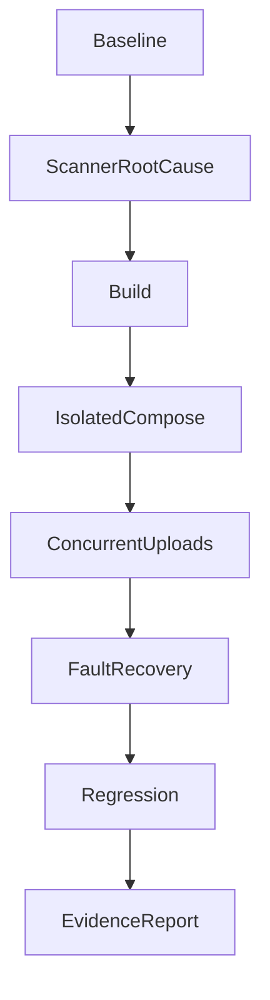

# local-acceptance - Plan

## Scope & Non-Goals

Complete remaining local verification for the 44 PAY/ADMIN/NFR/SMOKE cases. Preserve earlier changes, business accounts, storage, and running services. No real payments, production deployment, commit, or push.

## Acceptance Criteria

- [x] Confirm real 5GiB scan failure root cause without bypassing scanning.
- [x] Build the project Dockerfile with bounded context and health probe.
- [x] Exercise real 500MiB multi-user uploads and capacity isolation.
- [x] Verify isolated Compose health, release, restart and disk/scanner recovery.
- [x] Record exact results and external prerequisites; never label missing checks PASS.

## Assumptions & Constraints

User explicitly selected all locally executable repairs and tests first. No CodeGraph index. No delegation: shared fixture interfaces are still being developed. Chrome/Edge and phone keyboard verification remain unavailable. Previously rejected temporary 5GiB deletion will not be retried.

## Baseline Tests

| Item | Command | Baseline result |
| --- | --- | --- |
| Controlled acceptance | npm run test:acceptance | Prior 192 assertions passed |
| Real boundary | verify-real-large-file.mjs | 6 passed, 1 failed: scan_size_limit |
| Case totals | Existing report | 33 PASS / 7 PARTIAL / 3 BLOCKED / 1 FAIL |
| Commit | git rev-parse HEAD | 2b28997152162caabbf0e792408d0ee4fa4c7140 + dirty worktree |

## Diagram

## Task Checklist

| ID | Task | Owner | Deps | Done |
| --- | --- | --- | --- | --- |
| T1 | Reconcile evidence and confirm scanner limit | [main] | - | [x] |
| T2 | Build real Dockerfile with context exclusion and health status | [main] | T1 | [x] |
| T3 | Isolated Compose release and restart verification | [main] | T2 | [x] |
| T4 | 500MiB concurrent upload, quota and session tests | [main] | T3 | [x] |
| T5 | Scanner interruption and bounded real ENOSPC recovery | [main] | T3 | [x] |
| T6 | Targeted regression, report and service checks | [main] | T4,T5 | [x] |

## Sub-agent Registry

None. All work owned by main agent.

## Risks & Rollback

| Risk | Likelihood / Impact | Mitigation | Rollback |
| --- | --- | --- | --- |
| Disk pressure | Medium / high | Disposable bounded tmpfs and isolated storage | Stop test containers; preserve evidence |
| Scanner limit bypass | High / high | Retain fail-closed scanner behavior | No scan configuration changes |
| Business data changed | Low / high | Synthetic accounts and independent Compose project | No business storage mounts |

## Blockers

- NFR-005 needs a whole-file scanner supporting 5GiB; ClamAV 1.5.4 hard-clamps MaxFileSize to INT_MAX - 2.
- NFR-001/002 need supported Chrome/Edge connection; NFR-003 needs a phone keyboard.

## Change Log

| Time | Task ID | File / Task | Change | By |
| --- | --- | --- | --- | --- |
| 2026-10-10 20:24 | T1 | Scanner | Official 1.5.4 others.c lines 676–689 confirm ~2GiB limit | main |
| 2026-10-10 20:24 | T2 | .dockerignore, Dockerfile | Exclude multi-GB dataset; add actual API health probe | main |
| 2026-10-10 20:29 | T3 | verify-container-acceptance.mjs, deploy-test.sh | Generated actual Compose template, health/source/restart verified; strict complete release validation | main |
| 2026-10-10 20:29 | T4 | verify-container-acceptance.mjs | Three concurrent 500MiB paths and quota/privacy/retry checks | main |
| 2026-10-10 20:29 | T5 | verify-container-acceptance.mjs | Real scanner stop/recovery and bounded same-filesystem ENOSPC | main |
| 2026-10-10 20:29 | T6 | Reports, Docker COPY check | Update 44 case results; fix forced Windows exit; focused validation | main |

## Verification Evidence

| Time | Command | Result | Notes |
| --- | --- | --- | --- |
| 2026-10-10 20:24 | Official ClamAV source inspection | Hard limit confirmed | Real scan matches source; increasing config cannot fix |
| 2026-10-10 20:24 | docker build --progress=plain -t kunqiong-acceptance:local . | PASS | 53.63MB context; real Node20 production image |
| 2026-10-10 20:29 | npm run test:acceptance | 192 PASS / 0 FAIL | Latest acceptance-local-final.log |
| 2026-10-10 20:29 | node scripts/verify-container-acceptance.mjs | 27 PASS / 0 FAIL | container-acceptance-results.json; three 500MiB transfers, RSS +44.7MiB |
| 2026-10-10 20:29 | node scripts/verify-deploy-release.mjs | 5 PASS / 0 FAIL | Three failures before fix; deploy-release-before.json |
| 2026-10-10 20:29 | npm run verify:docker-copy | PASS, exit 0 | Previously Windows libuv aborted despite successful health |

## Bug & Fix Log

| Time | Symptom | Root cause | Fix (files) | Guard added |
| --- | --- | --- | --- | --- |
| 2026-10-10 20:24 | 5GiB cannot publish | Engine clamps size to INT_MAX - 2 | Unresolved engine limitation; retain safe rejection | Real 5GiB integration remains FAIL |
| 2026-10-10 20:24 | App has no Compose health state | Missing image HEALTHCHECK | Dockerfile | Container health validation |
| 2026-10-10 20:29 | Wrong or empty release passed deployment | Only warning, seven-character comparison | deploy-test.sh | Exact, mismatch, same-prefix, missing, unhealthy cases |
| 2026-10-10 20:29 | Docker COPY verifier aborts on Windows | Forced exit during process/pipe shutdown | check-docker-copy.mjs | Await close and normal exit; actual exit 0 |

## Completion Summary

Local verification completed with 224 passing assertions and honest partial case coverage. Overall 44-case result is 38 PASS / 3 PARTIAL / 2 BLOCKED / 1 FAIL. No business data or scanner policy changed; test containers stopped, evidence and volumes retained. 5GiB scanner capability and browser/device prerequisites remain unresolved, so this is not an all-pass acceptance.

## Next Steps

For complete acceptance, provide whole-file 5GiB scanning capability and supported Chrome/Edge/phone environments, then rerun NFR-005/008/009 and NFR-001/002/003. Local report and evidence are ready.
