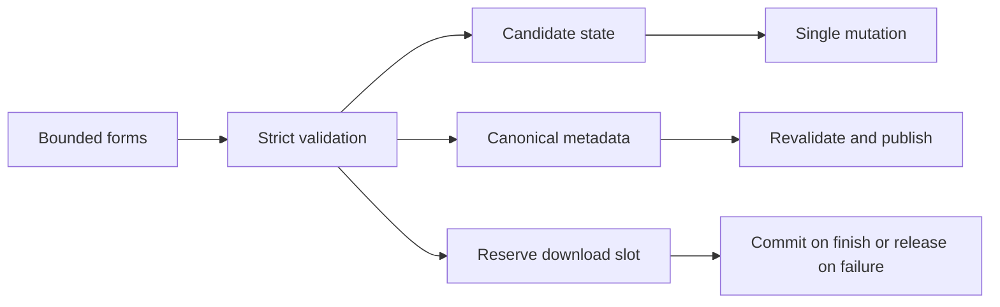

# Boundary remediation - Plan

## Scope & Non-Goals
- Goal: repair BND-001 through BND-031 and make adopted API rules explicit.
- Scope: writes, uploads, sessions, records, recipients, avatars, office previews and form limits.
- Non-goals: deploy, commit/push, real payments/messages, destructive real-account testing.

## Acceptance Criteria
- [x] Invalid input rejected without mutation; legal workflows remain valid.
- [x] Download limit reserved before streaming; failed streams release slots.
- [x] Upload paths use matching bounded metadata; corrupt avatars and excessive previews rejected.
- [x] Isolated regressions and build pass; external checks stated.

## Assumptions & Constraints
- Preserve existing changes; baseline in .workbuddy/boundary-fix-baseline.
- Strict new writes, tolerant historical normalization.
- Limits: name 80, nickname/title 40, description 120, alias 80, downloads 9999, file cap 5120 MB, password 128. Reject control/bidi characters.
- Retain per-file collection cap and per-request Range counting; clarify labels. Verification proves contact possession. Enforce upload TTL per request. Return negotiated chunk size. Bound external payment expiry.

## Baseline Tests
| Item | Command | Baseline |
| --- | --- | --- |
| Regression | node scripts/verify-boundary-suite.mjs | 2 pass / 107 expected failures |
| Audit | node .workbuddy/boundary-audit-20261012/run.mjs | 242 probes, 0 execution errors |
| Commit | git rev-parse --short HEAD | 2e958cc |

## Diagram

## Task Checklist
| ID | Task | Owner | Deps | Done |
| --- | --- | --- | --- | --- |
| T1 | Baseline and failing regressions | [main] | - | [x] |
| T2 | Validators, records/settings and atomic updates | [main] | T1 | [x] |
| T3 | Download reservations and upload validation | [main] | T2 | [x] |
| T4 | Real bounded avatar decoding | [sub-agent] | T1 | [x] |
| T5 | Bounded cancellable previews and password controls | [sub-agent] | T1 | [x] |
| T6 | Sessions/admin/payment/text and other form limits | [main] | T2 | [x] |
| T7 | Integration, regression/build and report status | [main] | T3,T4,T5,T6 | [x] |

## Sub-agent Registry
| Task ID | Agent Ref | Status | Integration | Owned Files | Checkpoint / Next Action | Updated |
| --- | --- | --- | --- | --- | --- | --- |
| T4 | avatar | completed | integrated | server/lib/avatar-validation.js; scripts/verify-avatar-boundaries.mjs | Parent reviewed and ran 31 decoder assertions | 2026-10-12 18:20 |
| T5 | office | completed | integrated | src/components/ui.jsx; src/lib/office-preview.js; src/workers/office-preview.js; scripts/verify-office-boundaries.mjs | Parent reviewed and ran 12 behavior groups; browser worker pending external check | 2026-10-12 18:20 |

## Risks & Rollback
| Risk | Mitigation | Rollback |
| --- | --- | --- |
| Stricter API breaks callers | Existing domain suites, explicit clear-all payload | Revert this patch only, preserve baseline |
| Native decoder availability | Verify install and decode | Preserve dependency baseline |
| Worker compatibility | Vite build and boundary tests | Download fallback |

## Blockers
None. External providers/mobile not exercised by local tests.

## Change Log
| Time | Task ID | File / Task | Change | By |
| --- | --- | --- | --- | --- |
| 2026-10-12 17:27 | T1 | scripts/verify-boundary-suite.mjs | Reproduced 107 failing assertions | main |
| 2026-10-12 18:20 | T2,T3,T6 | server/lib, routes, services; src/pages | Strict writes, atomic drafts, slot reservation, canonical paths, sessions/payment/form limits | main |
| 2026-10-12 18:20 | T4,T5 | Avatar decoder and office worker | Integrated bounded parsing, reencoding and pagination | agents + main |
| 2026-10-12 18:20 | T7 | Regression supplement | Reproduced 12 additional failures; fixed decode races, aliases, nested records, scalar code/status and MIME/session metadata | main |
| 2026-10-12 18:26 | T7 | UI, upload middleware, notification resolution, docs | Real React boundary tests; multipart count limits; trailing filename preservation and nickname exclusion; 31-group fix matrix | main |

## Verification Evidence
| Time | Command | Result | Notes |
| --- | --- | --- | --- |
| 2026-10-12 17:27 | node scripts/verify-boundary-suite.mjs | 2 pass / 107 fail | Expected red baseline |
| 2026-10-12 18:20 | Boundary suite supplement | 123 pass / 12 fail → 135 pass / 0 fail | Isolated actual HTTP fixture; synthetic decode gate only in copied test module |
| 2026-10-12 18:20 | Avatar; office; share suites | 31; 12 groups; 44 checks passed | Parent independently reran all three |
| 2026-10-12 18:20 | test:auth/team/acceptance/collections/upload/remediation/messages | exit 0 | Impacted suites were rerun after supplement |
| 2026-10-12 18:26 | npm run test:boundaries | exit 0 | HTTP 151, avatar 31, office 12 groups, React 6 groups |
| 2026-10-12 18:26 | auth; team; acceptance; upload; collections; share; remediation; messages; audit | exit 0 | Final logs in .workbuddy/boundary-*.log; relevant suites rerun after each change |
| 2026-10-12 18:26 | npm run build; git diff --check | exit 0 | Current source compiled; only existing large viewer bundle warning |

## Bug & Fix Log
| Time | Symptom | Root cause | Fix | Guard |
| --- | --- | --- | --- | --- |
| 2026-10-12 18:26 | Profile overwrites concurrent nickname or saves after logout | User snapshot read before asynchronous decode | Recheck session and merge current user after decode | Isolated gated real decoder HTTP tests |
| 2026-10-12 18:26 | Invalid-format code bypasses attempt accounting | Strict type rejection occurred before attempt increment | Invalid format always fails and counts toward five attempts | Auth suite and scalar-code HTTP test |
| 2026-10-12 18:26 | Five-character code rejected | Validation narrowed existing UI option | Accept integers 4–6 | Actual five-character share publication |
| 2026-10-12 18:26 | Alias duplicate or matching nickname receives notification | Notification lookup differed from authorization lookup | Canonical recipient dedup and same ID/contact resolver | Alias and nickname collision HTTP tests |

## Completion Summary
All BND-001–031 remediated and covered local suites passing. See docs/边界值修复验证-2026-10-12.md for rules, matrix, command evidence and limitations. No commit, push or deployment performed. Real provider/mobile/native browser-worker tests remain external validation, not claimed passed.

## Next Steps
Local task complete. Optional next scope: native browser worker/mobile and real-provider acceptance, followed by a separately authorized deployment.
