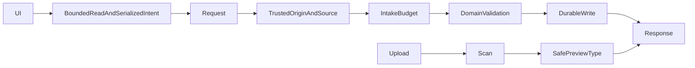

# Comprehensive defect remediation - Plan

## Scope & Non-Goals
Fix confirmed code findings R01-R34 from the 2026-10-15 review. No deployment parameter changes, credential rotation on servers, public Git history rewriting, business asset deletion, commit or deployment in this turn. Preserve the user's modified test document.

## Acceptance Criteria
- [x] Unsafe preview, verification debug, origin pollution, guest spoofing and password brute force are rejected through shared boundaries; valid flows remain available.
- [x] Upload intake, persistence, audit retention and shutdown fail safely without silent data loss.
- [x] Frontend bounded reads, resume privacy, confirmation, settings writes and error presentation work with regression coverage.
- [x] Focused regressions, relevant existing suites, static verification and build pass; external limitations are documented.

## Assumptions & Constraints
Use isolated fixtures only. Existing upload resume, legacy password access, payment reconciliation and team ownership behavior must remain compatible. No CodeGraph index exists. Root baseline b1659fd; only pre-existing modified file is the test-case docx.

## Baseline Tests
| Item | Command | Baseline result (at start) |
| --- | --- | --- |
| Ref | git rev-parse HEAD | b1659fd08d3413656706b582c2ab51bfd924462f |
| Static | npm run verify:refactor | passed; 33 modules, 692 imports, no cycles/violations, max depth 8 |
| Security | npm run test:security | passed; 11 boundary checks, 5 audit tests, 2 disk tests, 11 publication checks |

## Diagram

## Task Checklist
| ID | Task | Owner | Deps | Done |
| --- | --- | --- | --- | --- |
| T1 | Independent read-only investigation and source baseline | [main] | - | [x] |
| T2 | Security shared boundaries R01-R08 R11-R18 R26 | [main] | T1 | [x] |
| T3 | Persistence, audit, shutdown R19 R20 R30 | [main] | T2 | [x] |
| T4 | Frontend privacy, bounded reads, races and errors R09 R21-R27 | [main] | T2 | [x] |
| T5 | Engineering verification and portability R10 R29 R31 R33 R34 | [main] | T3,T4 | [x] |
| T6 | Focused and business regressions, build | [main] | T5 | [x] |
| T7 | Fresh read-only bypass review, final fixes and evidence | [main] | T6 | [ ] |

## Sub-agent Registry
| Task ID | Agent Ref | Status | Integration | Owned Files | Checkpoint / Next Action | Updated |
| --- | --- | --- | --- | --- | --- | --- |
| T1 | /root/boundary_investigator | complete | reviewed | none (read-only) | Findings reconciled into remediation and regression suites | 2026-10-16 01:44 |

## Risks & Rollback
| Risk | Likelihood / Impact | Mitigation | Rollback |
| --- | --- | --- | --- |
| Shared helpers affect legacy flows | medium/high | valid and legacy controls in focused regression | review individual patch |
| Credential already in Git history | confirmed/high | remove working-tree literals; report rotation/history limitations | no force-push |
| Persistence redesign errors | medium/high | isolated restart/concurrency/failure fixtures | preserve disk backups |

## Blockers
None for local code work. Real provider payment, native mobile and server credential rotation require separate environment validation.

## Change Log
| Time | File / task | Change | Owner |
| --- | --- | --- | --- |
| 2026-10-15 20:54 | plan | Scope, baseline, sequential tasks and investigator recorded | main |
| 2026-10-16 11:10 | team capacity | Organization-level team plan, legacy fallback, ownership-transfer preservation, and explicit personal/team capacity labels verified | main |

## Verification Evidence
All checks below ran against isolated local fixtures unless stated otherwise. Deployment configuration and external provider credentials were intentionally excluded.

| Suite | Result |
| --- | --- |
| `npm run test:security` | 11 security boundaries, 5 audit tests, 2 physical reservation tests, 11 upload publication checks passed |
| `npm run test:boundaries` | 151 server boundary checks, 31 avatar checks, 12 office checks, 6 UI checks passed |
| `npm run test:remediation` | 83 remediation checks and 26 payment UI checks passed |
| `npm run test:acceptance` | 192 finance/admin checks, 54 admin UI checks, 28 plan persistence checks, 50 NFR checks passed |
| `npm run test:collections` | 74 collection checks, 8 deadline checks, 23 picker checks, 36 resume checks passed |
| `npm run test:auth` | 119 authentication checks and 62 UI checks passed |
| `npm run test:team` | 186 team checks, 69 permission checks and 148 UI checks passed; ownership transfer preserves organization team plan and capacity |
| `npm run test:upload` | 50 chunk/resume/publication checks passed |
| `npm run test:orders` | 34 order UI checks passed |
| `npm run test:messages` | 8 message-center checks and 17 persistence/delete checks passed |
| `npm run test:scan-performance` | 21 scan/cache/concurrency checks passed; controlled parallel workload improved 435ms to 218ms |
| `node scripts/verify-metadata-cas.mjs` | 12 concurrent metadata persistence checks passed |
| `npm run verify:refactor` | 33 modules, no unused/missing imports, no cycles or violations, max depth 8 |
| `npm run build` | Vite production build passed |

## Bug & Fix Log
| Symptom | Root cause | Fix | Guard |
| --- | --- | --- | --- |
| Confirmed report findings | See review report R01-R34 | Shared validation, persistence, upload, preview, account, team and UI boundaries hardened | Focused regressions and full local suites |
| Final boundary review | Proxy-wide limits, anonymous replacement identity and queued settings after account change | Focused regressions and follow-up corrections in progress | Additional local tests |
| Team capacity after ownership transfer | Organization capacity was derived from the current owner's personal plan, so transferring to a free member displayed 0 B | Persist team plan fields on the organization, preserve them during transfer, synchronize them on owner plan changes, and keep personal/team entitlements separate; legacy organizations fall back to active team-plan members | TEAM-009 transfer assertions, TEAM-UI capacity labels, security and build suites |

## Completion Summary
Completed for the confirmed local code findings. N01-N06 and R18/R28/R32 already-safe or excluded portions are not represented as newly patched defects. External provider behavior, native mobile/browser coverage and deployment configuration remain outside this verification run.

**Next Steps:** Review the working-tree diff, then commit/push through the repository's normal CI deployment trigger when explicitly requested.
