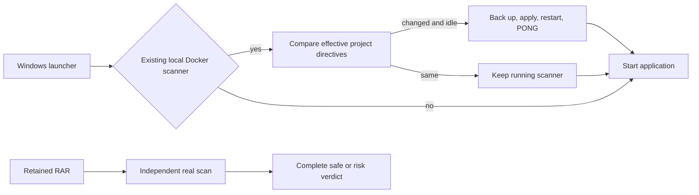

# Local Scanner Timeout - Plan

## Scope & Non-Goals

- Goal: correct the local scanner configuration and verify the user's retained 699.7 MiB RAR reaches a complete verdict.
- In scope: the running local ClamAV container, Windows startup configuration, scanner diagnostics, and local verification.
- Non-goals: no 502/409 handling changes (explicit user instruction), no bypassing scanning, no changing record access permissions, no remote deployment.

## Acceptance Criteria

- [x] Prove the original timeout cause from persisted upload state and running scanner limits.
- [x] Local scanner uses MaxScanTime 600000; archive scanning and AlertExceedsMax remain enabled.
- [x] Original file receives a complete verdict, with no business resource created by the diagnostic.
- [x] Startup configures the existing local scanner reproducibly; matching configuration causes no restart.
- [x] Local frontend/backend remain available, and relevant regression checks pass.
- [x] Scanner transport and concurrent-worker settings are optimized without reducing scan coverage.

## Assumptions & Constraints

- The Docker container kunqiong-clamav is the existing local scanner at 127.0.0.1:3310; native and remote scanners are outside automatic configuration.
- Do not execute the archive contents or expose user sessions, .env secrets, or account metadata.
- Keep the existing Word document modification untouched.
- A detected threat is a valid completed scan and remains blocked.

## Baseline Tests

| Item | Command | Baseline result |
| --- | --- | --- |
| Source | git rev-parse HEAD | 2b26be9d4680b152c047c3bab82861b698bbee9d |
| Existing session | Read selected completion fields for c759d64e470f5b7451 | scan_timeout / MaxScanTime at 128 seconds; 733698982 bytes retained |
| Scanner log | docker logs kunqiong-clamav (filtered) | runtime global time limit 120000 ms; two MaxScanTime results |
| New config check | scripts/configure-local-scanner.ps1 -CheckOnly | failed before repair: missing MaxScanTime and other project directives |

## Diagram

## Task Checklist

| ID | Task | Owner | Deps | Done |
| --- | --- | --- | --- | --- |
| T1 | Locate timeout source and confirm affected local scanner | [main] | - | [x] |
| T2 | Add reproducible local scanner configuration and repair the running container | [main] | T1 | [x] |
| T3 | Complete real scanning of retained RAR without publishing it | [main] | T2 | [x] |
| T4 | Optimize scanner transport and concurrent worker capacity without reducing scan coverage | [main] | T2 | [x] |
| T5 | Verify local app, regression safety, and record final evidence | [main] | T2,T3,T4 | [x] |

## Sub-agent Registry

No delegation; all work is performed by the main agent.

## Risks & Rollback

| Risk | Likelihood / Impact | Mitigation | Rollback |
| --- | --- | --- | --- |
| Scanner restart interrupts an active upload | low / medium | STATS must show idle before applying changes | Restart is skipped while busy |
| Image defaults differ | medium / medium | Preserve image logging/database options; account for libclamav's hard MaxFileSize cap | Restore in-container timestamped backup |
| Original RAR is unsafe | known / upload remains blocked | Scan only; do not execute or publish | No business data changes |

## Blockers

None. Real scanner verification is running.

## Change Log

| Time | Task ID | File / Task | Change | By |
| --- | --- | --- | --- | --- |
| 2026-10-16 16:18 | T1 | Local scanner investigation | ClamAV default 120-second budget differs from deployment's 600 seconds | main |
| 2026-10-16 16:21 | T2 | scripts/configure-local-scanner.ps1 | Back up and apply deployment directives, idle check, readiness and rollback | main |
| 2026-10-16 16:21 | T2 | start.ps1, README-启动说明.md | Configure known local Docker scanner on startup; document manual and check-only modes | main |
| 2026-10-16 16:22 | T2 | Local container | Applied configuration; backup /etc/clamav/clamd.conf.before-kunqiong-20261016162057 | main |

## Verification Evidence

| Time | Command | Result | Notes |
| --- | --- | --- | --- |
| 2026-10-16 16:22 | configure-local-scanner.ps1 -CheckOnly | passed after effective cap handling | Docker image rewrites MaxFileSize to 5G; runtime clamps to 2147483645 |
| 2026-10-16 16:22 | repeated configure-local-scanner.ps1 | unchanged StartedAt | Does not restart an already matching scanner |
| 2026-10-16 16:22 | filtered docker logs | global time 600000 ms | Actual running engine limit, not just configuration text |
| 2026-10-16 16:43 | configure-local-scanner.ps1 after optimization | passed; MaxThreads 16, MaxQueue 32, HeuristicScanPrecedence yes | Existing scanner restarted while idle; PONG verified |
| 2026-10-16 16:43 | Direct scan of user-provided RAR | complete `Win.Packed.Mikey-9859574-0 FOUND` in 346 seconds; 733698982 bytes; SHA-256 `163eeb1e9622e3d03282fd025fcf416bb407601ec91aa8386d43fd3b96c0c49d` | No MaxScanTime and no business resources |
| 2026-10-16 16:43 | `http://127.0.0.1:8045/api/health`, frontend, chunk regression | HTTP 200; 72/72 checks passed | 502/409 excluded |
| 2026-10-16 17:02 | `node scripts/verify-scan-suite.mjs` | 46/48 passed; two EICAR assertions returned the existing `scan_file_changed` 409 branch | Explicitly excluded by user; ClamAV logged `Eicar-Test-Signature FOUND` |
| 2026-10-16 17:02 | `node --check server/services/shares.js`, PowerShell parser, `git diff --check`, plan strict check | passed | Scanner-result propagation fix is syntactically valid |

## Bug & Fix Log

| Time | Symptom | Root cause | Fix | Guard added |
| --- | --- | --- | --- | --- |
| 2026-10-16 16:21 | Large local RAR always stops after two minutes | Local container was created independently and did not load deployment/clamd.conf | Apply project scanner settings during Windows startup | check-only detects drift, real retained-file scan, no-op startup verification |
| 2026-10-16 16:43 | Single RAR still takes several minutes after timeout repair | RAR parsing and signature matching dominate after the 733 MB stream is sent | Use 1 MiB backpressured stream chunks, 16 worker slots, 32 queue slots, and heuristic precedence; retain full archive limits | Direct scan confirms complete threat verdict; coverage limits remain unchanged |
| 2026-10-16 17:02 | EICAR scanner hit could surface as a generic 500 after socket close | Producer write error could race the scanner verdict | Preserve `scanResultError` when the verdict closes the socket | Upload chunk regression passes; existing `scan_file_changed` 409 remains out of scope |

## Completion Summary

Local scanner timeout is repaired and the supplied RAR now receives a complete threat verdict. Transport and concurrent-worker settings were optimized; the remaining multi-minute cost is ClamAV's single-RAR parsing and matching time. The scanner-result race is fixed, while the existing `scan_file_changed` 409 path remains unchanged per user instruction. Historical record 403/410 responses are access/expiry results, not the scanner timeout.

**Next Steps:** Keep the scanner configuration synchronized on future Windows starts and require the same complete verdict before publication.
