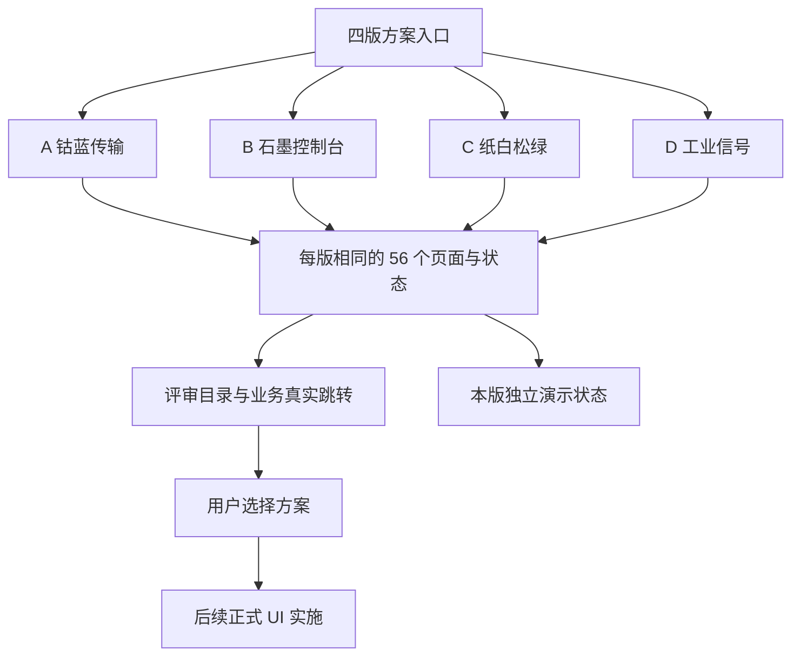

# ui-four-distinct-prototypes - Plan

用户后续反馈三版风格相近，并要求电脑端文字至少 13px、参考竞品。用户已明确回复「按四版重做（推荐）」。本轮将完整原型扩展为钴蓝传输、石墨控制台、纸白松绿、工业信号四版，保留每版 56 页范围、真实页面跳转及既有功能。

当前验收：230 个地址与链接通过，0 失败、0 警告；独立构建通过。1440px 和 1024px 各 229 个页面实际最小字号 13px，未出现页面级横向溢出。390px 总览和四版发送页抽查完成，未出现页面级横向溢出。四版截图已逐张核对，交互抽查完成，原型交付供用户选择。

## Scope & Non-Goals

- Goal: 交付四版完整可跳转交互原型，让用户选择方向后再实施正式 UI。
- In scope: ui-prototypes 下的页面、状态、示例交互、响应式样式、动效、验证和说明。
- Non-goals: 修改正式产品 UI、连接真实后端、真实登录上传支付和权限变更。

## Acceptance Criteria

- [x] A 钴蓝传输、B 石墨控制台、C 纸白松绿、D 工业信号四个设计方向可访问，配色、版式、字体和组件形态有明显区别。
- [x] 根据现有组件和路由映射每版 56 个页面与关键状态，附评审目录。
- [x] 使用真实 HTML 页面链接与顶部业务导航，没有左侧页面切换栏。
- [x] 按用户确认的四种方向分别配色，使用 Lucide 图标、进入与退出动效、共享元素过渡与按钮反馈。
- [x] 桌面字号全部不低于 13px，1440px 与 1024px 的 458 次页面检查通过。
- [x] 提供手机布局、键盘焦点、弹窗 Esc 与焦点控制、减少动态效果支持。
- [x] 所有页面入口及站内链接通过检查，独立生产构建通过。
- [x] 交付方案入口、预览与说明，正式实施等待用户选定。

## Assumptions & Constraints

- 原型采用本地示例数据，每版 sessionStorage 独立。
- 业务页面范围来源记录在 data.js 的 route 和 source 字段。
- 保留原有未提交修改与已有 prototype 目录，不覆盖不回退。
- 复用现有 React、Lucide 和 qrcode 依赖；shadcn/ui 只作为布局和交互参考。

## Baseline Tests

| Item | Command | Baseline result (at start) |
| --- | --- | --- |
| Git baseline | git status --short / existing plan metadata | 存在 workspace-page.jsx、components.css、测试用例 docx 等原有修改，均保留 |
| Commit / ref | Existing plan metadata | dabe885 / refactor/split-monoliths |
| Original app tests | Not run | 本轮为独立原型，正式应用未改动 |
| Prototype first build | npx vite build --config ui-prototypes/vite.config.mjs | 交接摘要记录已通过；恢复后重新运行通过 |

## Diagram

## Task Checklist

| ID | Task | Owner | Deps | Done |
| --- | --- | --- | --- | --- |
| T1 | 核对现有功能和页面清单 | [main] | - | [x] |
| T2 | 实现四种视觉方向及统一示例交互 | [main] | T1 | [x] |
| T3 | 生成页面路由与完整评审目录 | [main] | T2 | [x] |
| T4 | 添加动效、响应式和键盘交互 | [main] | T2 | [x] |
| T5 | 运行全部地址检查和生产构建 | [main] | T3,T4 | [x] |
| T6 | 浏览器抽查关键流程和布局 | [main] | T5 | [x] |
| T7 | 整理截图、运行说明与许可 | [main] | T6 | [x] |
| T8 | 向用户交付四版入口以选择 | [main] | T7 | [x] |

## Sub-agent Registry

本次没有委派子代理，所有工作在主代理执行。

| Task ID | Agent Ref | Status | Integration | Owned Files | Checkpoint / Next Action | Updated |
| --- | --- | --- | --- | --- | --- | --- |

## Risks & Rollback

| Risk | Likelihood / Impact | Mitigation | Rollback |
| --- | --- | --- | --- |
| 误把演示操作当作真实业务 | 中 / 中 | 入口和业务状态明确原型说明，不调用业务 API | 关闭原型服务 |
| 浏览器不支持 View Transitions | 中 / 低 | 保留普通链接跳转和 CSS 动效，尊重减少动态效果 | 使用标准页面导航 |
| 页面全量视觉未逐页人工检查 | 低 / 中 | 全量入口渲染与断链检查，关键流程桌面手机抽查 | 选定方向后逐页正式验收 |

## Blockers

无阻塞。原型交付完成后等待用户选择实施方向。

## Change Log

| Time (YYYY-MM-DD HH:mm) | Task ID | File / Task | Change | By |
| --- | --- | --- | --- | --- |
| 2026-10-19 19:51 | T1 | ui-prototypes/data.js | 恢复时核对现有页面映射，共 56 个页面与关键状态 | main |
| 2026-10-19 19:51 | T2 | ui-prototypes/app.jsx | 核对三版交互实现和示例状态存储 | main |
| 2026-10-19 19:51 | T3 | ui-prototypes/generate.mjs, vite.config.mjs | 核对每版独立入口和评审目录 | main |
| 2026-10-19 19:51 | T4 | ui-prototypes/style.css | 核对进入、退出、共享区域过渡、响应式和减少动态效果 | main |
| 2026-10-19 19:39 | T5 | verify.mjs, verification.json | 恢复后重新检查 173 个地址及生产构建，均通过 | main |
| 2026-10-19 19:51 | T6 | Browser acceptance | 抽查团队角色更改与恢复、消息筛选、订单详情、后台确认取消及布局 | main |
| 2026-10-19 19:51 | T7 | README.md, previews, THIRD_PARTY_NOTICES.md | 保存方案和首页截图，记录运行与验收边界、参考和许可 | main |
| 2026-10-19 19:51 | T8 | Deliverable | 保留方案入口供用户选择，后续 UI 实施另行开展 | main |
| 2026-10-19 21:22 | T2,T3,T4 | Four-direction revision | 按用户确认重做四版配色与视觉，增加 D 版，主题入口与路由自动生成，桌面字号下限提升至 13px | main |
| 2026-10-19 21:22 | T5,T6,T7,T8 | Final acceptance | 230 地址检查和独立构建通过；全量桌面字号、关键流程及手机布局抽查通过；四版预览核对并交付 | main |

## Verification Evidence

| Time | Command | Result | Notes (regression vs. pre-existing) |
| --- | --- | --- | --- |
| 2026-10-19 19:39 | node ui-prototypes/verify.mjs | exit 0，173 routes，56 pages/design，3 designs，0 failures，0 warnings | 覆盖总入口、全部页面、目录渲染与站内链接 |
| 2026-10-19 19:39 | npx vite build --config ui-prototypes/vite.config.mjs | exit 0，1798 modules，built in 2.08s | 独立原型生产构建通过 |
| 2026-10-19 19:51 | Browser via CUA | 核心交互及桌面/手机页面可用 | 人工抽查，不代表真实后端集成测试 |
| 2026-10-19 19:51 | git diff --stat | 原有 3 个 tracked 文件仍为原先修改 | 本轮仅增加 ui-prototypes 和计划文件 |
| 2026-10-19 19:51 | License review | Lucide ISC、qrcode MIT；shadcn/ui MIT 确认 | Jina 网络不通后通过浏览器读取官方文档与 LICENSE |
| 2026-10-19 21:15 | node ui-prototypes/verify.mjs | exit 0，230 routes，56 pages/design，4 designs，0 failures，0 warnings | 当前四版的全部地址和站内链接 |
| 2026-10-19 21:06 | Browser desktop typography | 1440px 与 1024px 共 458 次检查，最小 13px，0 小字号，0 页面横向溢出 | font-verification.json |
| 2026-10-19 21:22 | npx vite build --config ui-prototypes/vite.config.mjs | exit 0，1856 modules，built in 2.18s | 当前四版独立生产构建 |
| 2026-10-19 21:22 | Browser responsive / preview review | 390px 总览与四版发送页均无页面横向溢出；四张首页及拼图逐张核对 | 已恢复默认桌面视口并保留总览标签 |

## Bug & Fix Log

| Time | Symptom | Root cause | Fix (files) | Guard added (test/assert/check) |
| --- | --- | --- | --- | --- |
| 2026-10-19 19:39 | 交接记录中的页面跳转状态可能未及时保存 | 状态更新与页面导航时序 | app.jsx useStored 同步写入 sessionStorage，入口识别根路径与 index.html | 修正后重新运行全量 verify 和 build，通过 |

## Completion Summary

四版独立交互原型，每版 56 个页面与关键状态。正式产品代码保持原有状态，等待用户选定后再实施。
全部 230 个地址与链接检查、独立生产构建通过，458 次桌面字号和溢出检查通过，关键交互和手机布局已抽查。
verification_status 为 partial：页面视觉和交互采用抽查方式，未对 224 个页面逐一手工验收，不涉及真实后端。
外部资料采用 SwissTransfer、Smash 的传输层级参考和 shadcn/ui 的交互组织参考；未复制竞品源码，直接复用依赖及许可已说明。

## Next Steps

- 用户在 A/B/C/D 四版中选定方向后，再按现有功能与后端契约实施正式 UI。

