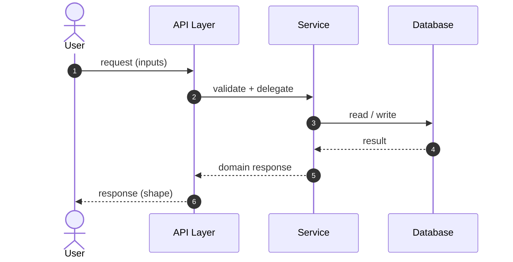

# membership-layout-order-deletion - Plan

## Scope & Non-Goals

- **Goal (one sentence):** Balance the desktop membership overview columns and let users safely remove eligible upgrade orders.
- **In scope:** `src/styles/app-team.css`, `src/pages/orders.jsx`, `server/services/account.js`, `server/routes/upgrade.js`, and focused order UI/API tests.
- **Non-goals (explicit):** No new package, no order deletion for paid or provider-linked orders, no new membership workflow, and no changes to the existing mobile breakpoint.

## Acceptance Criteria

Concrete, checkable conditions. "Done" = all of these are true.

- [x] Above 1000px, the membership benefits card matches the height of the full right-side column while preserving column widths; the stacked layout remains at 1000px and below.
- [x] Only canceled or expired orders without a provider order number expose deletion, and the detail dialog requires explicit confirmation.
- [x] The API enforces authentication, ownership, order locking, and the same deletion eligibility; provider-linked, pending, and paid orders remain.
- [x] Successful deletion closes the dialog, shows success feedback, and refreshes list rows, counts, and pagination; failures preserve the order and show an error.
- [x] Focused UI and API tests pass, with no JavaScript errors in the UI harness.

## Assumptions & Constraints

- **Assumptions:** Orders are stored in `metadata.upgradeOrders`; the existing per-order lock serializes payment creation and order mutations.
- **Constraints:** Preserve the user's existing working-tree changes. No real order records are deleted during testing.

## Baseline Tests

_Capture the starting state BEFORE changing code so later failures can be told apart
from pre-existing ones. Testing policy (see the skill): safe, fast, local, targeted
tests may run automatically; slow, paid, external, or destructive suites need the
user's go-ahead first. Record what was actually run vs. deferred._

| Item | Command | Baseline result (at start) |
| --- | --- | --- |
| Build | `npm run build` | Not run at baseline |
| Tests | `npm run test:orders` | Passed: 49 checks |
| Commit / ref | `git rev-parse --short HEAD` | `0250e71` on `refactor/split-monoliths`; working tree already contained user changes |

## Diagram

_Pick the diagram type that fits the work (see the skill's "choose a diagram" guidance):
`sequenceDiagram` for call chains, `flowchart` for branching/pipelines/dependencies,
`stateDiagram-v2` for lifecycles. Design the flow BEFORE writing code. Keep it honest:
update it if the real design drifts. Omit this section for tasks with no explanatory
value (docs, config bumps) and say so._

---

## Task Checklist

Each task has a stable **ID** (`T1`, `T2`, ...) and a **Deps** list referencing other IDs.
`[main]` runs sequentially in the main agent. `[sub-agent]` MAY be delegated only if the
delegation conditions in the skill hold (tools available, permission granted, stable
interface, non-overlapping file ownership); otherwise run it in the main thread too.

| ID | Task | Owner | Deps | Done |
| --- | --- | --- | --- | --- |
| T1 | Add failing UI and API tests for safe order deletion and UI state updates | `[main]` | - | [x] |
| T2 | Add shared order deletion eligibility and locked, owner-scoped DELETE route | `[main]` | T1 | [x] |
| T3 | Add detail confirmation, deletion feedback, and list refresh | `[main]` | T1,T2 | [x] |
| T4 | Stretch the desktop membership benefits card to match the full height of the right column | `[main]` | - | [x] |
| T5 | Run focused API/UI tests and production build | `[main]` | T2,T3,T4 | [x] |

> A task that depends on an unfinished interface is NOT independent. Give it a `Deps`
> entry on the task that stabilizes the interface, or lock the interface contract first
> and then allow parallel work.

## Sub-agent Registry

_Add a row immediately before starting each delegated attempt. Only the main agent edits
this registry. Sub-agents report checkpoints; they do not edit the shared plan. On task
resume, reconcile these rows with the task checkboxes, repository diff, and live agent
state. Resume only unchecked tasks with non-terminal attempts. A blocked attempt waits
until its blocker is resolved._

| Task ID | Agent Ref | Status | Integration | Owned Files | Checkpoint / Next Action | Updated |
| --- | --- | --- | --- | --- | --- | --- |
| _T4_ | _agent handle or stable name_ | _running / interrupted / blocked / completed / failed / cancelled / superseded_ | _pending / integrated / rejected / n/a_ | _exact non-overlapping paths_ | _completed work, remaining work, next command/action_ | _YYYY-MM-DD HH:mm_ |

_Terminal attempts (`completed`, `failed`, `cancelled`, `superseded`) are never
automatically resumed. If a completed attempt has `integration=pending`, the main agent
reviews and integrates its result instead of restarting it. If an old running/interrupted
agent is unavailable after a new session, mark it `superseded` and create a new row for
the replacement rather than reusing its identity._

## Risks & Rollback

| Risk | Likelihood / Impact | Mitigation | Rollback |
| --- | --- | --- | --- |
| A payment-state race could remove an order during checkout | low / high | Reuse the existing per-order lock and re-read the order after lock acquisition | Restore from the persisted metadata backup if operational recovery is needed |

## Blockers

_Open questions or external dependencies stopping progress. Empty when unblocked._

- _e.g. waiting on the user to confirm token expiry policy._

---

## Change Log

_Append one row after completing EACH task - including sub-agent work (fold their
reported rows in here after reviewing the diff). Write it as you finish, never in a batch._

| Time (YYYY-MM-DD HH:mm) | Task ID | File / Task | Change | By |
| --- | --- | --- | --- | --- |
| 2026-10-22 12:04 | T1-T5 | Acceptance pass | Verified the existing membership/order implementation; clarified why provider-linked canceled orders cannot be deleted; updated manual screenshots and build evidence | main |

## Verification Evidence

_Filled during/after the acceptance pass. Record the exact command and its real result,
plus the diff between baseline and now. Distinguish new regressions from pre-existing
failures carried over from Baseline Tests. Set `verification_status` in the frontmatter:
`verified` (all acceptance criteria checked by tests/build), `partial` (some verified,
rest deferred - list which), or `not-run` (nothing run - say why + residual risk)._

| Time | Command | Result | Notes (regression vs. pre-existing) |
| --- | --- | --- | --- |
| 2026-10-22 11:58 | `npm run test:orders` | Passed: 56 UI checks | Includes the provider-linked deletion explanation and no-JS-error checks |
| 2026-10-22 11:59 | `node scripts/verify-finance-admin-suite.mjs` | Passed: 242 checks, no failures | Includes ownership, locking and deletion eligibility |
| 2026-10-22 12:00 | `node _build_manual.mjs --refresh-screenshots` | Passed: 16 chapters, 37 screenshot/text pairs | Captures reviewed against the isolated demo UI |
| 2026-10-22 12:02 | `npm run build` | Passed | Existing >500 KB viewer chunk warning remains |
| 2026-10-22 12:03 | `node scripts/verify-user-manual.mjs --dist --url=http://localhost:8045/user-manual.html` | Passed: source, dist and HTTP match | Same SHA256 as the isolated port 8119 verification |

## Bug & Fix Log

_When a bug is reported (especially AFTER the project was marked complete), record it
here after fixing, so the same error logic is not repeated next time._

| Time | Symptom | Root cause | Fix (files) | Guard added (test/assert/check) |
| --- | --- | --- | --- | --- |
| 2026-10-22 11:58 | Missing deletion control looked like a restart problem | Provider-linked canceled orders are intentionally preserved for reconciliation, but the detail had no explanation | Added a visible reason for canceled/expired orders with provider order numbers in `src/pages/orders.jsx` | `scripts/verify-orders-ui.mjs` checks the reason text and hidden delete action |

## Completion Summary

_Leave empty until the acceptance pass is done. Then fill in: what was built, key
decisions, what was verified (and how), verification_status rationale, anything deferred._

Balanced the desktop membership benefits card to the full right-column height and implemented owner-scoped deletion for canceled/expired orders without provider references. Added an explanation for provider-linked orders that must remain. Verified 56 order UI checks, 242 finance/admin checks, a production build, and the manual's 37 current screenshot/text pairs served identically from ports 8119 and 8045.

## Next Steps

_Always keep ONE explicit next action here so any agent resuming knows exactly where to
start. Update it every time you stop._

- No remaining work in this plan.
