# Team Owner Handover - Plan

## Scope & Non-Goals
- Goal: Only the intended active member can accept a pending transfer; authorization changes only on acceptance.
- In scope: Organization handover persistence, routes, team page, message center, isolated regression tests, acceptance instructions.
- Non-goals: Other phase-two features, personal-file ownership transfer, deployment, production-data changes.

## Acceptance Criteria
- [x] Only the current owner can initiate a handover to a different active member with an active account.
- [x] Pending handover does not change owner, roles, resources, or team entitlement.
- [x] Recipient can accept or decline; owner can cancel; duplicate requests do not produce repeated transfers.
- [x] Removed, disabled, or expired recipients cannot accept; stale handovers are terminal and recorded.
- [x] Acceptance preserves organization identity, team plan, files, and task attribution while synchronizing both users and sessions.
- [x] History records initiator, recipient, status, and timestamps without exposing resource credentials.
- [x] Team and message interfaces are readable, responsive, guarded against duplicate actions, and have no runtime errors.
- [x] Targeted API/UI tests, build, and diff checks pass; stop for user acceptance before later features.

## Assumptions & Constraints
- Existing immediate-transfer endpoint becomes initiation; confirmation uses an ID-addressed decision endpoint.
- Ownership belongs to the organization; existing task/file attribution remains unchanged and new owner obtains existing team management authorization.
- Only owner can transfer ownership, consistent with existing role model; ordinary admins may not transfer the owner role.
- Reuse existing React, Express, Lucide, confirm dialogs, and invitation interaction patterns; no new library is needed for this domain state machine.
- Existing unrelated uncommitted work must be preserved. No production databases, external messaging, deployment, reset, or commit.
- One pending handover per organization; requests expire after 7 days. Historical attempts are persisted in organization metadata and audit logs.

## Baseline Tests
| Item | Command | Baseline result (at start) |
| --- | --- | --- |
| API | node scripts/verify-team-suite.mjs | PASS: 186 checks in disposable temp fixture |
| UI / permissions | Existing scripts | Baseline structure inspected; final full targeted runs required |
| Commit | git rev-parse --short HEAD | a57f0ea |
| Existing work | git status --short | Collection changes and untracked docs/test data already present; preserve |

## Diagram

```mermaid
stateDiagram-v2
    [*] --> Pending: owner initiates for active member
    Pending --> Accepted: recipient confirms and prerequisites revalidated
    Pending --> Declined: recipient refuses
    Pending --> Canceled: owner cancels
    Pending --> Expired: seven-day deadline
    Pending --> Invalidated: membership or account no longer valid
    Accepted --> [*]: change roles and sessions; preserve resources and plan
    Declined --> [*]
    Canceled --> [*]
    Expired --> [*]
    Invalidated --> [*]
```

## Task Checklist
| ID | Task | Owner | Deps | Done |
| --- | --- | --- | --- | --- |
| T1 | Inspect existing ownership, invitations, storage and tests; lock scope and contract | `[main]` | - | [x] |
| T2 | Implement normalization, handover state transitions and authorization routes | `[main]` | T1 | [x] |
| T3 | Implement team confirmation/history and message-center actions | `[main]` | T2 | [x] |
| T4 | Add adversarial API tests; adapt existing transfer regressions and UI tests | `[main]` | T2,T3 | [x] |
| T5 | Run isolated regressions, build, diff checks and produce acceptance guide | `[main]` | T4 | [x] |

## Sub-agent Registry
No delegated work. Main agent owns all tasks.

## Risks & Rollback
| Risk | Likelihood / Impact | Mitigation | Rollback |
| --- | --- | --- | --- |
| Legacy normalization discards new fields | Medium / high | Normalize handovers explicitly and test restart persistence | Revert only this feature diff; retain terminal audit history |
| Stale sessions retain management | Medium / high | Revalidate ownership per request and synchronize both sessions on acceptance | Disable initiation endpoint while preserving old role data |
| Recipient disappears or account is disabled | Medium / high | Revalidate on decision, mark stale attempt invalid, do not transfer | Owner can initiate a new request after invalidation |
| Unrelated existing edits overwritten | Medium / high | Surgical edits and scoped diff review | Restore only new edits, never reset entire tree |

## Blockers
None.

## Change Log
| Time (YYYY-MM-DD HH:mm) | Task ID | File / Task | Change | By |
| --- | --- | --- | --- | --- |
| 2026-10-24 10:00 | T1 | plan and existing workspace/team/invitation code | Reconciled inherited empty template; fixed scope, API design and acceptance gates | main |

| 2026-10-24 10:20 | T2 | server/services/ownership-handover.js; workspace routes; normalizers; account payload | Added pending/terminal state, role validation, mandatory messages, idempotent decisions and audit history | main |
| 2026-10-24 10:25 | T3 | team page; team-handover component; workspace messages; records helper; app-team.css | Added dedicated tab, confirmation actions, status banner, paged history and responsive styling | main |

| 2026-10-24 10:05 | T4 | API and UI verification scripts; package.json | Added 67 handover API checks, 19 message checks, team-page handover cases; adapted immediate-transfer regression | main |
| 2026-10-24 10:10 | T5 | serve-team-handover-demo.mjs; docs/阶段二-企业负责人交接-验收说明.md | Added isolated synthetic browser demo and human acceptance procedure; final browser pass in progress | main |
| 2026-10-24 10:17 | T5 | Team responsive layout; docs/verification/team-handover; acceptance guide | Removed redundant KPI cards from handover tab; verified 390px/1280px layouts and both roles in actual browser; saved proof and restarted clean synthetic demo | main |

## Verification Evidence
| Time | Command | Result | Notes (regression vs. pre-existing) |
| --- | --- | --- | --- |
| 2026-10-24 09:35 | node scripts/verify-team-suite.mjs (baseline) | PASS: 186 checks | Disposable fixture; no production accounts or files |
| 2026-10-24 10:07 | node scripts/verify-team-handover.mjs | PASS: 67 checks | .workbuddy/team-handover/results.json; temp JSON storage; same-process races, restart, stale accounts, roles and resources |
| 2026-10-24 10:08 | node scripts/verify-team-ui.mjs | PASS: 268 checks, no failures | .workbuddy/team-handover/team-ui-results.json; real React/JSDOM interactions |
| 2026-10-24 10:00 | node scripts/verify-handover-message-ui.mjs | PASS: 19 checks | .workbuddy/team-handover/message-ui-results.json; includes confirmation cancel keeping messages open |
| 2026-10-24 10:05 | node scripts/verify-team-suite.mjs | PASS: 187 checks | TEMP/kunqiong-team-after.log; adapted transfer to confirmation workflow |
| 2026-10-24 10:05 | node scripts/verify-team-permissions.mjs | PASS: 196 checks | TEMP/kunqiong-team-permissions-after.log |
| 2026-10-24 10:05 | node scripts/verify-message-center.mjs; node scripts/verify-message-delete.mjs | PASS: 15 and 17 checks | Existing message interaction and persistence regression |
| 2026-10-24 10:05 | node scripts/verify-team-entitlement-ui.mjs | PASS: 2 checks | Existing expired-team recovery regression |
| 2026-10-24 10:10 | node scripts/verify-collection-form-ui.mjs | PASS | TEMP/kunqiong-collection-form-regression.log; prior collection changes preserved |
| 2026-10-24 10:10 | npx vite build | PASS | TEMP/kunqiong-handover-release-build.log; existing chunk-size warning only |
| 2026-10-24 10:15 | CUA actual browser on isolated localhost demo | PASS | 390px mobile has no horizontal overflow; 1280px desktop confirms new owner management and old owner demotion; no captured console errors/warnings; screenshots in docs/verification/team-handover |
| 2026-10-24 10:17 | git diff --check; plan.py check --strict | PASS before close-out | Repeated once after final documentation edits; no reset, commit, deployment, or real storage mutation |

## Bug & Fix Log
| Time | Symptom | Root cause | Fix (files) | Guard added (test/assert/check) |
| --- | --- | --- | --- | --- |
| 2026-10-24 10:00 | Canceling message confirmation closed message center | Outside-click listener treated confirm dialog as unrelated outside UI | workspace.jsx ignores clicks within confirm-backdrop | verify-handover-message-ui.mjs cancellation assertions |
| 2026-10-24 09:53 | Native fs.cpSync crashed on this Windows runtime | Environment filesystem native copy behavior | Fixture uses existing recursive readdir/copyFile pattern | API fixture ran and passed |

## Completion Summary
Implemented two-party ownership handover, accept/decline/cancel, mandatory in-app pending actions, seven-day expiry, invalidation and audit history. Reused the project's React/Express/Lucide/dialog patterns without adding a library. Targeted API, permission, team UI, message, entitlement and collection regressions pass; build passes. Actual browser verification confirms both roles and mobile/desktop layouts. A fresh isolated synthetic demo and step-by-step Chinese acceptance guide are ready.

Verification remains partial because MySQL mode, cross-instance concurrency and deployment were not exercised. The existing whole-metadata snapshot model remains a multi-instance constraint; this work verifies same-process state transitions and JSON persistence only. User acceptance is pending and is not recorded as passed. No third-stage work, deployment, Git commit, or real-data transfer was performed.

## Next Steps
Wait for the user's acceptance of this feature using docs/阶段二-企业负责人交接-验收说明.md and http://localhost:18047/__handover_demo. Continue the next feature only after that checkpoint.
