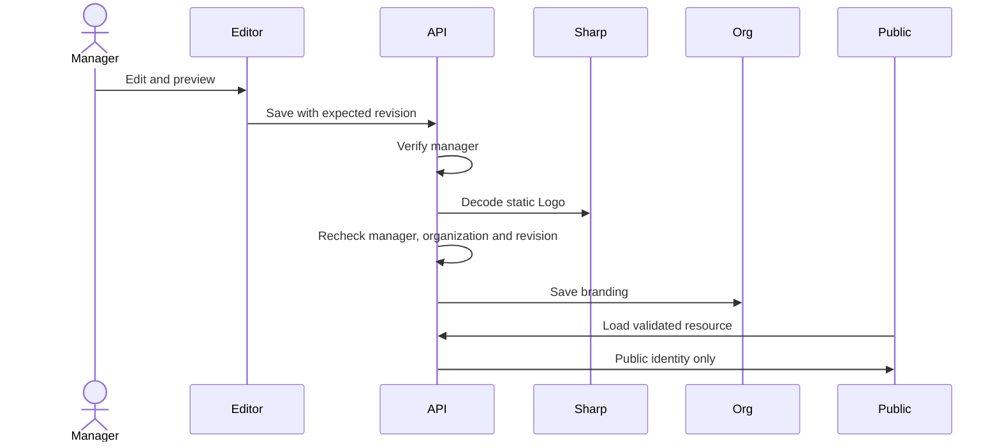

# Team Branding - Plan

## Scope & Non-Goals
- Goal: Team managers can publish a name, static Logo and introduction on associated public share and collection pages.
- In scope: Organization branding, authorization, image validation, public identity banner, editor preview, reset, tests and acceptance guide.
- Non-goals: Domains, theme editor, recycling, directed delivery, deployment, commits, real-data changes.

## Acceptance Criteria
- [x] Active owner/admin may edit branding; members, outsiders and disabled accounts cannot.
- [x] Static PNG/JPEG/WebP within 400 KiB are fully decoded and normalized; failed input preserves saved branding.
- [x] Bounded name and introduction render as text; preview and default reset work.
- [x] Conflicting revisions and permission revocation during decoding are rejected.
- [x] Associated team shares and enterprise collection links show matching identity; ordinary personal links keep defaults.
- [x] Reset preserves organization identity and file access; branding survives handover and restart.
- [x] API/UI tests, affected regressions, build, diff and desktop browser checks pass; clean demo ready.
- [ ] Actual mobile narrow-screen check remains deferred: requested 390 px still reported 1280 px; user device acceptance needed.

## Assumptions & Constraints
- Continue accepts the previous handover checkpoint and authorizes the next stage-two feature only.
- Reuse installed open-source React, Express, Lucide, Sharp and project avatar/dialog components; no new dependency or copied component needed.
- Public display name is separate from organization name. Logo/name/introduction are intentionally public on associated resource pages.
- Branding does not grant access. New personal resources bind branding organization at creation; only validated enterprise links display it. Team shares use their fixed organization.
- Legacy enterprise links retain existing association behavior. No theme or domain changes.
- Preserve all unrelated uncommitted work. Use disposable JSON fixtures; existing snapshot persistence still constrains multiple instances.

## Baseline Tests
| Item | Command | Baseline result (at start) |
| --- | --- | --- |
| Prior handover checks | Previous local results | 67 handover, 187 team API, 196 permissions, 268 team UI checks passed |
| Build | Previous npx vite build | Passed; pre-existing chunk warning |
| Tree | git status --short | Existing collection and handover changes retained |
| Commit | git rev-parse --short HEAD | a57f0ea |

## Diagram

## Task Checklist
| ID | Task | Owner | Deps | Done |
| --- | --- | --- | --- | --- |
| T1 | Confirm stage scope and reuse project patterns | `[main]` | - | [x] |
| T2 | Implement model, guarded settings and public payloads | `[main]` | T1 | [x] |
| T3 | Implement responsive editor and public brand banner | `[main]` | T2 | [x] |
| T4 | Run API/UI security tests, affected regressions and build | `[main]` | T2,T3 | [x] |
| T5 | Desktop browser checks, document mobile limitation, clean demo and acceptance guide | `[main]` | T4 | [x] |

## Sub-agent Registry
No delegation. Main agent owns all tasks sequentially.

## Risks & Rollback
| Risk | Likelihood / Impact | Mitigation | Rollback |
| --- | --- | --- | --- |
| Member changes team | Medium / high | Fixed new-resource association and slug validation | Disable brand output |
| Malformed image or script | Medium / high | Existing Sharp decoder, no SVG/GIF, React text | Restore default |
| Conflicting edit | Medium / medium | Expected revision and post-decode authorization | Reload latest revision |
| Unrelated edits overwritten | Medium / high | Surgical edits and diff review | Revert only brand edits |

## Blockers
No development blocker. Actual mobile narrow-screen acceptance is pending because the browser viewport capability left the page at 1280 px; user acceptance remains open, so this plan stays active with partial verification.

## Change Log
| Time (YYYY-MM-DD HH:mm) | Task ID | File / Task | Change | By |
| --- | --- | --- | --- | --- |
| 2026-10-24 10:26 | T1 | Existing team/avatar/public flows | Locked scope, roles and reuse; prior checkpoint accepted by continue | main |
| 2026-10-24 10:26 | T2 | server/lib/team-branding.js; metadata-normalizers.js | Added bounded brand schema and reused safe image decoder | main |
| 2026-10-24 10:31 | T2 | team-branding routes; account/share/collection services and routes | Added manager guards, revision conflicts, post-decode checks, safe Logo response and fixed new-resource associations | main |
| 2026-10-24 10:31 | T3 | team-branding and team-brand components/CSS; team/public pages | Added dedicated tab, live preview, safe upload/reset, shared brand banner and mobile controls | main |
| 2026-10-24 10:32 | T4 | scripts/verify-team-branding.mjs | Added 73 real HTTP/persistence/image/security checks including deterministic revoke-during-decode and restart | main |
| 2026-10-24 10:51 | T4 | scripts/verify-team-branding-ui.mjs; verify-team-ui.mjs; production build | Passed 45 actual React branding checks and affected team/handover/collection regressions; fixed two observed test/runtime issues | main |
| 2026-10-24 11:08 | T5 | test-kits/team-branding-2026-10-24 | Generated and verified 10 manual cases and 6 synthetic image files including exact 409600/409601-byte bounds | main |
| 2026-10-24 11:08 | T5 | docs/verification/team-branding; scripts/serve-team-branding-demo.mjs | Captured actual upload/save/public/guest/reset/member browser evidence; restored default branding and left isolated demo entry open | main |
| 2026-10-24 11:08 | T5 | docs/阶段二-团队品牌展示-验收说明.md | Documented rules, steps, test assets, evidence and explicit mobile/MySQL/user-acceptance limitations | main |
| 2026-10-24 11:12 | T5 | package.json; team-branding.jsx; verify-team-branding-ui.mjs | Investigated user 404: live 8045 and snapshot 18047 lack brand route while 18048 returns expected 401. Added Node watch for development and actionable missing-route feedback preserving drafts; runtime refresh verification in progress | main |
| 2026-10-24 11:18 | T5 | Local dev API/Vite and existing handover demo | Restarted main dev with Node watch after metadata backup; refreshed only server/dist in original 18047 synthetic fixture without reseeding; all four route probes now 401 instead of 404; saved synthetic brand in real browser and reloaded successfully | main |

## Verification Evidence
| Time | Command | Result | Notes (regression vs. pre-existing) |
| --- | --- | --- | --- |
| 2026-10-24 10:26 | Inspect previous local acceptance | Baseline recorded | No production services |
| 2026-10-24 10:32 | node scripts/verify-team-branding.mjs | PASS 73 checks | .workbuddy/team-branding/results.json; temporary fixtures only |
| 2026-10-24 10:48 | node scripts/verify-team-branding-ui.mjs | PASS 45 checks | .workbuddy/team-branding/ui-results.json; production React in JSDOM |
| 2026-10-24 10:51 | Existing team API/permission/handover/UI scripts | PASS 187 / 196 / 67 / 268 checks | TEMP kunqiong-branding-team-api.log, permissions.log, handover.log, team-ui-final.log |
| 2026-10-24 10:51 | Existing collection API/form UI scripts | PASS 82 API checks and form UI | TEMP kunqiong-branding-collection-api.log and collection-ui.log; template remains removed |
| 2026-10-24 10:51 | npx vite build | PASS | TEMP kunqiong-branding-build-final.log; existing chunk-size warning only |
| 2026-10-24 11:08 | build_test_kit.py --verify test-kits/team-branding-2026-10-24 | PASS, 10 cases / 6 files | Generated artifacts only; manual cases remain unexecuted |
| 2026-10-24 11:08 | Actual IAB browser on localhost:18048 | PASS desktop upload/save, share, guest collection, reset and member restriction | docs/verification/team-branding/browser-checks.json and PNGs; no observed console errors |
| 2026-10-24 11:08 | Browser viewport set to 390x844 | DEFERRED actual mobile verification | Actual width stayed 1280; override reset, no mobile-pass claim |
| 2026-10-24 11:08 | git diff --check | PASS | Existing unrelated edits preserved; Windows line-ending notices only |
| 2026-10-24 11:08 | plan.py check --strict; test-kit --verify | PASS plan structure and 10-case/6-file artifact validation | Plan close intentionally not forced: mobile acceptance is still unchecked |
| 2026-10-24 11:18 | npx vite build; node scripts/verify-team-branding-ui.mjs | PASS build and 46 UI checks | TEMP kunqiong-branding-route-fix-build.log / kunqiong-branding-route-fix-ui.log; includes missing-route preservation test |
| 2026-10-24 11:18 | Unauthenticated GET branding on 8045 / 4173 / 18047 / 18048 | PASS 401 on each, no 404 | No real account save or credential access used |
| 2026-10-24 11:18 | Real browser save and reload on 18047 synthetic owner | PASS saved name/introduction persist and 已启用 shown | docs/verification/team-branding/route-fix-save-18047.png; source fixture data preserved across code refresh |

## Bug & Fix Log
| Time | Symptom | Root cause | Fix (files) | Guard added (test/assert/check) |
| --- | --- | --- | --- | --- |
| 2026-10-24 10:38 | Logo reader missing readAsDataURL in full app | Existing PPT preview dependency replaces global FileReader | team-branding.jsx uses Blob.arrayBuffer and bounded base64 encoding | Actual application bundle UI upload test, plus real browser upload |
| 2026-10-24 10:38 | Existing handover UI test reads absent history | Predicate accepted transient loading/unmounted state before rerender | verify-team-ui.mjs waits for resolved history as well as absent pending card | Recipient accept and decline tests |
| 2026-10-24 11:12 | Saving brand reports 接口不存在 | Main dev API remained an old non-watching Node process; older isolated handover fixture also retained old server copy | package.json enables Node watch; branding errors explain stale service and preserve draft; refresh both affected local runtimes | Dedicated 404/draft UI case and post-refresh route/save checks |

## Completion Summary
Implemented team branding using existing React, Express, Lucide and Sharp components without new dependencies. Manager configuration, safe static Logo processing, preview, reset, revision conflicts, public identity and fixed associations for new resources are complete. API 73 and React UI 46 branding checks passed; team API 187, permissions 196, handover 67, team UI 268, collection API 82 and collection form UI regressions passed. Production build and whitespace check passed. Real browser desktop upload/save, public/guest display, reset and member restriction passed, with screenshots recorded. The 10-case/6-file acceptance kit is generated and verified. The localhost:18048 demo is left with default branding ready for user testing. The subsequent stale-backend 404 report was fixed by refreshing local development and old handover-demo runtimes; Node watch and clear 404 feedback were added, with successful real browser save/reload on 18047.

Verification is partial: the browser viewport tool did not change actual width, so narrow-screen mobile testing is explicitly unverified; MySQL multi-instance persistence and deployment were not tested. Existing snapshot-storage limitations and legacy resource branding association remain. Manual user acceptance is pending. No real accounts/storage/database were modified, no deployment or Git commit was performed, and no later feature was started.

## Next Steps
User to execute the acceptance guide and test kit, including a real mobile viewport; wait for acceptance before implementing the next feature.
