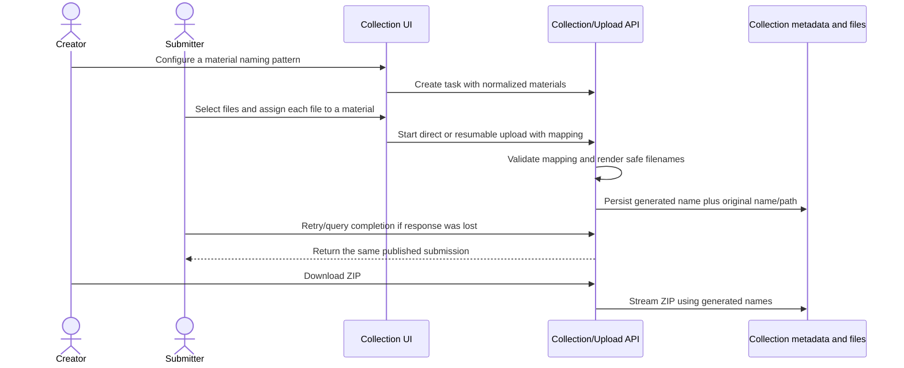

# Collection Filename Naming - Plan

## Scope & Non-Goals

- Goal: Generate safe per-file collection submission names from each material rule while preserving original names and existing collection behavior.
- In scope: Optional naming patterns on material items, per-file material assignment in the submitter flow, client/server validation, upload-session persistence, original-name traceability, ZIP export, regression tests, and user acceptance guide.
- Non-goals: Collection templates (previously removed by the user), custom-field placeholders, AI naming, changing existing task rules, bulk distribution, recycle bin, deployment, commits, or real account/storage changes.

## Acceptance Criteria

- [ ] A material can optionally define a bounded pattern using `{提交人}`, `{材料项}`, and `{原文件名}`; unsupported placeholders are rejected.
- [ ] If any material has a pattern, each uploaded file must be assigned to one selected material; the server independently validates the mapping.
- [ ] The generated display/export filename is a safe single path segment, retains the original extension when omitted, resolves same-directory collisions deterministically, and stores the submitted original filename/path for traceability.
- [ ] ZIP exports use the generated name for newly named files; old tasks and tasks without naming rules keep existing behavior.
- [ ] Direct multipart and chunked/resumable collection submissions preserve the same mapping and generated names; retrying completion cannot duplicate a submission.
- [ ] Create/submit UI explains supported fields and previews each generated filename; mobile layout has no horizontal overflow.
- [ ] Targeted API/UI tests, affected collection regressions, build, and diff checks pass; acceptance instructions make user testing possible.

## Assumptions & Constraints

- Assumptions: The user selected automatic generated submission names with original filenames preserved. Naming is configured per material when creating a task; task-rule editing is not currently supported. Supported values are submitter name, material name, and original filename (including its extension).
- Constraints: Keep the removed template feature removed; do not add dependencies; preserve legacy task submissions; use isolated test fixtures only; no commit/deployment/production changes. Existing upload session signature must include per-file material mapping so a resumed upload cannot silently change names.

## Baseline Tests

| Item | Command | Baseline result (at start) |
| --- | --- | --- |
| Build | `npx vite build` | Not run before edits; run after targeted tests. |
| API | `node scripts/verify-collection-suite.mjs` | PASS: 82 checks, 0 failures; disposable fixture. |
| Create form | `node scripts/verify-collection-form-ui.mjs` | PASS; removed template controls remain absent. |
| Submit picker | `node scripts/verify-collection-picker-ui.mjs` | PASS: 28 checks, 0 failures. |
| Commit / ref | `git rev-parse --short HEAD` | `a57f0ea`; preserve existing uncommitted work. |

## Diagram

## Task Checklist

| ID | Task | Owner | Deps | Done |
| --- | --- | --- | --- | --- |
| T1 | Lock naming format and baseline | `[main]` | - | [x] |
| T2 | Normalize patterns and implement safe deterministic renderer/mapping validation | `[main]` | T1 | [x] |
| T3 | Persist mapping in direct/chunked upload and generate stored/export names | `[main]` | T2 | [x] |
| T4 | Add creator pattern controls, per-file assignment, preview, resume integration, and responsive styling | `[main]` | T2,T3 | [x] |
| T5 | Add adversarial API/UI tests and acceptance guide; run build and focused regressions | `[main]` | T3,T4 | [x] |

## Sub-agent Registry

| Task ID | Agent Ref | Status | Integration | Owned Files | Checkpoint / Next Action | Updated |
| --- | --- | --- | --- | --- | --- | --- |
| None | No delegated work | n/a | n/a | n/a | Main agent owns sequential interface and test work. | 2026-10-24 12:08 |

## Risks & Rollback

| Risk | Likelihood / Impact | Mitigation | Rollback |
| --- | --- | --- | --- |
| Pattern abuse creates unsafe/ambiguous ZIP names | Medium / high | Allow only known placeholders, sanitize to one safe filename segment, retain extension and test path traversal/reserved names | Revert only this feature's naming changes; legacy metadata remains readable |
| Upload resume restores a mapping inconsistent with the selected files | Medium / high | Include per-file mapping in the upload signature and validate server side | Abandon only the mismatched session and restart upload |
| Pattern changes could rename historical submissions | Low / medium | Rules are configured at task creation; persist frozen generated and original names on each file | Restore default rule only for future submissions; never mutate stored historical file names |
| Unrelated in-progress edits are overwritten | Medium / high | Surgical patches; review scoped diff and keep unrelated edits intact | Restore only naming feature files/lines |

## Blockers

- None. User selected generation with original filename preservation.

## Change Log

| Time (YYYY-MM-DD HH:mm) | Task ID | File / Task | Change | By |
| --- | --- | --- | --- | --- |
| 2026-10-24 12:08 | T1 | Plan and existing collection flows | Locked placeholder contract and upload/export data-flow; recorded clean 82 API, 28 submit UI, and create-form baselines | main |
| 2026-10-24 12:42 | T2-T5 | Naming implementation and verification | Added safe pattern rendering, per-file mapping, direct/chunked persistence, UI preview, ZIP traceability, adversarial regressions and user acceptance guide | main |

## Verification Evidence

| Time | Command | Result | Notes (regression vs. pre-existing) |
| --- | --- | --- | --- |
| 2026-10-24 12:05 | `node scripts/verify-collection-suite.mjs` | PASS 82 / 0 | Temporary JSON fixture; baseline before edits |
| 2026-10-24 12:05 | `node scripts/verify-collection-form-ui.mjs` | PASS | Production React bundle; template controls absent |
| 2026-10-24 12:05 | `node scripts/verify-collection-picker-ui.mjs` | PASS 28 / 0 | Actual submit UI in JSDOM; baseline before edits |
| 2026-10-24 12:40 | `node scripts/verify-collection-suite.mjs` | PASS 91 / 0 | Includes naming validation, safe filenames, collision suffixes, ZIP and restart-resume mapping |
| 2026-10-24 12:40 | `node scripts/verify-collection-picker-ui.mjs` | PASS 33 / 0 | Includes per-file naming selector, preview and upload manifest mapping |
| 2026-10-24 12:40 | `node scripts/verify-collection-form-ui.mjs` | PASS | Naming control and removed template controls |
| 2026-10-24 12:40 | `node scripts/verify-collection-resume-ui.mjs` | PASS 38 / 0 | Collection resumable upload and scan state regressions |
| 2026-10-24 12:41 | `npx vite build` | PASS | Production bundle built; pre-existing large chunk warning remains |
| 2026-10-24 12:41 | `git diff --check` | PASS | Only line-ending normalization warnings |

## Bug & Fix Log

| Time | Symptom | Root cause | Fix (files) | Guard added (test/assert/check) |
| --- | --- | --- | --- | --- |
| | | | | |

## Completion Summary

Implementation and automated checks complete. User acceptance is pending at the isolated demo URL described in `docs/verification/2026-10-24-collection-filename-naming-验收说明.md`.

## Next Steps

- Wait for user acceptance of the naming flow before starting another feature.
