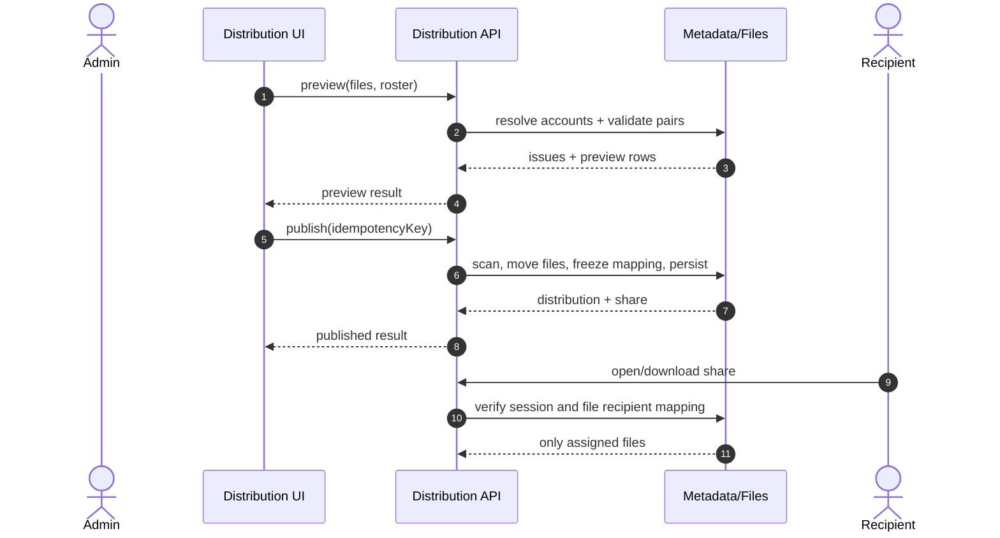

# targeted-recipient-distribution - Plan

## Scope & Non-Goals

- **Goal (one sentence):** 管理员可以导入“编号,收件人”名单和“编号__文件名”文件，预览并修正所有匹配问题后一次性发布，发布后每个登录收件人只能领取自己的文件，重复发布请求不会产生重复分发。
- **In scope:** 分发名单与文件名解析、账号唯一匹配、预览问题清单、发布幂等键、冻结逐文件收件人映射、公开分享文件过滤、管理端完整查看、前端定向分发入口和回归测试。
- **Non-goals (explicit):** 不新增短信/邮件验证体系；不改造现有普通分享的权限模型；不做自动通知渠道扩展；不提供发布后的收件人改派或文件替换界面。

## Acceptance Criteria

_Concrete, checkable conditions. "Done" = all of these are true._

- [ ] 名单支持 `编号,收件人`，文件支持 `编号__文件名.ext`，编号重复、缺件、孤立文件、账号不存在或歧义时预览明确报错并禁止发布。
- [ ] 收件人解析只接受现有登录账号 ID、用户名、邮箱或手机号，且每个编号只能对应一个有效账号。
- [ ] 发布成功后冻结编号、文件版本和收件人映射；管理员可查看全部文件，收件人只能查看/下载分配给自己的文件。
- [ ] 转发普通分享链接不能让未授权账号获取文件；重复提交相同幂等键返回同一分发结果，不创建第二份分享。
- [ ] 现有普通分享、团队资源分享、单文件下载、ZIP 下载和预览回归通过，构建无新增错误。

## Assumptions & Constraints

- **Assumptions:** 继续使用现有账号会话、上传扫描、容量检查和分享存储；管理员通过现有登录会话操作；文件编号使用安全的 ASCII 标识，名单以 UTF-8 文本/CSV 提交。
- **Constraints:** 不破坏旧分享快照；不暴露内部收件人字段；所有权限判断服务端完成；首期最多使用现有批量文件上限；重复请求必须幂等。

## Baseline Tests

_Capture the starting state BEFORE changing code so later failures can be told apart
from pre-existing ones. Testing policy (see the skill): safe, fast, local, targeted
tests may run automatically; slow, paid, external, or destructive suites need the
user's go-ahead first. Record what was actually run vs. deferred._

| Item | Command | Baseline result (at start) |
| --- | --- | --- |
| Build | `npx vite build` | green；已有大 chunk 警告 |
| Tests | `node scripts/verify-share-suite.mjs` | 46 项通过，0 失败 |
| Commit / ref | `a57f0ea` | 基线分支 `refactor/split-monoliths` |

## Diagram

_Pick the diagram type that fits the work (see the skill's "choose a diagram" guidance):
`sequenceDiagram` for call chains, `flowchart` for branching/pipelines/dependencies,
`stateDiagram-v2` for lifecycles. Design the flow BEFORE writing code. Keep it honest:
update it if the real design drifts. Omit this section for tasks with no explanatory
value (docs, config bumps) and say so._

---

## Task Checklist

Each task has a stable **ID** (`T1`, `T2`, ...) and a **Deps** list referencing other IDs.
`[main]` runs sequentially in the main agent. `[sub-agent]` MAY be delegated only if the
delegation conditions in the skill hold (tools available, permission granted, stable
interface, non-overlapping file ownership); otherwise run it in the main thread too.

| ID | Task | Owner | Deps | Done |
| --- | --- | --- | --- | --- |
| T1 | 定义分发元数据、名单解析和账号匹配规则 | `[main]` | - | [x] |
| T2 | 增加分发预览/发布 API 与幂等持久化 | `[main]` | T1 | [x] |
| T3 | 将逐文件收件人映射接入公开列表、下载和预览权限 | `[main]` | T2 | [x] |
| T4 | 增加前端定向分发页面、导航和预览问题清单 | `[main]` | T2 | [x] |
| T5 | 编写接口、权限、幂等和旧分享回归测试 | `[main]` | T3,T4 | [x] |
| T6 | 生成测试数据与用户验收说明 | `[main]` | T5 | [x] |

> A task that depends on an unfinished interface is NOT independent. Give it a `Deps`
> entry on the task that stabilizes the interface, or lock the interface contract first
> and then allow parallel work.

## Sub-agent Registry

_Add a row immediately before starting each delegated attempt. Only the main agent edits
this registry. Sub-agents report checkpoints; they do not edit the shared plan. On task
resume, reconcile these rows with the task checkboxes, repository diff, and live agent
state. Resume only unchecked tasks with non-terminal attempts. A blocked attempt waits
until its blocker is resolved._

| Task ID | Agent Ref | Status | Integration | Owned Files | Checkpoint / Next Action | Updated |
| --- | --- | --- | --- | --- | --- | --- |
| | | | | | | |

_Terminal attempts (`completed`, `failed`, `cancelled`, `superseded`) are never
automatically resumed. If a completed attempt has `integration=pending`, the main agent
reviews and integrates its result instead of restarting it. If an old running/interrupted
agent is unavailable after a new session, mark it `superseded` and create a new row for
the replacement rather than reusing its identity._

## Risks & Rollback

| Risk | Likelihood / Impact | Mitigation | Rollback |
| --- | --- | --- | --- |
| 错发或越权下载 | med / high | 发布前阻断歧义；每次访问服务端按会话过滤；冻结映射 | 回滚分发路由/前端入口，旧分享数据仍按旧逻辑读取 |
| 元数据快照并发覆盖 | med / high | 分发写入使用现有 CAS；幂等键与冻结映射同时持久化 | 删除未发布临时目录，保留已确认的持久化记录供恢复 |
| 大量文件预览耗时 | med / med | 预览只返回元数据，不复制文件；复用现有扫描与上传限制 | 关闭入口，不影响普通分享 |

## Blockers

_Open questions or external dependencies stopping progress. Empty when unblocked._

- 当前无阻塞；用户已确认按规则生成提交名并保留原文件名，本阶段使用现有登录账号匹配。

---

## Change Log

_Append one row after completing EACH task - including sub-agent work (fold their
reported rows in here after reviewing the diff). Write it as you finish, never in a batch._

| Time (YYYY-MM-DD HH:mm) | Task ID | File / Task | Change | By |
| --- | --- | --- | --- | --- |
| 2026-10-24 15:10 | T1 | 计划与数据规则 | 明确编号匹配、冻结映射、权限过滤和非目标 | main-agent |
| 2026-10-24 15:35 | T1 | server/lib/distributions.js | 完成文件名、名单解析与账号匹配预览纯函数 | main-agent |
| 2026-10-24 15:45 | T2 | server/routes/distributions.js | 完成预览、发布、幂等记录和冻结映射接口 | main-agent |
| 2026-10-24 15:50 | T3 | server/services/shares.js, server/routes/shares.js | 公开列表、下载和预览按逐文件收件人过滤 | main-agent |
| 2026-10-24 15:55 | T4 | src/pages/distribution.jsx, src/pages/workspace.jsx | 增加定向分发工作台入口、预览问题清单和发布结果 | main-agent |
| 2026-10-24 16:00 | T5 | scripts/verify-distribution-suite.mjs | 隔离验证预览、阻断、权限和幂等重试 | main-agent |
| 2026-10-24 16:05 | T6 | test-kits/distribution, docs/verification | 提供测试文件、异常名单和用户验收步骤 | main-agent |
| 2026-10-24 16:20 | T2/T5 | shares/distributions persistence | 将分发记录与分享首次元数据提交一起保存，修正重复请求误判并补回归 | main-agent |

## Verification Evidence

_Filled during/after the acceptance pass. Record the exact command and its real result,
plus the diff between baseline and now. Distinguish new regressions from pre-existing
failures carried over from Baseline Tests. Set `verification_status` in the frontmatter:
`verified` (all acceptance criteria checked by tests/build), `partial` (some verified,
rest deferred - list which), or `not-run` (nothing run - say why + residual risk)._

| Time | Command | Result | Notes (regression vs. pre-existing) |
| --- | --- | --- | --- |
| 2026-10-24 15:35 | `node scripts/verify-distribution-suite.mjs` | PASS | 隔离接口验证通过：预览阻断、发布、逐文件权限、越权下载、幂等重试 |
| 2026-10-24 15:45 | `node scripts/verify-share-suite.mjs` | PASS：46/46 | 现有分享回归通过，无新增失败 |
| 2026-10-24 16:00 | `npx vite build` | PASS | 仅保留原有大 chunk 警告 |
| 2026-10-24 16:20 | `npm run test:distribution` | PASS | 修复幂等记录原子保存后的回归验证通过 |

## Bug & Fix Log

_When a bug is reported (especially AFTER the project was marked complete), record it
here after fixing, so the same error logic is not repeated next time._

| Time | Symptom | Root cause | Fix (files) | Guard added (test/assert/check) |
| --- | --- | --- | --- | --- |
| | | | | |
| 2026-10-24 16:20 | 首次发布被识别为重复请求 | 分发记录已与分享在同一提交中写入，发布后再次查找命中了刚创建记录 | 仅把不同 `distributionId` 的记录视为并发重复；当前请求继续返回 201 | `verify-distribution-suite.mjs` 断言首次 201、重试 200 |

## Completion Summary

_Leave empty until the acceptance pass is done. Then fill in: what was built, key
decisions, what was verified (and how), verification_status rationale, anything deferred._

开发、自动化验证和测试样例已完成；用户验收尚未完成，因此本计划保持 `status: active`、`verification_status: partial`，不得将总计划第 3 阶段标记为“已完成”。

## Next Steps

_Always keep ONE explicit next action here so any agent resuming knows exactly where to
start. Update it every time you stop._

- 等待用户按 `docs/verification/批量分发-开发测试验收说明-2026-10-24.md` 完成验收并反馈结果；收到通过或问题后再修复并更新阶段状态。
