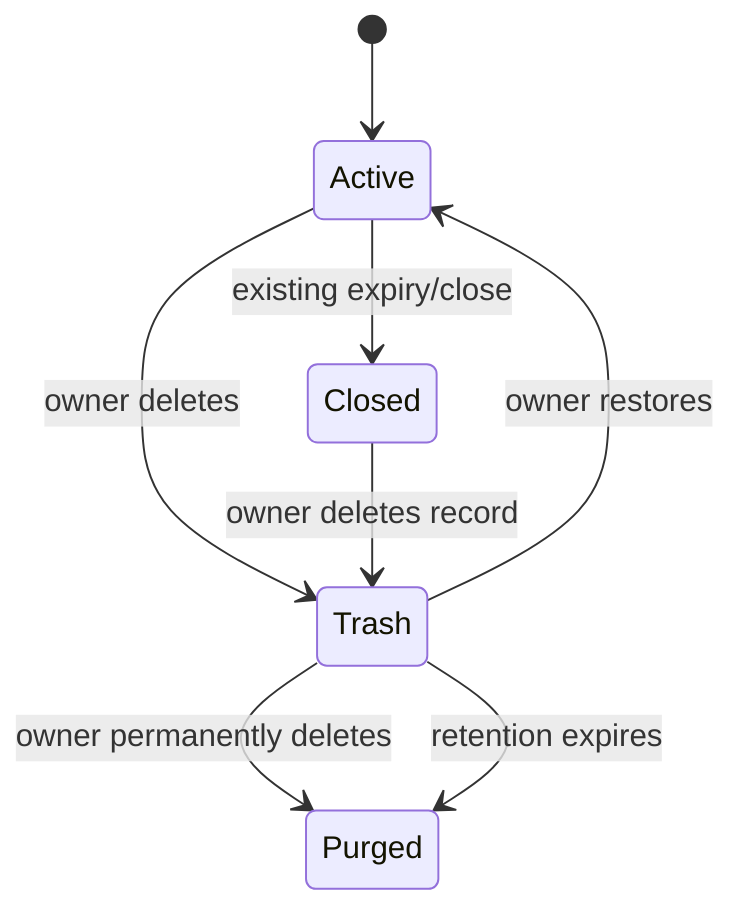

# trash-restore - Plan

## Scope & Non-Goals

- **Goal:** 用户删除自己的个人分享或收集任务后进入回收站，七天内可恢复或彻底删除；恢复只恢复资源归属和文件，不自动重新开启已关闭的公开链接。
- **In scope:** 软删除字段、回收站查询/恢复/彻底删除接口、过期清理、容量统计、旧分享访问阻断、记录删除联动、工作台回收站页面和隔离测试。
- **Non-goals:** 不把团队资源纳入个人回收站；不恢复已被安全策略物理清理的文件；不改变分享过期自动清理的现有宽限规则；不自动重开分享链接。

## Acceptance Criteria

- [ ] 个人分享和收集任务删除后不再能通过旧公开链接访问，但文件仍保留在回收站。
- [ ] 资源所有者可以查看回收站、在七天内恢复或彻底删除；其他账号不能查看、恢复或删除。
- [ ] 恢复后资源内容和容量统计恢复，分享保持关闭状态且旧公开链接不会自动重新开放。
- [ ] 彻底删除和七天到期清理同时删除元数据与文件目录，重复操作幂等且不会删除相邻资源。
- [ ] 团队资源删除、普通分享、收集提交和现有记录回归通过。

## Assumptions & Constraints

- 使用现有 `metadata.shares`、`metadata.collections` 和文件目录，不新增数据库表。
- 回收站保留期首期固定七天，后续可配置；回收站文件继续计入个人容量。
- 所有接口使用现有登录会话和服务端资源归属检查。

## Baseline Tests

| Item | Command | Baseline result |
| --- | --- | --- |
| Share regression | `node scripts/verify-share-suite.mjs` | 46 项通过 |
| Collection regression | `node scripts/verify-collection-suite.mjs` | 基线脚本可运行 |
| Build | `npx vite build` | 通过，已有大 chunk 警告 |

## Diagram

## Task Checklist

| ID | Task | Owner | Deps | Done |
| --- | --- | --- | --- | --- |
| T1 | 增加软删除字段、规范化和访问/容量规则 | `[main]` | - | [x] |
| T2 | 增加回收站查询、恢复、彻底删除和自动清理 API | `[main]` | T1 | [x] |
| T3 | 接入收发记录删除联动与工作台回收站界面 | `[main]` | T2 | [x] |
| T4 | 增加隔离接口测试、旧功能回归和测试数据 | `[main]` | T2,T3 | [x] |
| T5 | 生成用户验收说明并等待用户确认 | `[main]` | T4 | [ ] |

## Risks & Rollback

| Risk | Likelihood / Impact | Mitigation | Rollback |
| --- | --- | --- | --- |
| 旧链接误开放 | med / high | 访问路由统一拒绝 `deletedAt`；恢复只清软删除字段并保持 closed | 回滚新接口，保留旧资源字段 |
| 回收站占满容量 | med / med | 继续计入容量，明确七天期限，定时清理 | 停止新入口，手动执行清理 |
| 并发恢复/彻底删除 | med / high | 资源对象引用校验、幂等状态检查、物理删除后再改元数据 | 保留资源记录供重试 |

## Change Log

| Time | Task ID | File / Task | Change | By |
| --- | --- | --- | --- | --- |
| 2026-10-24 16:30 | T1 | 计划与生命周期规则 | 明确七天保留、容量计入、恢复不重开链接 | main-agent |
| 2026-10-24 16:45 | T1 | server/services/trash.js, server/routes/shares.js | 增加软删除字段、旧链接阻断和容量保留规则 | main-agent |
| 2026-10-24 16:50 | T2 | server/routes/account.js, server.mjs | 增加回收站查询、恢复、彻底删除和自动清理 | main-agent |
| 2026-10-24 16:55 | T3 | src/pages/records.jsx, src/styles/app-main.css | 收发记录中心增加回收站面板和恢复/彻底删除操作 | main-agent |
| 2026-10-24 17:00 | T4 | scripts/verify-trash-suite.mjs | 隔离验证删除、隔离、恢复不重开链接和彻底删除 | main-agent |
| 2026-10-24 17:05 | T5 | docs/verification | 生成用户验收步骤，等待真实账号验收 | main-agent |

## Verification Evidence

| Time | Command | Result | Notes |
| --- | --- | --- | --- |
| 2026-10-24 16:45 | `npm run test:trash` | PASS | 回收站删除、隔离、恢复不重开链接和彻底删除通过 |
| 2026-10-24 16:50 | `node scripts/verify-share-suite.mjs` | PASS：46/46 | 普通分享回归通过 |
| 2026-10-24 16:50 | `node scripts/verify-collection-suite.mjs` | PASS：91/91 | 收集任务回归通过 |
| 2026-10-24 16:50 | `node scripts/verify-team-suite.mjs` | PASS：187/187 | 团队资源删除和权限回归通过 |
| 2026-10-24 17:00 | `npx vite build` | PASS | 仅保留原有大 chunk 警告 |

## Bug & Fix Log

| Time | Symptom | Root cause | Fix (files) | Guard added |
| --- | --- | --- | --- | --- |
| | | | | |

## Completion Summary

开发和自动化测试已完成，用户验收尚未完成；因此本计划保持 `status: active`、`verification_status: partial`。

## Next Steps

- 等待用户按 `docs/verification/回收站与文件恢复-开发测试验收说明-2026-10-24.md` 完成真实账号验收。

