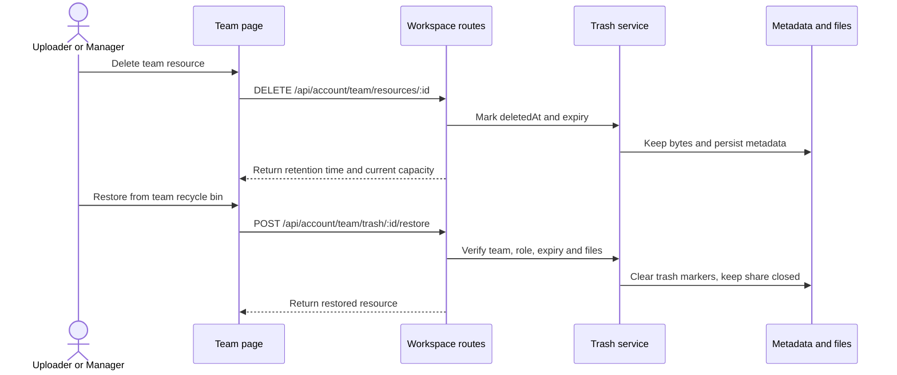

plan_id: 20261026-103737-team-trash-recovery
title: team-trash-recovery
goal: Add a team-scoped recycle bin for deleted team shares with secure restore, manager-only permanent deletion, and seven-day automatic cleanup.
status: completed
verification_status: passed
owner: main-agent
repo_root: D:/demo/鲲穹文件传输/kunqiong-file-transfer-web-main/kunqiong-file-transfer-web-main
branch: refactor/split-monoliths
base_sha: 8c90c7a
created: 2026-10-26 10:37
updated: 2026-10-26 11:32
supersedes: ""
---

# 团队回收站实施计划

## Scope & Non-Goals

- **Goal:** 团队文件资源删除后进入团队回收站，团队成员按权限查看和恢复，管理员可永久删除，7 天后自动清理。
- **In scope:** `server/services/trash.js`、`server/routes/workspace.js`、`server/services/shares.js`、`src/pages/team.jsx`、`src/styles/app-team.css`、相关团队 API/UI 验证脚本。
- **Non-goals:** 不实现单个文件从多文件分享中拆除；不恢复公开分享链接的可下载状态；不改变个人回收站行为；不增加第三方依赖。

## Acceptance Criteria

- [x] 删除团队资源只设置回收站标记，文件仍留存 7 天；公开链接立即失效，团队容量在彻底删除或到期清理前持续计入。
- [x] 团队管理员可查看本团队全部回收站资源；普通成员只可查看自己上传的资源。
- [x] 资源上传者或当前团队管理员可恢复资源；恢复后资源回到团队文件列表但保持关闭，须由有权成员另行开启分享。
- [x] 只有当前团队管理员可永久删除；跨团队、非成员、无效会话均不能查看或操作资源。
- [x] 到期清理会移除文件、元数据和失效记录；清理失败或恢复失败不会误删元数据。
- [x] 团队页面提供独立的“回收站”页签，显示删除时间、自动清理时间和操作；移动端可用并遵守减少动态效果设置。
- [x] 上传同一路径的新文件不被回收站旧文件阻止；个人回收站和现有团队权限测试保持通过。

## Assumptions & Constraints

- 团队资源以 `metadata.shares` 中 `teamResource` 分享为单位，删除一次将整组分享文件移入回收站。
- 复用个人回收站的 7 天保留设置和现有团队页签/权限机制；回收站文件继续计入团队存储容量。
- 仅当前团队上传者与团队管理员可查看/恢复该资源，永久删除仅管理员可执行。
- 恢复不重新开放公开链接，避免旧链接在恢复时意外重新生效。

## Baseline Tests

| Item | Command | Baseline result (at start) |
| --- | --- | --- |
| Personal trash | `npm run test:trash` | PASS: delete, isolation, restore and permanent deletion |
| Team API suite | `node scripts/verify-team-suite.mjs` | PASS: 187 assertions; includes hard-delete behavior to be updated |
| Frontend build | `npx vite build` | PASS; existing chunk-size warning (>500 kB) |
| Commit / ref | `git rev-parse --short HEAD` | `8c90c7a` on `refactor/split-monoliths` |

## Diagram

## Task Checklist

| ID | Task | Owner | Deps | Done |
| --- | --- | --- | --- | --- |
| T1 | Implement team-scoped soft delete, list, restore, manager-only permanent deletion, expiry cleanup and upload-path reuse | `[main]` | - | [x] |
| T2 | Add team recycle-bin tab with loading/empty/error states, retention guidance and authorized actions | `[main]` | T1 | [x] |
| T3 | Update team API/UI tests, add trash-specific permission/retention/recovery assertions, run regression/build checks | `[main]` | T1, T2 | [x] |

## Risks & Rollback

| Risk | Likelihood / Impact | Mitigation | Rollback |
| --- | --- | --- | --- |
| Old links become usable after restore | Low / High | Restore leaves resource closed and tests confirm download remains unavailable | Revert route/service/UI changes; existing records remain in metadata |
| Retained files consume team quota for 7 days | Medium / Medium | Show explicit capacity/retention note; permanent deletion and expiry cleanup release quota | Use manager permanent-delete action or revert feature after preserving trashed files |
| Unauthorized cross-team access to trashed files | Low / High | Resolve current organization server-side and compare fixed teamOrganizationId on every request | Revert API change and retain current hard-delete behavior |

## Blockers

- None.

---

## Change Log

| Time (YYYY-MM-DD HH:mm) | Task ID | File / Task | Change | By |
| --- | --- | --- | --- | --- |
| 2026-10-26 11:32 | T1 | `server/services/trash.js`, `server/routes/workspace.js`, `server/services/shares.js` | Added team-scoped trash listing, soft-delete, restore, admin-only permanent deletion, seven-day cleanup, audit records and same-path upload reuse | `[main]` |
| 2026-10-26 11:32 | T2 | `src/pages/team.jsx`, `src/styles/app-team.css` | Added a dedicated team recycle-bin tab with retention/capacity guidance, role-aware actions, restore and permanent-delete confirmation | `[main]` |
| 2026-10-26 11:32 | T3 | `scripts/verify-team-suite.mjs`, `scripts/verify-team-ui.mjs` | Added API permission/retention/cross-site checks and member/admin UI coverage; all planned verification passed | `[main]` |

## Verification Evidence

| Time | Command | Result | Notes (regression vs. pre-existing) |
| --- | --- | --- | --- |
| 2026-10-26 11:32 | `npm run test:team` | PASS | API 210 assertions; permissions 196; team UI 282; entitlement UI 2/2; no failures |
| 2026-10-26 11:32 | `npm run test:trash` | PASS | Personal trash delete, isolation, restore-with-link-closed and permanent-delete regression |
| 2026-10-26 11:32 | `npx vite build` | PASS | Production build succeeded; existing warning for chunks larger than 500 kB remains |
| 2026-10-26 11:32 | `git diff --check` | PASS | No whitespace errors |

## Bug & Fix Log

| Time | Symptom | Root cause | Fix (files) | Guard added (test/assert/check) |
| --- | --- | --- | --- | --- |

## Completion Summary

Implemented and verified the team recycle bin. Team-resource deletion now retains files for seven days, invalidates public links, and keeps retained bytes counted against team capacity. Uploaders can restore their own items, while current team administrators can review all team items and permanently delete them. Restored resources remain closed until sharing is explicitly enabled again. Expired items are cleaned up, and the UI provides a dedicated team tab with role-aware controls and retention details.

## Next Steps

- Manual acceptance: open `http://localhost:8045/team?tab=trash` while signed in as a team member and as an administrator; verify restore, admin-only permanent deletion, retained capacity, and that restored sharing stays closed.
