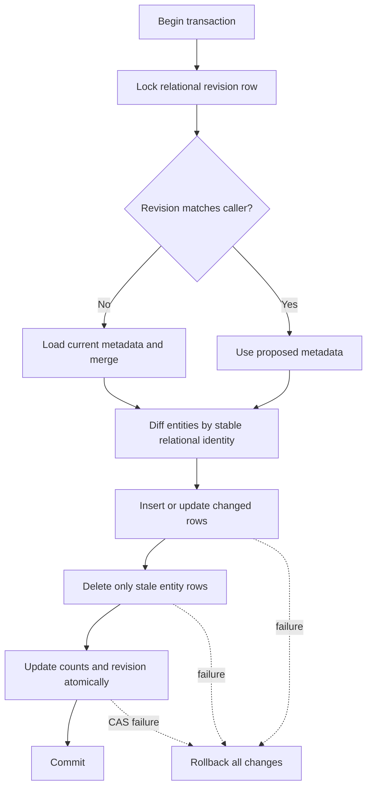

# Relational Incremental Sync - Plan

## Scope & Non-Goals

- **Goal (one sentence):** Replace full relational-table rebuilds with transactional row-level synchronization and verify concurrency, capacity, and rollback recovery.
- **In scope:** `server/db/relational-store.js`, database tests/harness under `scripts/db/`, and operational database documentation.
- **Non-goals (explicit):** Change business APIs, remove the compatibility metadata model, rewrite audit storage, or alter existing production-like database contents outside namespaced test fixtures.

## Acceptance Criteria

- [x] Existing rows retain internal IDs; unchanged rows are not updated; inserted, changed, and removed entities are synchronized by stable identity within one transaction.
- [x] A failed relational write rolls back all entity changes and the revision update; concurrent writers retain both independent changes without duplicate rows.
- [x] Local-only synthetic capacity/concurrency/recovery checks leave managed table counts and the committed metadata revision unchanged after cleanup/rollback.
- [x] Targeted database tests, database-backed verification, build, and a local app health check pass; results and limits are recorded.
- [x] Warm same-revision saves reuse process-local row state and avoid full managed-table reads; failed transactions do not publish the updated cache.
- [x] A bounded synthetic dump/restore check verifies the relational schema and application read path after restore; temporary databases are removed.

## Assumptions & Constraints

- **Assumptions:** The existing 20 managed InnoDB tables and their unique keys are authoritative; `mysql2` and compatibility metadata remain in use. The revision row serializes application writers.
- **Constraints:** Preserve unrelated user changes and current data. Do not drop/recreate live managed tables or benchmark with unbounded production-like load. Use isolated, clearly namespaced synthetic records and rollback or cleanup them in `finally`.

## Baseline Tests

_Capture the starting state BEFORE changing code so later failures can be told apart
from pre-existing ones. Testing policy (see the skill): safe, fast, local, targeted
tests may run automatically; slow, paid, external, or destructive suites need the
user's go-ahead first. Record what was actually run vs. deferred._

| Item | Command | Baseline result (at start) |
| --- | --- | --- |
| Build | `npm run build` | Deferred until implementation |
| Tests | `npm run test:db-schema` | 6 passed, 0 failed |
| Commit / ref | `git rev-parse --short HEAD` | `70a7670` |

## Diagram

_Pick the diagram type that fits the work (see the skill's "choose a diagram" guidance):
`sequenceDiagram` for call chains, `flowchart` for branching/pipelines/dependencies,
`stateDiagram-v2` for lifecycles. Design the flow BEFORE writing code. Keep it honest:
update it if the real design drifts. Omit this section for tasks with no explanatory
value (docs, config bumps) and say so._

---

## Task Checklist

Each task has a stable **ID** (`T1`, `T2`, ...) and a **Deps** list referencing other IDs.
`[main]` runs sequentially in the main agent. `[sub-agent]` MAY be delegated only if the
delegation conditions in the skill hold (tools available, permission granted, stable
interface, non-overlapping file ownership); otherwise run it in the main thread too.

| ID | Task | Owner | Deps | Done |
| --- | --- | --- | --- | --- |
| T1 | Implement identity-aware row synchronization, no-op detection, revision-bound row caching, stale-row deletion, and atomic counts in `server/db/relational-store.js` | `[main]` | - | [x] |
| T2 | Add regression tests for no-op, insert/update/delete, conflict merge, and rollback | `[main]` | T1 | [x] |
| T3 | Add bounded local database harness for concurrency, 5,000-row capacity smoke, rollback, and isolated backup/restore checks | `[main]` | T1,T2 | [x] |
| T4 | Run database and feature regressions, build, live DB checks, health-check app, and record evidence | `[main]` | T1,T2,T3 | [x] |

> A task that depends on an unfinished interface is NOT independent. Give it a `Deps`
> entry on the task that stabilizes the interface, or lock the interface contract first
> and then allow parallel work.

## Sub-agent Registry

_Add a row immediately before starting each delegated attempt. Only the main agent edits
this registry. Sub-agents report checkpoints; they do not edit the shared plan. On task
resume, reconcile these rows with the task checkboxes, repository diff, and live agent
state. Resume only unchecked tasks with non-terminal attempts. A blocked attempt waits
until its blocker is resolved._

| Task ID | Agent Ref | Status | Integration | Owned Files | Checkpoint / Next Action | Updated |
| --- | --- | --- | --- | --- | --- | --- |
| | | | | | | |

_Terminal attempts (`completed`, `failed`, `cancelled`, `superseded`) are never
automatically resumed. If a completed attempt has `integration=pending`, the main agent
reviews and integrates its result instead of restarting it. If an old running/interrupted
agent is unavailable after a new session, mark it `superseded` and create a new row for
the replacement rather than reusing its identity._

## Risks & Rollback

| Risk | Likelihood / Impact | Mitigation | Rollback |
| --- | --- | --- | --- |
| Parent/child rows are synchronized in the wrong order | medium / high | Preserve the mapper's parent-first insertion and child-first deletion ordering; test submissions and distribution links | Roll back the encompassing transaction |
| Ciphertext randomness causes needless writes | high / medium | Compare encrypted payloads by decrypting with their existing context, and test no-op persistence | Keep previous writer behavior while fixing comparator |
| Test harness touches live business records | low / high | Use a scratch database or rollback-only namespaced fixtures; assert baseline revision/counts before and after | Drop only the unique scratch database created by the harness |

## Blockers

_Open questions or external dependencies stopping progress. Empty when unblocked._

- No matching database plan existed; this plan starts from the current uncommitted relational-store implementation.

---

## Change Log

_Append one row after completing EACH task - including sub-agent work (fold their
reported rows in here after reviewing the diff). Write it as you finish, never in a batch._

| Time (YYYY-MM-DD HH:mm) | Task ID | File / Task | Change | By |
| --- | --- | --- | --- | --- |
| 2026-10-29 19:05 | T0 | Baseline | Confirmed target DB suite baseline: 6 passed; found no matching active DB plan | main |
| 2026-10-29 19:34 | T1 | `server/db/relational-store.js` | Added stable-key row sync, semantic encrypted-payload no-op comparison, stale child-first deletes, transactional count/revision CAS | main |
| 2026-10-29 19:34 | T2 | `scripts/db/verify-relational-sync.mjs` | Added rollback-only real-MySQL tests for no-op, stable PKs, CRUD, merge, lock serialization, rollback and 1,000-row smoke test | main |
| 2026-10-29 19:34 | T3 | `package.json`, DB docs | Added runnable local DB test command and recorded measured capacity/verification boundaries | main |
| 2026-10-29 20:06 | T1 | `server/db/relational-store.js` | Warm saves now clone and update a revision-bound row cache instead of scanning every managed table; cache publishes only after commit | main |
| 2026-10-29 20:06 | T2 | `scripts/db/relational-store.test.mjs` | Added test proving cache hits issue no table reads and no-op sync issues no row writes | main |
| 2026-10-29 20:06 | T3 | `scripts/db/verify-relational-sync.mjs`, `scripts/db/verify-relational-backup-restore.mjs`, `package.json`, DB docs | Added 5,000-user rollback-only capacity smoke and isolated MySQL dump/restore verification | main |
| 2026-10-29 20:06 | T4 | Database and feature suites | Ran database, CAS, six-feature, build, live DB, and local health checks; recorded limitations | main |
| 2026-10-29 20:16 | T3 | `scripts/db/verify-relational-backup-restore.mjs` | Tightened cleanup ordering and asserted both scratch databases are gone before reporting success | main |
| 2026-10-29 20:16 | T4 | `docs/数据库设计-2026-10-29/*`, `plan/20261029-190556-relational-incremental-sync-Plan.md` | Updated current DB docs and verified the new server instance on 8046 while preserving the existing 8045 service | main |

## Verification Evidence

_Filled during/after the acceptance pass. Record the exact command and its real result,
plus the diff between baseline and now. Distinguish new regressions from pre-existing
failures carried over from Baseline Tests. Set `verification_status` in the frontmatter:
`verified` (all acceptance criteria checked by tests/build), `partial` (some verified,
rest deferred - list which), or `not-run` (nothing run - say why + residual risk)._

| Time | Command | Result | Notes (regression vs. pre-existing) |
| --- | --- | --- | --- |
| 2026-10-29 19:05 | `npm run test:db-schema` | 6 passed, 0 failed | Baseline before code edits |
| 2026-10-29 19:34 | `npm run test:db-schema` | 6 passed, 0 failed | After incremental write change |
| 2026-10-29 20:05 | `npm run test:db-schema` | 7 passed, 0 failed | Includes no-full-table-read cache regression |
| 2026-10-29 20:05 | `npm run test:db-relational-sync` | Passed | Warm cache; 590 rows unchanged; 5,000 synthetic users; 5,590-row no-op ~201 ms and one-row update ~221 ms; all test writes rolled back; revision unchanged |
| 2026-10-29 20:05 | `npm run test:db-backup-restore` | Passed | Isolated synthetic schema dump and restore; one user verified by application reader; both scratch databases and dump file removed |
| 2026-10-29 20:16 | `npm run test:db-backup-restore` | Passed | Re-run after cleanup hardening; both random databases confirmed absent before success was reported |
| 2026-10-29 19:34 | `npm run verify:metadata-cas` | 12/12 passed | Two-process metadata CAS/merge regression in isolated filesystem fixture |
| 2026-10-29 20:06 | `npm run verify:metadata-cas` | 12/12 passed | Re-run after relational cache change |
| 2026-10-29 20:05 | `npm run test:six-features` | Passed | Collection, handover, distribution, trash, team, branding, 14 end-to-end cases, manual verification, and production build passed |
| 2026-10-29 20:06 | `GET http://127.0.0.1:8045/api/health` | HTTP 200, `ok: true` | Existing service was already bound to 8045; new process loaded relational revision 5 then exited on `EADDRINUSE` |
| 2026-10-29 20:16 | `GET http://127.0.0.1:8046/api/health`, `GET /` | HTTP 200, `ok: true` | Current-code server loaded relational revision 5; remains available because 8045 is occupied |
| 2026-10-29 20:06 | Read-only MySQL state check | Passed | Relational mode enabled; revision 5, source snapshot revision 43, all 20 managed table counts matched |

## Bug & Fix Log

_When a bug is reported (especially AFTER the project was marked complete), record it
here after fixing, so the same error logic is not repeated next time._

| Time | Symptom | Root cause | Fix (files) | Guard added (test/assert/check) |
| --- | --- | --- | --- | --- |
| | | | | |

## Completion Summary

Relational writes now synchronize only changed rows on the normal warm-save path, reuse a revision-bound in-process row cache, and serialize cross-process conflicts under the state-row lock. Database transaction, bounded capacity, backup/restore, feature regressions, build, and health checks passed. The compatibility object remains in application memory by design; production-scale load, HA failover, and restoration of a real production backup remain deployment exercises.

<!-- filled in at close-out -->

## Next Steps

_Always keep ONE explicit next action here so any agent resuming knows exactly where to
start. Update it every time you stop._

- Before production release, run target-volume sustained concurrency, failover, and real backup-media recovery in an isolated staging environment.
