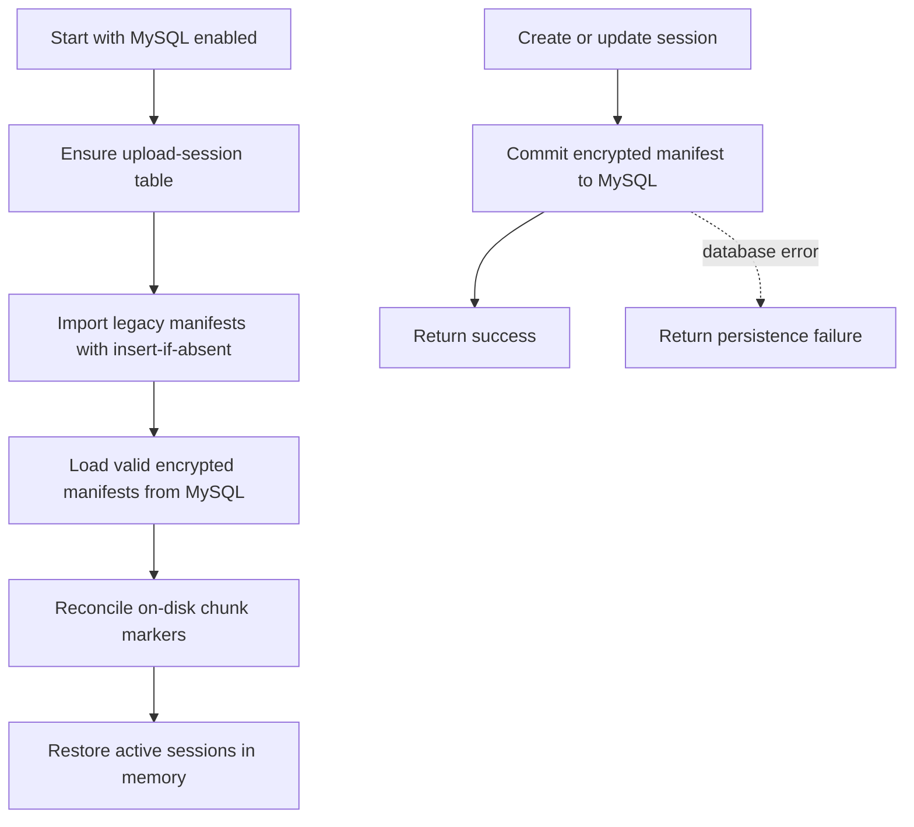

# Runtime JSON State To MySQL - Plan

## Scope & Non-Goals

- **Goal:** Ensure active application JSON persistence is represented in MySQL and verify startup recovery and writes.
- **In scope:** Upload session manifest persistence, idempotent import of legacy `storage/tmp/upload-sessions/*/session.json`, relational DDL, tests, and current database documentation.
- **Non-goals:** Move file bytes or upload chunks into MySQL; import stale backup snapshots as live records; delete recovery backups; replace the in-memory compatibility metadata model.

## Acceptance Criteria

- [x] Runtime relational mode never writes new upload session manifests to JSON; a fresh server process restores sessions from MySQL.
- [x] Existing JSON manifests are imported idempotently, with MySQL rows taking precedence and encrypted manifest content.
- [x] Session create/update/cancel/expiry operations preserve current API behavior and fail visibly when MySQL persistence fails.
- [x] Current business metadata and retained audit logs remain present in MySQL; legacy snapshots remain recovery-only.
- [x] Isolated MySQL tests cover migration, reload, update precedence, cancellation, expiry, and database failure; application and targeted regression checks pass.

## Assumptions & Constraints

- **Assumptions:** Relational MySQL mode is enabled in the current local configuration. Active metadata and audit logs already reside in MySQL; upload manifests are the remaining runtime JSON source.
- **Constraints:** Preserve user changes and current database contents. Do not import historical backup snapshots into current business tables. Keep uploaded bytes and chunk marker files on disk.

## Baseline Tests

| Item | Command | Baseline result |
| --- | --- | --- |
| Relational DB | Read-only row counts and revision query | Connected; revision 6; 20 managed business tables |
| Audit parity | Logical retained local audit IDs compared with MySQL | 5,000 retained local IDs; 0 missing in MySQL |
| Upload manifests | Count active temporary session directories and JSON manifests | 0 directories; 0 manifests |
| Unit tests | `npm run test:db-schema` | Not run in this task yet |

## Diagram

## Task Checklist

| ID | Task | Owner | Deps | Done |
| --- | --- | --- | --- | --- |
| T1 | Add encrypted MySQL upload-session repository and schema | `[main]` | - | [x] |
| T2 | Migrate legacy manifests and switch runtime session lifecycle to MySQL | `[main]` | T1 | [x] |
| T3 | Add isolated MySQL lifecycle and migration regression checks | `[main]` | T1,T2 | [x] |
| T4 | Run targeted regressions, build, and local DB consistency checks; update docs | `[main]` | T1,T2,T3 | [x] |

## Sub-agent Registry

| Task ID | Agent Ref | Status | Integration | Owned Files | Checkpoint / Next Action | Updated |
| --- | --- | --- | --- | --- | --- | --- |
| | | | | | | |

## Risks & Rollback

| Risk | Likelihood / Impact | Mitigation | Rollback |
| --- | --- | --- | --- |
| A migrated manifest differs from the latest MySQL row | medium / high | Insert only when absent; always load MySQL after migration | Restore the preserved session JSON and remove only the new upload-session row if needed |
| Upload bytes exist but session metadata commit fails | low / high | Return an error and keep disk chunks for retry; do not acknowledge an unpersisted session | Retry persistence or remove the isolated session directory after reporting failure |

## Blockers

- None known.

## Change Log

| Time | Task ID | File / Task | Change | By |
| --- | --- | --- | --- | --- |
| 2026-10-29 20:29 | T0 | Baseline | Confirmed active metadata and retained audit logs are in MySQL; found no active upload sessions and identified JSON manifests as the remaining persistent runtime JSON state | main |
| 2026-10-29 20:35 | T1 | `server/db/upload-session-store.js`, relational schema, DB tests | Added encrypted upload manifest repository, idempotent insert support, schema validation, and a new `kq_upload_session` table | main |
| 2026-10-29 20:45 | T2 | `server/services/shares.js`, `server/routes/upload.js`, `server.mjs` | Imported legacy session JSON at startup, made MySQL authoritative for new and resumed sessions, and wired lifecycle changes and cancellation to encrypted database rows | main |
| 2026-10-29 20:55 | T3 | `scripts/db/upload-session-store.test.mjs` | Covered idempotent import, encrypted reload/update, expiry, delete, and database write failure using an isolated temporary table | main |
| 2026-10-29 21:13 | T4 | Runtime JSON verification and database docs | Verified a real upload through a fresh server process on a temporary port; updated current table/data counts and documented local-only and filesystem state boundaries | main |

## Verification Evidence

| Time | Command | Result | Notes |
| --- | --- | --- | --- |
| 2026-10-29 20:29 | Read-only MySQL and local audit comparison | Connected; relational revision 6; no retained local audit IDs missing; no upload sessions present | No database mutation |
| 2026-10-29 20:35 | `npm run test:db-upload-sessions` | 1 passed | Uses a connection-local temporary MySQL table; no persistent table or data modified |
| 2026-10-29 21:00 | Live upload-session integration on 8047 plus fresh server process | Passed | Created a session (201), wrote a 3-byte chunk (200), verified encrypted MySQL row and no `session.json`, restored uploaded chunk index 0 in a fresh process, then cancelled (204) and verified row and temporary directory removal |
| 2026-10-29 21:02 | `npm run test:db-upload-sessions` | 1 passed | Idempotent legacy import, new-store reload, MySQL precedence, encrypted payload, update, expiry, delete, and failed write |
| 2026-10-29 21:02 | `npm run test:db-schema` and `npm run db:schema:check` | 8 tests passed; 21 relational DDL tables validated | Static schema validation; runtime database counts checked separately |
| 2026-10-29 21:03 | `npm run test:upload` | 72 upload checks and 106 cancellation/notification UI checks passed | Existing chunk/restart and cancellation regression suite |
| 2026-10-29 21:13 | Read-only MySQL state verification and `GET /api/health` on 8047 | Passed | DB and relational mode enabled; 26 physical tables; revision 8 from source snapshot revision 43; 590 records across 20 managed tables; 5,800 audit entries in both audit tables at verification time; 0 upload-session rows after test cleanup; health HTTP 200 |

## Bug & Fix Log

| Time | Symptom | Root cause | Fix (files) | Guard added |
| --- | --- | --- | --- | --- |
| | | | | |

## Completion Summary

All active server-side persistent JSON-backed application state is stored in MySQL in relational mode: business entities in managed tables, audit entries in MySQL audit tables, and encrypted resumable-upload manifests in `kq_upload_session`. Legacy snapshot/audit files remain as recovery or local-mode data; browser drafts and file bytes remain outside the server database by design.

## Next Steps

- Keep MySQL relational mode enabled for the database-backed deployment; retain local JSON and file backups until a separately planned retention/restore policy authorizes their archival.
