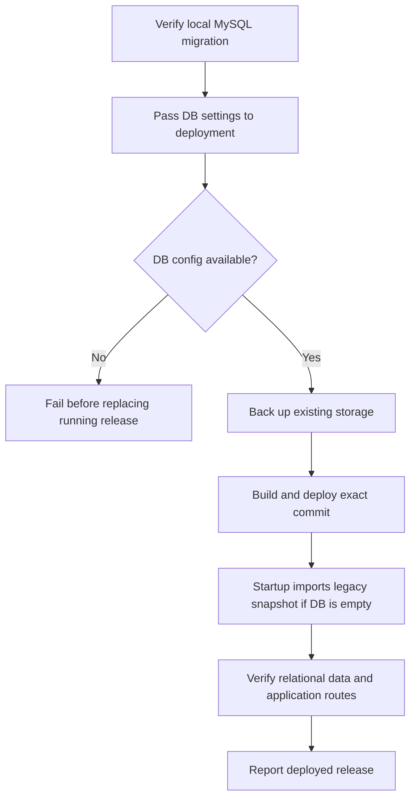

# Relational JSON Release - Plan

## Scope & Non-Goals

- **Goal (one sentence):** Deploy the current release to the Gitea test server with MySQL relational mode enabled and confirm migrated business state is served from MySQL.
- **In scope:** Verify local migration state; pass MySQL connection settings through test deployment; fail closed without DB configuration; verify deployed DB state; commit and push the intended release.
- **Non-goals (explicit):** Move uploaded file bytes or browser-only caches into MySQL; delete JSON recovery backups; redesign the relational schema; deploy to production.

## Acceptance Criteria

- [x] Local MySQL relational mode is enabled; managed rows load, source snapshot revision is recorded, audit source/mirror counts match, and upload-session manifests are stored in MySQL.
- [x] Test deployment passes DB settings and requires relational mode; it cannot silently start in JSON mode.
- [ ] Post-deploy verification confirms exact release, MySQL connectivity, relational revision, migrated data, audit parity, and core routes.
- [x] Targeted tests/build pass.
- [x] Intended changes are committed and pushed to Gitea `main`.

## Assumptions & Constraints

- **Assumptions:** Gitea `main` is the test deployment target; server-side MySQL settings come from repository Secrets or existing server configuration. Local DB migration is complete.
- **Constraints:** Keep recovery snapshots and uploaded file bytes on disk; never stage `.env`, DB dumps, credentials, generated backups, or one-off scratch files. Production is out of scope.

## Baseline Tests

_Capture the starting state BEFORE changing code so later failures can be told apart
from pre-existing ones. Testing policy (see the skill): safe, fast, local, targeted
tests may run automatically; slow, paid, external, or destructive suites need the
user's go-ahead first. Record what was actually run vs. deferred._

| Item | Command | Baseline result (at start) |
| --- | --- | --- |
| Build | `npx vite build` | Passed at baseline; existing large viewer chunk warning. |
| UI tests | `node scripts/verify-collection-layout.mjs`; `node scripts/verify-collection-fields-ui.mjs` | Passed; 38 custom-field UI assertions. |
| Database | Read-only local MySQL state query | Passed: 26 tables, source revision 43, 7,112 audit rows mirrored, 2 MySQL upload sessions, no legacy session manifests. |
| Commit / ref | `git rev-parse --short HEAD` | `70a7670`; pending changes from earlier authorized tasks. |

## Diagram

_Pick the diagram type that fits the work (see the skill's "choose a diagram" guidance):
`sequenceDiagram` for call chains, `flowchart` for branching/pipelines/dependencies,
`stateDiagram-v2` for lifecycles. Design the flow BEFORE writing code. Keep it honest:
update it if the real design drifts. Omit this section for tasks with no explanatory
value (docs, config bumps) and say so._

---

## Task Checklist

Each task has a stable **ID** (`T1`, `T2`, ...) and a **Deps** list referencing other IDs.
`[main]` runs sequentially in the main agent. `[sub-agent]` MAY be delegated only if the
delegation conditions in the skill hold (tools available, permission granted, stable
interface, non-overlapping file ownership); otherwise run it in the main thread too.

| ID | Task | Owner | Deps | Done |
| --- | --- | --- | --- | --- |
| T1 | Reconcile local MySQL state and legacy JSON boundaries | `[main]` | - | [x] |
| T2 | Preserve/pass DB configuration and fail closed before deployment | `[main]` | T1 | [x] |
| T3 | Extend deployment verification to require relational MySQL state | `[main]` | T2 | [x] |
| T4 | Run deploy, migration, targeted feature tests and build | `[main]` | T2,T3 | [x] |
| T5 | Stage and commit only the intended deployment, responsive UI, test and plan files | `[main]` | T4 | [x] |
| T6 | Push the reviewed commit to Gitea `main` after remote DB settings are available | `[main]` | T5 | [x] |
| T7 | Verify test deployment release and database-backed state | `[main]` | T6 | [ ] |

> A task that depends on an unfinished interface is NOT independent. Give it a `Deps`
> entry on the task that stabilizes the interface, or lock the interface contract first
> and then allow parallel work.

## Sub-agent Registry

_Add a row immediately before starting each delegated attempt. Only the main agent edits
this registry. Sub-agents report checkpoints; they do not edit the shared plan. On task
resume, reconcile these rows with the task checkboxes, repository diff, and live agent
state. Resume only unchecked tasks with non-terminal attempts. A blocked attempt waits
until its blocker is resolved._

| Task ID | Agent Ref | Status | Integration | Owned Files | Checkpoint / Next Action | Updated |
| --- | --- | --- | --- | --- | --- | --- |

_Terminal attempts (`completed`, `failed`, `cancelled`, `superseded`) are never
automatically resumed. If a completed attempt has `integration=pending`, the main agent
reviews and integrates its result instead of restarting it. If an old running/interrupted
agent is unavailable after a new session, mark it `superseded` and create a new row for
the replacement rather than reusing its identity._

## Risks & Rollback

| Risk | Likelihood / Impact | Mitigation | Rollback |
| --- | --- | --- | --- |
| Missing or incorrect test-server DB settings | medium / high | Preserve existing DB config, inject secret-backed values, and validate connectivity before changing containers | Fail before deployment; keep the running service and recovery backup |
| Existing DB differs from the expected migration source | low / high | Keep additive schema migration and verify revision/counts/audit parity | Restore previous image and storage backup; do not delete DB rows |

## Blockers

_Open questions or external dependencies stopping progress. Empty when unblocked._

- None. The five database connection values are now configured as repository Actions Secrets; the password is not stored in Git or this plan.

---

## Change Log

_Append one row after completing EACH task - including sub-agent work (fold their
reported rows in here after reviewing the diff). Write it as you finish, never in a batch._

| Time (YYYY-MM-DD HH:mm) | Task ID | File / Task | Change | By |
| --- | --- | --- | --- | --- |
| 2026-10-30 11:20 | T1 | Local MySQL and storage audit | Confirmed relational mode, 26 tables, revision 59/source revision 43, 7,112 audit rows in both tables, 2 upload sessions in MySQL and zero `session.json` files. Recovery JSON remains on disk. | main |
| 2026-10-30 11:43 | T2 | `.gitea/workflows/deploy-test.yml`, `scripts/deploy-test.sh` | Passed DB settings through Gitea Secrets, required both database flags and validated connection parameters before replacing the running container. | main |
| 2026-10-30 11:44 | T3 | `scripts/verify-test-deployment.mjs`, `scripts/verify-deploy-release.mjs` | Added relational revision, migrated-row, audit-parity, preserved-data, route, asset and exact-release checks; release gate fixture passed 5/5 cases. | main |
| 2026-10-30 11:48 | T4 | Relational sync, responsive upload toolbar and regression suite | Fixed account-record replay to ignore database-managed `gmt_modified`; moved guest quota and batch distribution into an adaptive grid; database and UI/build checks passed. | main |
| 2026-10-30 | T4 | `scripts/deploy-test.sh`, `scripts/verify-deploy-release.mjs` | Added a secret-safe fallback to the current app container's configuration and verified secret precedence/log redaction; 6 deployment checks pass. The remote app currently has no DB configuration, so fallback alone cannot unblock deployment. | main |
| 2026-10-30 15:06 | T5,T6 | Git release | Committed and pushed `4429b25` to Gitea `main`; Actions run 128 started. No SSH connection used. | main |
| 2026-10-30 15:12 | T7 | Schema compatibility and deployment preflight | Run 128 reached MySQL but failed table-type validation on `kq_user`. Normalize integer display widths only, retain range/precision checks, and inspect existing tables before replacing the service. 14 DB tests and 10 deployment gates pass. | main |
| 2026-10-30 16:05 | T7 | Legacy audit and upload-session startup repair | Runs 129/130 migrated the 20 managed tables but failed while reading the unbounded audit payload query and then stopped on an incompatible upload-session table. Paginate audit mirroring by primary-key batches, reuse canonical column types for upload-session checks, and include that table in the read-only deployment preflight. | main |
| 2026-10-30 16:12 | T7 | Audit backup retention verification | Run 131 has 4,820 matching IDs out of the verifier's 5,000 expected IDs. A focused fixture reproduces that exact overlap when the backup reader selects the latest 5,000 by timestamp but LocalAuditStore retains 180 older critical entries ahead of 5,000 access entries. Make verification use the shared runtime merge policy; rerun deployment to confirm against the retained server backup. | main |
| 2026-10-30 16:25 | T7 | Host verification module dependency | Run after `4e013ff` deployed the release but failed before assertions because importing `metadata-normalizers.js` pulled `mysql2` through `server/state.js`, which is absent on the runner host. Move the shared audit normalizer into a dependency-light module and import that from the host verifier. | main |
| 2026-10-30 16:50 | T7 | Matched audit row query shape | Run after `7913c43` reached the database comparison but failed because the verifier destructured `mysql2.execute()` rows as a single nested record, then called `.map()` on that object. Read the returned row array, and derive unique matched ID counts directly from the source and relational table selections. | main |

## Verification Evidence

_Filled during/after the acceptance pass. Record the exact command and its real result,
plus the diff between baseline and now. Distinguish new regressions from pre-existing
failures carried over from Baseline Tests. Set `verification_status` in the frontmatter:
`verified` (all acceptance criteria checked by tests/build), `partial` (some verified,
rest deferred - list which), or `not-run` (nothing run - say why + residual risk)._

| Time | Command | Result | Notes (regression vs. pre-existing) |
| --- | --- | --- | --- |
| 2026-10-30 | `npx vite build` | Passed | Existing large viewer chunk warning only. |
| 2026-10-30 | `node scripts/verify-collection-layout.mjs` | Passed | Desktop alignment and mobile/modal scrolling. |
| 2026-10-30 | `node scripts/verify-collection-fields-ui.mjs` | 38 passed, 0 failed | Collection field UI and export regressions. |
| 2026-10-30 | Read-only MySQL query via `loadRelationalMetadataFromConnection` | Passed | 26 tables; revision 59/source revision 43; managed row counts and audit parity verified without printing user records. |
| 2026-10-30 | `npm run test:db-schema` | 9 passed, 0 failed | Includes database-managed account-record timestamp regression. |
| 2026-10-30 | `npm run test:db-upload-sessions` | 1 passed, 0 failed | Legacy upload-session import, reload, update, expiry and deletion. |
| 2026-10-30 | `npm run test:db-relational-sync` | Passed | 5,000 synthetic users; no-op, stable IDs, concurrent lock and rollback checks; no durable test rows. |
| 2026-10-30 | `npm run test:db-backup-restore` with local admin override | Passed | Synthetic MySQL dump/restore validated and scratch databases removed. |
| 2026-10-30 | `node scripts/verify-deploy-release.mjs` | 5 passed, 0 failed | Exact release and unhealthy/mismatch rejection cases. |
| 2026-10-30 | `node scripts/verify-collection-layout.mjs`; `node scripts/verify-collection-fields-ui.mjs` | Passed; 38 passed, 0 failed | Existing collection layout and field regressions remain green. |
| 2026-10-30 | `npm run build` | Passed | Manual generation/verification passed; existing large viewer chunk warning only. |
| 2026-10-30 | Browser responsive viewport checks | Passed | 1440px, 1024px, 760px and 390px representative viewports; no toolbar overlap or horizontal overflow. |
| 2026-10-30 | Gitea Actions deployment and remote config inspection | Failed / blocked | Previous run failed before replacement with missing `KUNQIONG_DB_HOST`; the app container and deployment directories have no DB connection values. Local MySQL uses loopback and is not the test server DB. |
| 2026-10-30 | `node scripts/verify-deploy-release.mjs` | 6 passed, 0 failed | Covers existing-container config inheritance and exact release/health gates; secret sentinel is absent from output. |
| 2026-10-30 | `npm run test:db-schema`; `npm run test:db-upload-sessions`; `npm run test:db-relational-sync` | Passed | 9 schema/store tests, 1 upload-session test, and 5,000 synthetic-user transactional sync; no durable synthetic rows. |
| 2026-10-30 | `node scripts/verify-collection-layout.mjs`; `npx vite build`; `git diff --check` | Passed | Responsive layout regression checks and production build; existing large viewer chunk warning remains. |
| 2026-10-30 16:12 | `npm run test:audit`; `npm run test:db-schema`; `node scripts/verify-deploy-release.mjs`; `node scripts/verify-team-handover.mjs`; syntax checks; `git diff --check` | Passed: 10 audit tests, 11 audit persistence checks, 14 database tests, 10 deployment gates and 65 handover cases | New retention regression reproduces the 4,820 overlap locally. The actual server backup still needs the next post-deploy verification run. |
| 2026-10-30 16:25 | Gitea Actions release `4e013ff` | Deploy passed; host verification stopped during module resolution | `mysql2` was imported transitively by the audit normalizer's aggregate module; replace it with the standalone audit normalizer before retrying. |
| 2026-10-30 16:50 | Gitea Actions release `7913c43` | Host verifier loaded; database comparison stopped on the `mysql2.execute()` row-array shape | Select matched IDs as rows and build `Set` counts; local probe and database tests must pass before retry. |
| 2026-10-30 | Read-only Gitea API permission check | Blocked | Repository push access works, but the current account cannot manage Actions Secrets (HTTP 403; owner required). No deployment was triggered. |
| 2026-10-30 | Repository Actions Secrets page | Passed | `KUNQIONG_DB_HOST`, `KUNQIONG_DB_PORT`, `KUNQIONG_DB_NAME`, `KUNQIONG_DB_USER`, and `KUNQIONG_DB_PASSWORD` are present and masked. |
| 2026-10-30 | Database, persistence, release-gate and packaging suite | Passed | 20 tests, 10 release-gate checks, 5,000-user transactional sync, upload-session test, shell syntax and Docker COPY startup check; no synthetic rows retained. |

## Bug & Fix Log

_When a bug is reported (especially AFTER the project was marked complete), record it
here after fixing, so the same error logic is not repeated next time._

| Time | Symptom | Root cause | Fix (files) | Guard added (test/assert/check) |
| --- | --- | --- | --- | --- |
| 2026-10-30 15:12 | Run 128 app restarts during schema bootstrap | Schema comparator treated MySQL integer display width metadata as a different type | Canonicalize integer display widths; add detailed mismatch errors and read-only schema preflight | MySQL 5.7 type fixtures, unsigned/range/precision rejection and SELECT-only preflight tests |
| 2026-10-30 16:05 | Runs 129/130 fail after first relational import | Legacy audit mirroring selected the whole payload table; upload-session validation hid the actual existing field mismatch | Read audit rows with `id > cursor LIMIT 100`, report upload-session field names/types, and preflight all 21 relation tables plus `kq_upload_session` before replacement | 205-row paged mirror test, canonical type checks, upload-session DDL included in SELECT-only preflight |
| 2026-10-30 16:12 | Run 131 verification reports 4820/5000 audit IDs | Probable root cause: backup verification used timestamp-only truncation while runtime prioritizes critical entries; a focused fixture reproduces the exact 4,820 overlap | Reconstruct deployment evidence with the same exported `mergeAuditEntries` policy; emit safe ID-length/type counts if records are still missing | Regression test applies runtime selection to the snapshot+journal fixture and reproduces the old 4,820 overlap |
| 2026-10-30 16:25 | Run after `4e013ff` cannot load the host verifier | Importing the aggregate metadata normalizers loads `server/state.js` and requires `mysql2` on a runner that does not install application dependencies | Put `normalizeAuditLog` in `server/lib/audit-normalizer.js`; preserve its export from `metadata-normalizers.js` and import the lightweight module in host scripts | Host dependency graph no longer references `server/state.js`; audit and syntax checks cover the new module |
| 2026-10-30 16:50 | Run after `7913c43` throws `sourceMatchedRows.map is not a function` | mysql2 `execute()` returns `[rows, fields]`; nested destructuring selected the first row object instead of the result row array | Use `[rows]` for ID selections and count distinct matches with `Set` | Deployment verifier parses and checks its generated probe before container execution; re-run it against MySQL |

## Completion Summary

_Leave empty until the acceptance pass is done. Then fill in: what was built, key
decisions, what was verified (and how), verification_status rationale, anything deferred._

Migration work resumed on 2026-10-30 after the user supplied the test database connection details. Release `4429b25` was committed and pushed. Actions run 128 reached MySQL but failed schema type validation; compatibility repair is tested locally. Migration completion and remote acceptance remain unverified.

## Next Steps

_Always keep ONE explicit next action here so any agent resuming knows exactly where to
start. Update it every time you stop._

- Commit and push the matched-row result-shape fix, then confirm the next Actions run passes both the backup audit comparison and relational audit parity checks.
