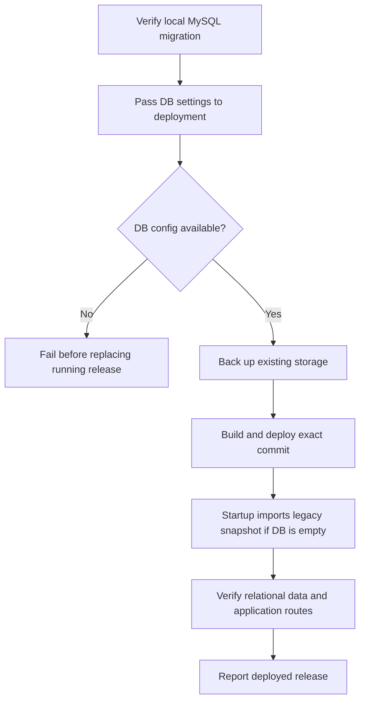

# Relational JSON Release - Plan

## Scope & Non-Goals

- **Goal (one sentence):** Deploy the current release to the Gitea test server with MySQL relational mode enabled and confirm migrated business state is served from MySQL.
- **In scope:** Verify local migration state; pass MySQL connection settings through test deployment; fail closed without DB configuration; verify deployed DB state; commit and push the intended release.
- **Non-goals (explicit):** Move uploaded file bytes or browser-only caches into MySQL; delete JSON recovery backups; redesign the relational schema; deploy to production.

## Acceptance Criteria

- [x] Local MySQL relational mode is enabled; managed rows load, source snapshot revision is recorded, audit source/mirror counts match, and upload-session manifests are stored in MySQL.
- [x] Test deployment passes DB settings and requires relational mode; it cannot silently start in JSON mode.
- [ ] Post-deploy verification confirms exact release, MySQL connectivity, relational revision, migrated data, audit parity, and core routes.
- [ ] Targeted tests/build pass; intended changes are committed and pushed to Gitea `main`.

## Assumptions & Constraints

- **Assumptions:** Gitea `main` is the test deployment target; server-side MySQL settings come from repository Secrets or existing server configuration. Local DB migration is complete.
- **Constraints:** Keep recovery snapshots and uploaded file bytes on disk; never stage `.env`, DB dumps, credentials, generated backups, or one-off scratch files. Production is out of scope.

## Baseline Tests

_Capture the starting state BEFORE changing code so later failures can be told apart
from pre-existing ones. Testing policy (see the skill): safe, fast, local, targeted
tests may run automatically; slow, paid, external, or destructive suites need the
user's go-ahead first. Record what was actually run vs. deferred._

| Item | Command | Baseline result (at start) |
| --- | --- | --- |
| Build | `npx vite build` | Passed at baseline; existing large viewer chunk warning. |
| UI tests | `node scripts/verify-collection-layout.mjs`; `node scripts/verify-collection-fields-ui.mjs` | Passed; 38 custom-field UI assertions. |
| Database | Read-only local MySQL state query | Passed: 26 tables, source revision 43, 7,112 audit rows mirrored, 2 MySQL upload sessions, no legacy session manifests. |
| Commit / ref | `git rev-parse --short HEAD` | `70a7670`; pending changes from earlier authorized tasks. |

## Diagram

_Pick the diagram type that fits the work (see the skill's "choose a diagram" guidance):
`sequenceDiagram` for call chains, `flowchart` for branching/pipelines/dependencies,
`stateDiagram-v2` for lifecycles. Design the flow BEFORE writing code. Keep it honest:
update it if the real design drifts. Omit this section for tasks with no explanatory
value (docs, config bumps) and say so._

---

## Task Checklist

Each task has a stable **ID** (`T1`, `T2`, ...) and a **Deps** list referencing other IDs.
`[main]` runs sequentially in the main agent. `[sub-agent]` MAY be delegated only if the
delegation conditions in the skill hold (tools available, permission granted, stable
interface, non-overlapping file ownership); otherwise run it in the main thread too.

| ID | Task | Owner | Deps | Done |
| --- | --- | --- | --- | --- |
| T1 | Reconcile local MySQL state and legacy JSON boundaries | `[main]` | - | [x] |
| T2 | Preserve/pass DB configuration and fail closed before deployment | `[main]` | T1 | [x] |
| T3 | Extend deployment verification to require relational MySQL state | `[main]` | T2 | [x] |
| T4 | Run deploy, migration, targeted feature tests and build | `[main]` | T2,T3 | [x] |
| T5 | Stage intended work, commit, and push Gitea `main` | `[main]` | T4 | [ ] |
| T6 | Verify test deployment release and database-backed state | `[main]` | T5 | [ ] |

> A task that depends on an unfinished interface is NOT independent. Give it a `Deps`
> entry on the task that stabilizes the interface, or lock the interface contract first
> and then allow parallel work.

## Sub-agent Registry

_Add a row immediately before starting each delegated attempt. Only the main agent edits
this registry. Sub-agents report checkpoints; they do not edit the shared plan. On task
resume, reconcile these rows with the task checkboxes, repository diff, and live agent
state. Resume only unchecked tasks with non-terminal attempts. A blocked attempt waits
until its blocker is resolved._

| Task ID | Agent Ref | Status | Integration | Owned Files | Checkpoint / Next Action | Updated |
| --- | --- | --- | --- | --- | --- | --- |

_Terminal attempts (`completed`, `failed`, `cancelled`, `superseded`) are never
automatically resumed. If a completed attempt has `integration=pending`, the main agent
reviews and integrates its result instead of restarting it. If an old running/interrupted
agent is unavailable after a new session, mark it `superseded` and create a new row for
the replacement rather than reusing its identity._

## Risks & Rollback

| Risk | Likelihood / Impact | Mitigation | Rollback |
| --- | --- | --- | --- |
| Missing or incorrect test-server DB settings | medium / high | Preserve existing DB config, inject secret-backed values, and validate connectivity before changing containers | Fail before deployment; keep the running service and recovery backup |
| Existing DB differs from the expected migration source | low / high | Keep additive schema migration and verify revision/counts/audit parity | Restore previous image and storage backup; do not delete DB rows |

## Blockers

_Open questions or external dependencies stopping progress. Empty when unblocked._

- Test-server MySQL configuration may require Gitea repository Secrets; deployment must stop safely if values are unavailable.

---

## Change Log

_Append one row after completing EACH task - including sub-agent work (fold their
reported rows in here after reviewing the diff). Write it as you finish, never in a batch._

| Time (YYYY-MM-DD HH:mm) | Task ID | File / Task | Change | By |
| --- | --- | --- | --- | --- |
| 2026-10-30 11:20 | T1 | Local MySQL and storage audit | Confirmed relational mode, 26 tables, revision 59/source revision 43, 7,112 audit rows in both tables, 2 upload sessions in MySQL and zero `session.json` files. Recovery JSON remains on disk. | main |
| 2026-10-30 11:43 | T2 | `.gitea/workflows/deploy-test.yml`, `scripts/deploy-test.sh` | Passed DB settings through Gitea Secrets, required both database flags and validated connection parameters before replacing the running container. | main |
| 2026-10-30 11:44 | T3 | `scripts/verify-test-deployment.mjs`, `scripts/verify-deploy-release.mjs` | Added relational revision, migrated-row, audit-parity, preserved-data, route, asset and exact-release checks; release gate fixture passed 5/5 cases. | main |
| 2026-10-30 11:48 | T4 | Relational sync, responsive upload toolbar and regression suite | Fixed account-record replay to ignore database-managed `gmt_modified`; moved guest quota and batch distribution into an adaptive grid; database and UI/build checks passed. | main |

## Verification Evidence

_Filled during/after the acceptance pass. Record the exact command and its real result,
plus the diff between baseline and now. Distinguish new regressions from pre-existing
failures carried over from Baseline Tests. Set `verification_status` in the frontmatter:
`verified` (all acceptance criteria checked by tests/build), `partial` (some verified,
rest deferred - list which), or `not-run` (nothing run - say why + residual risk)._

| Time | Command | Result | Notes (regression vs. pre-existing) |
| --- | --- | --- | --- |
| 2026-10-30 | `npx vite build` | Passed | Existing large viewer chunk warning only. |
| 2026-10-30 | `node scripts/verify-collection-layout.mjs` | Passed | Desktop alignment and mobile/modal scrolling. |
| 2026-10-30 | `node scripts/verify-collection-fields-ui.mjs` | 38 passed, 0 failed | Collection field UI and export regressions. |
| 2026-10-30 | Read-only MySQL query via `loadRelationalMetadataFromConnection` | Passed | 26 tables; revision 59/source revision 43; managed row counts and audit parity verified without printing user records. |
| 2026-10-30 | `npm run test:db-schema` | 9 passed, 0 failed | Includes database-managed account-record timestamp regression. |
| 2026-10-30 | `npm run test:db-upload-sessions` | 1 passed, 0 failed | Legacy upload-session import, reload, update, expiry and deletion. |
| 2026-10-30 | `npm run test:db-relational-sync` | Passed | 5,000 synthetic users; no-op, stable IDs, concurrent lock and rollback checks; no durable test rows. |
| 2026-10-30 | `npm run test:db-backup-restore` with local admin override | Passed | Synthetic MySQL dump/restore validated and scratch databases removed. |
| 2026-10-30 | `node scripts/verify-deploy-release.mjs` | 5 passed, 0 failed | Exact release and unhealthy/mismatch rejection cases. |
| 2026-10-30 | `node scripts/verify-collection-layout.mjs`; `node scripts/verify-collection-fields-ui.mjs` | Passed; 38 passed, 0 failed | Existing collection layout and field regressions remain green. |
| 2026-10-30 | `npm run build` | Passed | Manual generation/verification passed; existing large viewer chunk warning only. |
| 2026-10-30 | Browser responsive viewport checks | Passed | 1440px, 1024px, 760px and 390px representative viewports; no toolbar overlap or horizontal overflow. |

## Bug & Fix Log

_When a bug is reported (especially AFTER the project was marked complete), record it
here after fixing, so the same error logic is not repeated next time._

| Time | Symptom | Root cause | Fix (files) | Guard added (test/assert/check) |
| --- | --- | --- | --- | --- |
| | | | | |

## Completion Summary

_Leave empty until the acceptance pass is done. Then fill in: what was built, key
decisions, what was verified (and how), verification_status rationale, anything deferred._

Local migration, deployment gates, targeted tests, build and responsive checks are complete. Remote deployment remains pending until the commit is pushed and the Gitea runner reports success; post-deploy verification must then be run against the deployed container.

## Next Steps

_Always keep ONE explicit next action here so any agent resuming knows exactly where to
start. Update it every time you stop._

- Stage only the intended product, relational migration, test, plan and manual files; commit and push `HEAD:main` to Gitea, then inspect the workflow and run `verify-test-deployment.mjs` on the test runner.
