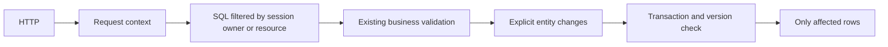

# On-demand relational data - Plan

## Scope & Non-Goals

Database-backed HTTP requests, persistence, audit, resumable uploads and maintenance move to bounded SQL operations. Existing standalone file mode stays available. No unrelated UI edits, commits or deployment in this request.

## Acceptance Criteria

- [x] Database HTTP startup does not read business tables or metadata.json
- [x] Login/account/config queries load only the relevant records; resource pages load the requested resource or owner's domain
- [x] Concurrent requests have separate data and write queues
- [x] Saving a partial result never removes rows outside its explicit write set
- [x] Stale updates fail safely without overwriting newer data
- [x] Upload restoration and audit do not scan JSON files or all history at startup
- [x] SQL integration and existing local feature tests pass

## Assumptions & Constraints

Existing normalized relational tables and per-entity encrypted extension fields are retained. MySQL is authoritative; migration remains an explicit operation. Reuse Express, mysql2 and Node AsyncLocalStorage rather than introducing an ORM that would replace the existing schema. Preserve all unrelated workspace changes.

## Baseline Tests

12 startup/paged-reader tests and legacy storage migration passed before this task. Existing distribution cleanup no-op test was previously intermittent. Local MySQL executable available for an isolated fixture.

## Design Diagram

## Architecture Decision

Adopt request-scoped domain objects as a compatibility boundary while queries and commits use relational keys. No process-wide business snapshot in database mode. A partial-load flag on the old snapshot synchronizer is rejected because it could delete unseen rows. Writes calculate a change set, reread and validate only affected aggregates under the revision lock, then update bounded rows. Unchanged entities are never synchronized. Concurrent edits to the same aggregate return a conflict rather than silently merging unrelated fields.

## Task Checklist

- [x] T1 [main] Inspect data contracts and write architecture decision (deps: none)
- [x] T2 [main] Request context and bounded relational repository (deps: T1)
- [x] T3 [main] Route scopes, OAuth and direct persistence integration (deps: T2)
- [x] T4 [main] Lazy upload restoration, direct audit and bounded maintenance (deps: T3)
- [x] T5 [main] Isolated MySQL and regression verification (deps: T4)
- [x] T6 [main] Document migration requirements and review diff (deps: T5)

## Sub-agent Registry

No delegated work. Main agent owns all changes.

## Risks & Rollback

Highest risks are partial-save deletion, same-entity concurrent writes and resource ownership leaks. Verify with real SQL and two-user fixtures. Existing standalone mode and prior Git revision remain rollback references. Do not change server data during development.

## Blockers

None.

## Change Log

- 2026-11-02 12:35: Confirmed startup full-table reads and global snapshot synchronization; selected request-scoped SQL design.
- 2026-11-02: T2, main: Added AsyncLocalStorage context, SQL key/owner repository, local change sets, transactional entity conflict checks and reference-only foreign identity lookup. Unseen rows never enter the synchronization delete set.
- 2026-11-02: T3, main: Integrated API scopes, OAuth account lookup, multipart recipient lookup, record references, public share metadata and durable response boundaries. Removed the runtime whole-JSON session query branch.
- 2026-11-02: T4, main: Added SQL capacity/active collection aggregates, upload publication index, per-ID upload restoration, shared durable relational audit queue and cursor-based cleanup/payment maintenance.
- 2026-11-02: T5, main: Verified random isolated MySQL schemas, actual HTTP publication/download/collection/team/OAuth flows and standalone auth/collection/team regressions. No remote database or server changes.
- 2026-11-02: T6, main: Packaged explicit migration CLI in Docker, wired versioned migration after deployment backup, and documented rollout in docs/数据库按需查询运行说明.md. Container naming and test-server stop policy are unchanged.

## Verification Evidence

- `$env:KUNQIONG_TEST_DB_PORT='33318'; node --test scripts/db/request-store.integration.test.mjs scripts/startup-lifecycle.test.mjs`: 18 passed, 0 failed. Each run creates/drops only a random loopback test schema. Covers broken local JSON, no startup DB connection, unavailable DB with working page/health, concurrent context isolation, partial saves, stale writes, session revocation, history preservation, SQL statistics/count limits, upload restart/publish/download, collection submission/delete, team invite/accept/remove/dissolve, OAuth and audit retention/recovery.
- `node --test scripts/db/relational-store.test.mjs scripts/db/upload-session-store.test.mjs scripts/relational-auth-session.test.mjs scripts/persistence-boundaries.test.mjs scripts/audit-store.test.mjs`: 29 passed, 0 failed.
- `node --test scripts/db/paged-reader.test.mjs scripts/db/relational-startup-read.test.mjs scripts/db/relational-schema.test.mjs scripts/db/deployment-preflight.test.mjs`: 19 passed, 0 failed.
- `node scripts/verify-auth-suite.mjs`, `node scripts/verify-collection-suite.mjs`, `node scripts/verify-team-suite.mjs`: completed with exit code 0; collection 127 and team 226 assertions passed.
- `node scripts/verify-legacy-user-storage-startup.mjs`: passed; legacy standalone files migrated and both download routes stayed byte-identical.
- `node scripts/refactor/check-docker-copy.mjs`: all runtime imports packaged, actual isolated service returned HTTP 200.
- `D:/Git/bin/bash.exe -n scripts/deploy-test.sh` and `git diff --check`: passed.
- Existing unrelated UI/manual files and earlier startup-reader changes were preserved. No commit, push, build image, migration on a remote database, or server deployment was performed.
- Isolated MySQL on 127.0.0.1:33318 was shut down with mysqladmin and its listener/processes exited. Automatic approval policy rejected recursive removal of its verified TEMP datadir (tool returned only `blocked by policy`); the stopped fixture directory remains, with no impact on the application changes.

## Bug & Fix Log

- Partial loaders originally omitted incoming record references, multipart recipient notification settings, active collection limits and public share SEO data. Added explicit queries and HTTP regression coverage so these features retain their previous rules without startup snapshots.
- Retained distribution history originally had a nondeterministic no-op check because missing frozenAt used a new timestamp on each save. Existing rows now preserve that fallback; the previously failing unit test and real SQL cleanup/delete checks pass.
- Per-request audit instances could discard retryable pending entries after a transient failure. A bounded shared relational writer now retains and retries them across requests; real SQL outage/recovery coverage passes.
- Maintenance now rotates resource/upload/session cursors, includes the upcoming expiration window and loads notification settings before adding messages. Jobs are tracked for graceful shutdown.

## Completion Summary

Implemented and locally verified. Database HTTP startup no longer opens SQL connections or reads local/whole-database JSON; feature requests query their own domain and save only explicit changes. Existing encrypted per-entity extension fields remain compatible. First deployment must execute migration 005 using the existing shared data key; the release script includes this step after backup and it skips repeat backfills. Production data and deployment remain untouched in this request.

**Next Steps:** Deliver the reviewed local changes. A later deployment uses the documented one-time SQL migration; the stopped test datadir may be removed manually if desired.
