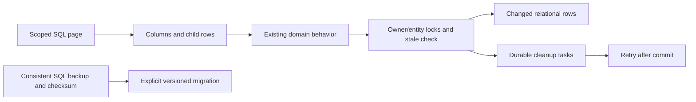

# MySQL consistency and query optimization - Plan

## Scope & Non-Goals

Fix all six findings from the local MySQL review. Keep existing APIs and standalone mode compatible. Preserve pre-existing UI, manual and startup changes. This request does not include commit, push, remote migration or deployment.

## Acceptance Criteria

- [x] Deployment takes a consistent MySQL backup before migrations and records checksum/completion only on success
- [x] Business file removals are committed through a durable cleanup outbox; rollback cannot delete published bytes
- [x] Resource/submission/file and account reads reconstruct normalized rows; encrypted extension JSON contains only nonrelational fields
- [x] Independent owners can commit concurrently without a global metadata lock; stale writes and capacity races stay protected
- [x] List reads and admin summaries use SQL pages/aggregates; frontend retrieves all required pages
- [x] Connection queue and acquisition are bounded, with no startup database gate
- [x] Isolated SQL, failure injection and targeted feature regressions pass

## Assumptions & Constraints

Use the existing MIT-licensed mysql2 implementation, SQL schema, Node filesystem/streams and existing dump/restore approach. No ORM or queue infrastructure replacement is needed. Migration is explicit and versioned, never HTTP startup. Keep the fixed container name kunqiong-file-transfer-web and existing test-server stop policy. Do not query remote databases for local tests.

## Baseline Tests

`node --test scripts/db/relational-store.test.mjs scripts/db/relational-schema.test.mjs scripts/startup-lifecycle.test.mjs scripts/persistence-boundaries.test.mjs`: 24 passed. Previous on-demand plan is complete; the open older release plan has a different deployment goal and is not resumed.

## Design Diagram

## Architecture Decision

Adapt the existing relational synchronizer with a normalized codec and encrypted extensions rather than rewriting routes around a new ORM. Split nested resources into their existing child tables. Replace the global revision serialization with deterministic owner/entity locks; use per-entity comparison and owner quota checks. Store filesystem cleanup intent in the same transaction and retry after commit. Bundle the MariaDB dump client for a transaction-consistent logical backup streamed through gzip and SHA256; do not skip SQL backup if the tool fails. Pagination must preserve visibility and bulk-action semantics.

## Task Checklist

- [x] T1 [main] Reconcile workspace, inspect contracts and record design (deps: none)
- [x] T2 [main] Backup and rollback-safe filesystem cleanup (deps: T1)
- [x] T3 [main] Normalized row codec and explicit incremental migration (deps: T2)
- [x] T4 [main] Scoped locking and bounded connection handling (deps: T3)
- [x] T5 [main] SQL pages, summaries and compatible clients (deps: T3)
- [x] T6 [main] Isolated SQL/failure regression tests, docs and diff review (deps: T4,T5)

## Sub-agent Registry

No delegated work. Main agent owns all changes.

## Risks & Rollback

Data-shape compatibility and bulk operations require HTTP regression tests. Keep migrations additive and resumable; preserve the shared encryption key. Cleanup validates paths inside storage and never executes before commit. Deployment requires a successful database backup; rollback uses that backup with matching storage/key. No remote data is touched during development.

## Blockers

None.

## Change Log

- 2026-11-02 13:40 T1 main: Inspected local changes, mysql2 pool, row synchronization, legacy backup and deletion paths. Baseline 24 tests pass. Selected compatibility-preserving incremental design.

- 2026-11-02 14:05 T2 main: Added real gzip SQL dump with checksum/manifest to pre-migration deployment backup; file-storage and directory removals now enqueue durable transactional cleanup with retry. Added runtime dump client packaging. Fault-injection tests pending.
- 2026-11-02 14:05 T3 main: Added normalized column/child reconstruction and extension-only payload writes, versioned per-aggregate resumable migration 006. Real SQL and HTTP suite passes (15 tests).
- 2026-11-02 14:05 T4 main: Replaced global revision writes with deterministic owner/entity locks and per-row versions; added finite connection queues, acquisition/query deadlines and optional verified TLS. Startup stays query-free.
- 2026-11-02 14:05 T5 main: Added cursor pages/client page retrieval for records/messages/trash/team, SQL team usage and path-index name checks; admin overview uses SQL summaries and 200-row projections. Admin cleanup isolation and regression coverage in progress.
- 2026-11-02 14:29 T2-T6 main: Finished guarded SQL orphan cleanup, cross-batch admin cleanup, independent collection-submission rebasing with participant/capacity checks, cache refresh and UTC timestamp preservation. Added interruption/resume migration, SQL backup/restore, old-page message actions and backup overwrite protection tests. Updated deployment/rollback documentation. No remote migration or release performed.

## Verification Evidence

Final isolated MySQL fixture: loopback port 33319, only random `kunqiong_demand_test_*` databases. `npm run test:db-on-demand`: 32 passed, none skipped. Final combined run with `scripts/db/relational-store.test.mjs`: 40 passed. The separate existing schema/reader/audit/session/persistence suite passed 48 tests. Fault injection covers hung acquisition/query/transaction acknowledgement, late-connection release, rollback, EACCES retry, audit recovery, stale writes, participant/capacity races, migration interruption and existing-backup protection. Real mysqldump gzip SHA256 and restore round trip passed.

Feature regressions: collection suite 127 assertions, auth suite 127, message-center 15, message deletion 17, trash and distribution suites all passed; team suite previously passed 226 assertions. Final Vite production build succeeded in a unique TEMP directory (existing chunk-size warning). Docker COPY materialization and HTTP startup succeeded; both release scripts passed `bash -n`, and `git diff --check` passed.

Validation limit: Docker daemon is available, but Docker Hub failed to resolve/pull `node:22-alpine`; the image-internal MariaDB dump binary could not be exercised. Full SQL backup/restore used local MySQL tools. No remote server/database was contacted.

Cleanup: the isolated MySQL instance was shut down normally and its fixture processes exited. Automatic approval policy rejected the combined temporary-build-directory cleanup command without a detailed reason; the task-created `build-mysql-verification/` directory is retained. No deletion workaround was attempted.

## Bug & Fix Log

- Child row cache was stale after a commit: refreshed all affected tables and lookup keys, including deletion and collection-rebase children; repeated hydration test passes.
- New collection participants could overrun a stale limit: recheck merged identities and fresh SQL quota while locks are held; concurrent submissions survive, overlapping edits conflict, excess participant/capacity is rejected.
- SQL DATETIME cache strings were host-timezone dependent and internal versions triggered automatic modification times: normalize SQL dates as UTC, compare UTC values and preserve domain timestamps during synchronization/version updates; migration round trip and post-save timestamp tests pass.
- Normalized guest-usage envelopes were not unwrapped: restore quota fields from their columns and retain only extensions; direct SQL authority test passes.
- Orphan deletion could target a storage-domain root: require a descendant path, guard live references again under the write lock, and preserve files published after scanning.
- Deployment backup pointer advanced too early: only publish it after all backup steps succeed; retries cannot overwrite an existing database backup.

## Completion Summary

Six optimization areas implemented and locally validated. HTTP startup still performs no database query. Existing workspace changes were preserved; no commit, push, deployment or remote migration was requested or performed. Upgrade requires explicit migrations 005/006 after a matching SQL backup. Remaining scope limits: historical account-record/configuration JSON is intentional, clients still gather all pages on opening a list, and a single task still hydrates its selected aggregate. Upload bytes remain in the existing volume rather than an independent disaster-recovery copy.

## Next Steps

Before a future authorized release, validate the packaged MariaDB client in the deployment environment, take the consistent backup and run the explicit migration. Restore the matching pre-upgrade database/key before rolling back to older application code. No further local implementation steps remain.
