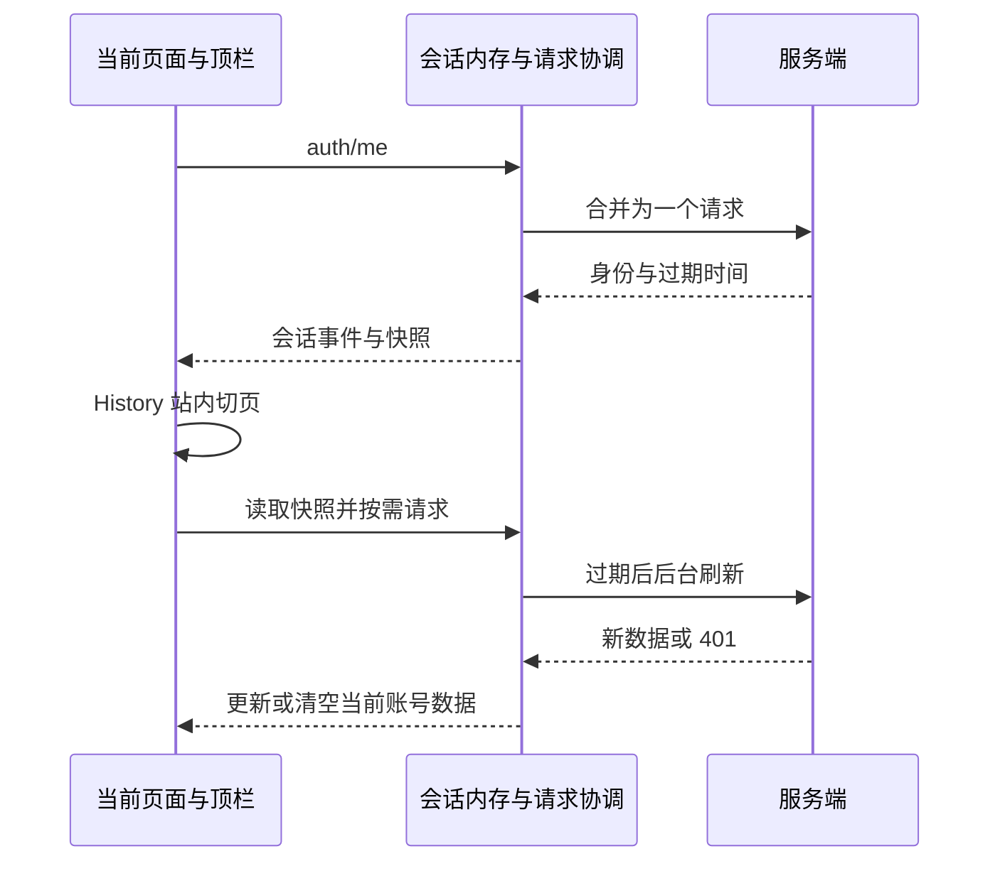

# page-navigation-session-performance - Plan

## Scope & Non-Goals

- Goal: 切页复用身份与会员快照，减少重复数据库请求与整页刷新
- In scope: API 请求协调、内存会话、站内导航、首页按需记录加载、UI 回归
- Non-goals: 本轮不部署、不提交、不恢复备份或历史数据迁移，不修改后端权限验证

## Acceptance Criteria

- [x] 同一页面初始化 auth/me 只发一次，runtime-config 只发一次
- [x] 首页与账户资料页不抓取或回写全部收发记录，记录页仍能加载
- [x] 首页、会员、设置站内切换不刷新文档，复用已确认身份
- [x] 缓存仅在内存中，退出/401/换账号清空用户快照，取消单个消费者不影响其他请求
- [x] 支付/手动刷新强制更新会员状态，已有快照后台刷新，不整页遮挡
- [x] 相关 UI 回归与生产构建通过

## Assumptions & Constraints

- 沿用现有 React18 hooks 和原生 History API，项目没有 router/query 库，无需引入依赖
- 共享请求只覆盖身份、运行配置和会员 GET，变更使缓存失效，后端权限不受缓存控制
- 用户工作区原有 package.json、app-main.css 等差异保留
- 不使用子代理；首次打开仍需服务器校验身份；公网 MySQL 的间歇传输延迟无法由前端消除

## Baseline Tests

| Item | Command | Baseline result (at start) |
| --- | --- | --- |
| Commit / ref | git rev-parse HEAD | df916af1c71cbf8b04ba998b41ee5115b18b5301 |
| UI baseline | 上轮 verify-auth-ui / verify-team-ui | 已通过，后者 331 assertions；本轮修改后再跑 |
| Initial investigation | 源码调用与路由检查 | 根组件/顶栏/页面重复 auth，首页自动同步所有记录，链接刷新文档 |

## Diagram

## Task Checklist

| ID | Task | Owner | Deps | Done |
| --- | --- | --- | --- | --- |
| T1 | 调查请求重复与路由，确定缓存边界 | main | - | [x] |
| T2 | 共享内存会话、去重、隔离、变更失效 | main | T1 | [x] |
| T3 | 站内导航、快照恢复、按需记录、上传保护 | main | T2 | [x] |
| T4 | 请求次数、失效、切页与现有功能验证 | main | T3 | [x] |
| T5 | 生产构建、结果与交付记录 | main | T4 | [x] |

## Sub-agent Registry

无子代理，全部主代理顺序完成

## Risks & Rollback

| Risk | Likelihood / Impact | Mitigation | Rollback |
| --- | --- | --- | --- |
| 旧请求覆盖新账号 | 中/高 | 会话代数校验、变更清空缓存、401 清理、回归测试 | 仅撤销本轮文件差异 |
| 缓存导致支付权益陈旧 | 中/高 | 30 秒有效期、支付/手动刷新强制读取、变更失效 | 撤销会员读取缓存 |
| SPA 离开上传 | 中/中 | 当前上传期间阻止离开对应组件，保留原生外链 | 撤销站内导航 |

## Blockers

无

## Change Log

| Time | Task ID | File / Task | Change | By |
| --- | --- | --- | --- | --- |
| 2026-11-02 19:00 | T1 | 调查与设计 | 复用 React 与 History API，确认三个重复调用与全记录同步 | main |
| 2026-11-02 19:10 | T2 | api.js/account.jsx | 合并请求、会话快照、消费者独立取消与用户事件同步 | main |
| 2026-11-02 19:10 | T3 | main.jsx/navigation.js/workspace*.jsx/team.jsx | 局部导航、快照恢复、运行配置去重、记录按需和上传保护 | main |
| 2026-11-02 19:18 | T4 | scripts/verify-navigation-performance.mjs、上传与既有UI测试 | 694项断言通过，补充原生链接边界、取消隔离、晚到响应与上传导航保护 | main |
| 2026-11-02 19:18 | T5 | npm run build、差异与计划复核 | 生产构建与手册验证通过，原有改动保留，本轮未部署 | main |

## Verification Evidence

| Time | Command | Result | Notes |
| --- | --- | --- | --- |
| 2026-11-02 19:18 | node scripts/verify-navigation-performance.mjs | 34 passed | 合并请求、独立取消、跨账号/401清理、资料更新竞态、导航次数、原生链接和后台刷新 |
| 2026-11-02 19:18 | node scripts/verify-auth-ui.mjs | 91 passed / 0 failures | focus、会话替换、TTL、晚到响应与账号隔离 |
| 2026-11-02 19:18 | node scripts/verify-team-ui.mjs | 331 passed / 0 failures | 团队权限、CRUD、回收站、会员错误恢复 |
| 2026-11-02 19:18 | node scripts/verify-send-cancellation-ui.mjs | 110 passed | 新增上传中/暂停切页保护及完成后恢复导航 |
| 2026-11-02 19:18 | node scripts/verify-payment-ui.mjs | 57/57 | 聚焦读取最新支付状态、权益刷新 |
| 2026-11-02 19:18 | node scripts/verify-orders-ui.mjs | 56 passed | 订单支付、受限订单与核对 |
| 2026-11-02 19:18 | node scripts/verify-message-center.mjs | 15 passed | 未读、删除、通知及URL状态 |
| 2026-11-02 19:18 | npm run build | passed | 手册生成/校验通过，Vite 6.80s；既有大块体积提示仍存在 |
| 2026-11-02 19:18 | git diff --check | passed | 无空白错误，保留用户原有差异 |

## Bug & Fix Log

| Time | Symptom | Root cause | Fix | Guard added |
| --- | --- | --- | --- | --- |
| 2026-11-02 19:10 | 每页重复检查登录 | 独立组件请求、整页导航、页面顺序等待 | 共享请求/导航/快照 | 请求次数与账号隔离回归 |
| 2026-11-02 19:18 | 初轮测试聚焦未及时清理过期会话 | 短期缓存抑制了focus校验 | main.jsx 聚焦强制校验并合并并发 | auth UI 91项通过 |
| 2026-11-02 19:18 | 初轮测试聚焦无法发现待补登录支付 | 会员焦点刷新复用了旧快照 | workspace-page.jsx 聚焦/支付强制读取，保留页面内容 | payment UI 57项通过 |

## Completion Summary

本地优化完成：身份、运行配置与会员 GET 在内存中去重并短期复用；首页、会员和账户通过 History 切页；记录进入列表时同步。会员快照后台更新，手动/支付/聚焦刷新保持实时读取；退出、401、换账号与会话到期清理。合计 694 项本地模拟断言通过，生产构建通过。首次打开仍需服务器认证；未对测试服真实延迟作保证。本轮没有提交、推送或部署。

## Next Steps

- 已完成并交付本地修改；后续部署按用户新指令执行。
