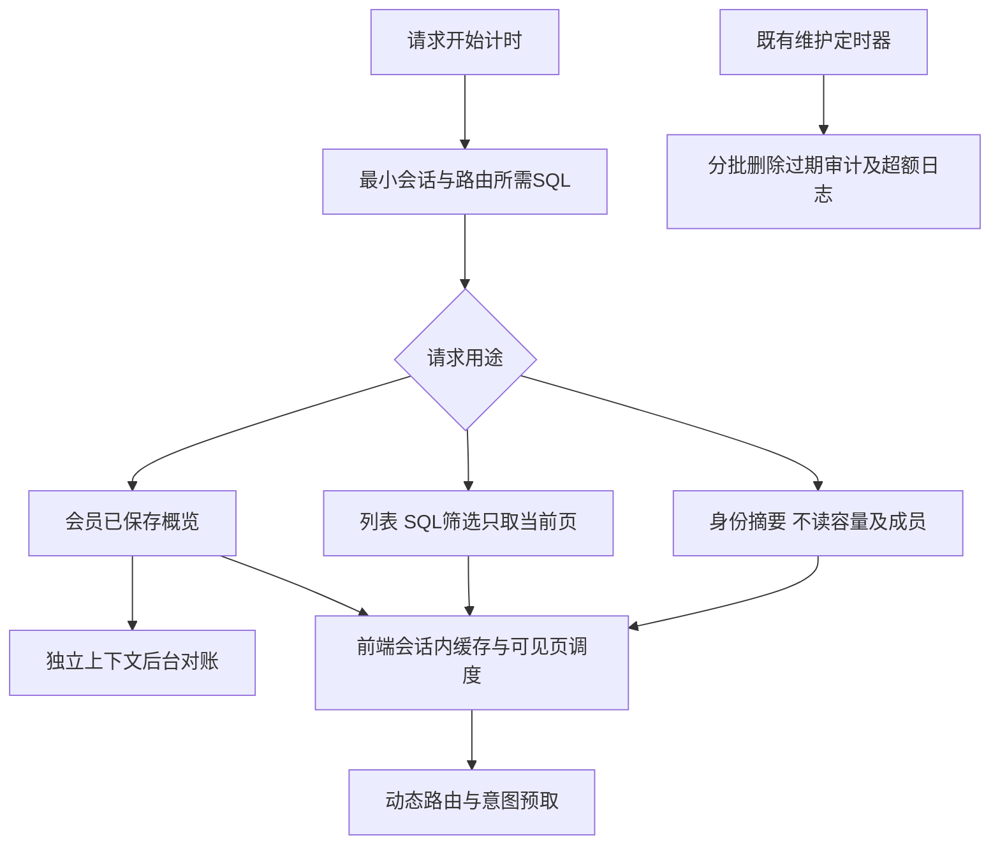

# demand-loading-audit-retention - Plan

## Scope & Non-Goals

- Goal: 完成本聊天已经批准的六项性能方案和审计定时清理
- In scope: 请求全程指标、会话查询分层、按页记录/消息/团队加载、会员概览非阻塞对账、React动态路由与资源压缩、统一前台刷新、分批审计清理、文档及回归
- Non-goals: 本轮未要求提交、推送或部署；不连接真实业务库删除日志，不恢复备份、JSON整库加载或旧历史转换

## Acceptance Criteria

- [x] 请求计时覆盖SQL准备、连接排队、SQL与业务阶段，日志不含凭据或SQL参数
- [x] 普通身份/保活不读取完整组织图、订单、容量，详细资料按需获取且兼容旧调用
- [x] 已登录记录/消息首屏只取一页，无循环全拉、逐记录请求或浏览触发全量PUT；筛选、翻页和作用域清空正确
- [x] 会员页不等待外部支付对账，后台独立上下文安全更新，支付确认仍权威且幂等
- [x] 页面和大型功能按需加载，导航代码可预取；文本响应支持压缩，下载流不受影响
- [x] 定时刷新集中调度、隐藏页暂停、焦点事件合并，支付中保留及时刷新
- [x] 审计按配置定时、分批清理，默认访问7天/关键30天，保留5000条上限，不阻塞启动或请求
- [x] 本地隔离SQL、UI、性能边界及生产构建通过，保留现有工作区差异

## Assumptions & Constraints

- 沿用React18、History API、mysql2与现有维护任务；适合时使用成熟MIT开源compression中间件，避免手写压缩协议
- 记录/消息筛选在SQL端执行；每页有界，兼容老客户端不带分页参数时的现有契约
- 审计已有后台保留天数设置，兼容旧值，访问保留额外可配置；不执行线上删除
- 测试服MySQL5.7，新增SQL避免MySQL8专有能力
- 无.codegraph；无子代理，主代理依次实施
- 保护上一轮导航优化与用户原有package.json、样式、支付测试等未提交改动

## Baseline Tests

| Item | Command | Baseline result |
| --- | --- | --- |
| Commit | git rev-parse HEAD | df916af，上一轮性能改动在工作区 |
| UI/build | 上一轮7组UI/请求回归与npm run build | 694断言通过，构建通过 |
| Build payload | .runtime/navigation-build-verification.log | 主业务JS572.48KB/CSS433.22KB未压缩 |
| Code inspection | 调用链 | SQL加载前未计时；客户端分页全拉；每记录检查与全量PUT；会员同步对账；审计日清理无界DELETE |

## Diagram

## Task Checklist

| ID | Task | Owner | Deps | Done |
| --- | --- | --- | --- | --- |
| T1 | 核对工作区、约定接口与保留策略 | [main] | - | [x] |
| T2 | 全程请求/SQL指标及审计定时分批保留 | [main] | T1 | [x] |
| T3 | 登录摘要、详细资料与路由按需SQL | [main] | T2 | [x] |
| T4 | 记录与团队真分页、服务端状态及筛选、增量变更 | [main] | T3 | [x] |
| T5 | 消息未读摘要、分页与局部更新 | [main] | T4 | [x] |
| T6 | 会员概览与后台对账分离、近期订单按需 | [main] | T3 | [x] |
| T7 | 统一刷新调度、路由与弹窗拆包、压缩 | [main] | T4,T5,T6 | [x] |
| T8 | 有针对性SQL/UI测试、生产构建与文档交付 | [main] | T2,T3,T4,T5,T6,T7 | [x] |

## Sub-agent Registry

无子代理

## Risks & Rollback

| Risk | Mitigation | Rollback |
| --- | --- | --- |
| 分页后清空分类误删/筛选只作用当前页 | 服务端作用域过滤及权限限定，跨页操作回归 | 仅回退本轮分页差异 |
| 轻量会话覆盖完整用户快照 | 同账号合并、明确定义详细状态、401及换账号清理 | 回退摘要视图 |
| 后台对账写入复用已结束请求上下文 | 新独立上下文、跟踪与合并事务、已有幂等 | 恢复原对账流程 |
| 定时删除长锁或并发重入 | 小批LIMIT、执行预算、无重入、配置与最旧优先上限 | 关闭定时年龄清理，保留原上限逻辑 |
| 懒加载破坏CSS顺序或首屏 | 保持共享样式顺序，拆页后做布局与加载失败重试 | 回退对应拆包 |

## Blockers

无

## Change Log

| Time | Task ID | File / Task | Change | By |
| --- | --- | --- | --- | --- |
| 2026-11-02 19:28 | T1 | 调查与设计 | 用户批准全部方案；复用既有React/SQL/维护框架，访问7天关键30天默认策略 | main |
| 2026-11-02 20:00 | T2 | request-metrics、bounded-pool、server.mjs、audit-store、request-audit-store、relational-maintenance、config、normalizers、AdminPage、admin-validation、database-cleanup | 全程指标；响应不等审计；访问/关键分类分批删除，积压续跑；配置可保存 | main |
| 2026-11-02 20:00 | T3 | account、request-store、relational-request、api、main、workspace | identity/summary/full查询视图；保活不读容量，普通消息/记录变更不读组织图 | main |
| 2026-11-02 20:00 | T4 | record-list、on-demand-schema、request-store、account routes、records、workspace | 008可续跑单实体投影迁移；SQL筛选分页；单页加载取消逐记录请求和PUT；分类清空分批事务；增量POST | main |
| 2026-11-02 20:00 | T5 | messages routes、records helpers、workspace | 未读COUNT摘要、20条单页、加载更多、消息操作局部更新 | main |
| 2026-11-02 20:00 | T6 | workspace routes、request-store、relational-request | 概览不等待外部对账，近期订单限10；复用独立维护上下文 | main |

| 2026-11-02 20:30 | T4 | teamResourcePage、team.jsx、records.jsx、workspace.jsx | 真分页与权限计数、全局统计、取消与版本防护，修正越界页、搜索竞态与首次重复请求 | main |
| 2026-11-02 20:30 | T5 | workspace消息及HTTP测试 | 20条加载更多、操作不全拉，摘要与本地更新，邀请和交接后只重取单页 | main |
| 2026-11-02 20:30 | T7 | page-loaders、main、page-load-boundary、refresh-scheduler、hooks、compression | 页面拆包与意图预取、加载失败恢复、焦点合并/隐藏暂停、价格共享缓存、MIT压缩中间件 | main |
| 2026-11-02 20:30 | T2 | audit-store、metadata-store、admin、server | 本地兼容模式分类保留与可配置周期；同进程上限裁剪去重；审计异步化；错误响应保留中文说明头 | main |
| 2026-11-02 20:30 | T8 | scripts、docs/PERFORMANCE-按需加载与审计清理-2026-11-02.md、package | 隔离SQL与真实React回归、构建/手册校验、操作与迁移说明、test:performance入口 | main |

## Verification Evidence

- 最终后端/隔离SQL/审计/指标/压缩/启动回归55通过、0跳过：.runtime/demand-acceptance-final.log
- 导航34、按需分页UI15、登录91、团队331、团队权益2、消息15、消息删除17、交接19、支付57、订单56、上传110、运行配置129均通过，详细日志路径见交付文档
- npm run build完整通过（包含手册生成和校验，手册1.59MB）：.runtime/demand-production-build-final.log
- 入口60.21KB/gzip22.22KB，各页面独立块；首屏仍包含React/共享UI/首页/样式，不将入口大小当作整页大小
- MySQL夹具为8.0.41/127.0.0.1:33431；SQL保持5.7语法，未做远端/5.7实例性能承诺
- git diff --check通过，保留已有工作区改动，无提交/推送/部署

## Bug & Fix Log

- 轻量身份为null时曾被合并成{}，导致退出后仍被当成登录；增加明确user.id条件，导航退出/换号用例通过
- 消息批量操作没有标记已加载邮箱时会重新生成默认消息；显式空邮箱上下文后SQL删除/全已读用例通过
- 旧搜索可能覆盖新结果；父级与团队添加版本及取消防护，延迟响应回归通过
- 团队初次请求曾重复，分页后卡片曾统计单页；统一初次加载并返回独立授权统计，331项团队回归通过
- 团队首次查询失败原被静默处理为提示，导致无团队具体原因丢失；首次失败显示完整错误状态
- 008列已建立但回填未完成时不能开放筛选；分页读取额外校验008完成标记，写入可提前维护已建投影
- 旧支付测试检查独立15000ms计时器；改为验证实际请求与付费状态，按统一调度假时钟推进，57/57通过
- 启动故障夹具原只断开首次MySQL握手，既有一次重连会等待；夹具同时拒绝重连，1500ms原验收边界不变，测试通过

## Completion Summary

T1–T8本地完成并验证。审计默认访问7天/关键30天/60分钟，兼容旧配置并保留5000条上限。008显式迁移和部署要求已写入文档，本轮未执行线上迁移、日志删除或部署。

## Next Steps

- 本轮无未完成代码任务。后续如安排部署，先显式执行db:on-demand:apply完成008，再发布前端并做线上验收。
