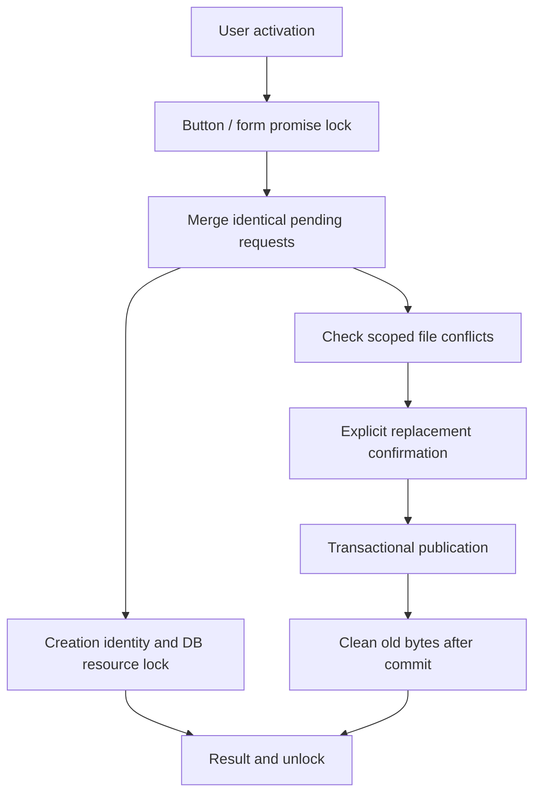

# Duplicate action prevention - Plan

## Scope & Non-Goals
Prevent repeated CRUD interactions, persist idempotent collection creation, and confirm replacement of collection files belonging to the same submitter. Preserve all unrelated uncommitted edits. No commit, push or deployment requested in this task.

## Acceptance Criteria
- [x] Async buttons and forms immediately prevent repeated activation and recover after rejection
- [x] Identical concurrent requests share a network call; different bodies, headers and sessions stay isolated
- [x] Collection creation retries return the original task in both local and on-demand MySQL modes
- [x] Existing collection files require confirmation; replacement is scoped to task, submitter and full relative path
- [x] Upload resume, concurrent publication, rollback and other operations retain their current behavior

## Assumptions & Constraints
Existing React, native Promise and the project's distribution idempotency pattern are the implementation base. No dependency or copied external component is needed. No .codegraph directory. Normal uploads, quotas and database authorization remain enforced. Main agent executes all work.

## Baseline Tests
HEAD df916af on deploy/user-file-isolation-20261029. Numerous pre-existing uncommitted MySQL/performance changes recorded by git status. No full pre-change test baseline was run before initial edits; use isolated fixtures and scoped regressions to attribute failures.

## Diagram

## Task Checklist
| ID | Task | Owner | Deps | Done |
| --- | --- | --- | --- | --- |
| T1 | Inspect shared requests, upload publication and existing OSS / project patterns | [main] | - | [x] |
| T2 | Shared request merging and promise-based button/form prevention | [main] | T1 | [x] |
| T3 | Durable idempotent collection creation | [main] | T1 | [x] |
| T4 | Scoped conflict confirmation and transactional file replacement | [main] | T1 | [x] |
| T5 | Concurrency, UI, isolated API and build regressions | [main] | T2,T3,T4 | [x] |

## Sub-agent Registry
No delegation used.

## Risks & Rollback
Do not manually change React-owned disabled attributes. Consumer cancellation must not abort another caller's write. Concurrent MySQL snapshots must not merge conflicting file paths. Old bytes are removed only after durable publication. Rollback only edits from this task, retaining earlier changes.

## Blockers
None.

## Change Log
| Time | Task ID | File / Task | Change | By |
| --- | --- | --- | --- | --- |
| 2026-11-03 09:43 | T1 | Existing routes, API layer, relational store | Inspected project patterns and isolated existing modifications | main |
| 2026-11-03 09:43 | T2 | src/lib/api.js, src/components/action-button.*, JSX callers | In-flight merging; promise-based React controls replacing an initial DOM-lock approach | main |
| 2026-11-03 09:43 | T3 | server/routes/collections.js, src/pages/workspace.jsx | Stable client key and replay checks; MySQL identity work pending | main |
| 2026-11-03 09:43 | T4 | server/services/shares.js, server/routes/upload.js, server.mjs | Conflict contract, replacement publication and persisted overwrite intent; UI and concurrent validation pending | main |
| 2026-11-03 10:07 | T2 | src/pages and src/components | Preserve asynchronous callback returns, route Enter through the same guarded buttons, keep independent cancellation enabled | main |
| 2026-11-03 10:07 | T3 | server/routes/collections.js | Deterministic owner-scoped identity, bounded MySQL lookup and creation lock held through persistence | main |
| 2026-11-03 10:07 | T4 | server/lib/collection-conflicts.js, server/db/request-store.js, src/lib/transfer.js, src/pages/public.jsx | Identity/path isolation, concurrent rebase check, explicit consent before bytes or publication, resume intent | main |
| 2026-11-03 10:07 | T5 | scripts/duplicate-actions.test.mjs, scripts/verify-action-controls-ui.mjs, existing collection and publication checks | Slow-response and failure tests; local MySQL 8.0.41 fixture verifies actual SQL route behavior | main |
| 2026-11-03 10:07 | T5 | scripts/verify-distribution-ui.mjs, package.json | Refresh stale layout assertion to the pre-existing grid design; expose npm run test:actions | main |

## Verification Evidence
- API singleflight and merge-conflict unit tests: 6 passed.
- React controls: 12 passed, including same-tick clicks, repeated submit/Enter, rejected promises, independent cancel and unmount.
- Collection form: slow duplicate clicks send one request and a failed retry reuses the same key.
- Collection API: 139 passed, including concurrent publication followed by explicit overwrite consent.
- Collection upload UI: 49 passed, including consent before upload and after a publication conflict without retransmitting bytes.
- Upload publication: 23 passed, including failed replacement preserving old metadata and bytes, with no new orphan files.
- Navigation/session regression: 34 passed. Orders UI: 56 passed.
- Actual isolated MySQL 8.0.41 integration: 25 tests passed, no skips; includes four concurrent task creations at an active quota of one, replay, conflict and authorized replacement. Temporary server stopped after tests. No application database used.
- Team UI: 331 passed. Send cancellation/notification UI: 110 passed. Distribution UI: 15 passed. Message delete fixture: 17 passed.
- Final npx vite build passed (existing large-chunk advisory only); node --check on modified API/upload/server modules and git diff --check passed.
- HTTP/file tests use isolated temporary fixtures; SQL integration uses its own temporary loopback MySQL instance. No live server or application database was modified. Multiple server-process creation races were not exercised; deterministic IDs and SQL resource locks provide that boundary.
- Normal capacity/reservation checks remain conservative during replacement; this change does not increase quota or waive temporary storage requirements.

## Bug & Fix Log
- Removed the initial manual DOM lock in favor of React state/ref controls, preserving React ownership.
- Kept shared network start synchronous to preserve existing navigation behavior; header comparisons are case independent.
- New test harness issues (missing assert import, worker output format and changed pending button text) corrected; the corresponding tests now pass.
- The distribution UI test expected absolute positioning despite HEAD already using a grid toolbar. Matched the test to the existing grid design; all 15 checks pass, with no product layout change.

## Completion Summary
Completed front-end immediate pending locks, matching request merging, durable collection-create retry identity, scoped conflict confirmation and file replacement with rollback/concurrency protection. Targeted local, React and actual isolated SQL checks pass. Existing unrelated edits preserved. No commit, push or deployment performed.

## Next Steps
None for this task. Changes are ready for review and an explicitly requested release.
