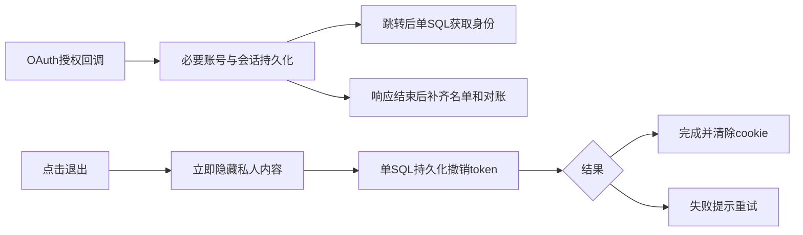

# 登录退出延迟优化

## Scope & Non-Goals

复用现有mysql2、请求作用域和前端共享请求机制，优化身份查询、OAuth回调加载和退出会话撤销。保留OAuth协议、持久化登录、单设备登录、联系方式唯一性、禁用账号和付款对账。沿用已授权SSH发布方式。无需新增依赖或数据库迁移，不调整查询预算，不提交推送。

## Acceptance Criteria

- [x] 身份校验用一条带会话和账号的实时SQL，无跨请求过期权限缓存
- [x] 退出无需读取配置、订单、团队和容量，仅撤销当前token并等待数据库确认
- [x] 退出立即隐藏私有内容，期间禁止晚到响应恢复账号；失败显示可重试提示
- [x] OAuth回调不等待团队名单加载，持久化登录后后台补齐名单及付款凭据
- [x] 真实MySQL验证新旧格式会话撤销、换设备、禁用账号、登录和付款相关行为
- [x] 测试服部署与实际会话接口验收完成

## Assumptions & Constraints

保留既有未提交差异及测试服容器、端口、卷、scanner、运行时隙和查询配置。任何退出成功必须有数据库撤销确认，不以纯前端假退出或放宽认证换取速度。现有OAuth/DB参数沿用，无需重新收集。首选库能力为mysql2的nestTables联表返回，避免重造登录系统。比较过仅修改视觉反馈、增加认证TTL缓存和精简实时SQL三种方案，采用精简SQL与明确前端状态反馈。

## Baseline Tests

| Item | Command | Baseline result |
| --- | --- | --- |
| 当前测试服 | 上轮actions-c63b4de2f333发布证据 | 独立账号登录身份首次40秒、后续2秒，数据库连接间歇停顿 |
| 代码路径 | account/logout、loadRouteData、createAuthSession | logout读取配置及用户的订单/团队/用量并通用提交；session查询3次冷SQL；登录加载全团队图 |
| 既有回归 | 上轮计划和本地测试 | 认证UI、导航和真实MySQL回归已通过，按本次变化重跑相关范围 |

## Diagram

## Task Checklist

| ID | Task | Owner | Deps | Done |
| --- | --- | --- | --- | --- |
| T1 | 复核代码和设计认证关键路径 | [main] | - | [x] |
| T2 | 会话联表读取及持久化撤销快速路径 | [main] | T1 | [x] |
| T3 | 登录加载瘦身和响应后资料补齐 | [main] | T2 | [x] |
| T4 | 前端轻量身份及退出状态与重试 | [main] | T2 | [x] |
| T5 | SQL、UI和构建回归 | [main] | T3,T4 | [x] |
| T6 | SSH部署和测试服实际验证 | [main] | T5 | [x] |

## Sub-agent Registry

无委派。

## Risks & Rollback

| Risk | Mitigation | Rollback |
| --- | --- | --- |
| 旧格式会话忽略SQL撤销列 | hydration统一尊重SQL的过期与撤销列，加入旧格式回归 | 保留旧镜像；撤销记录不删除 |
| 退出中晚到响应或失败恢复私有数据 | 前端generation隔离；失败保持私人内容隐藏并可重试 | 回退应用镜像 |
| 后台名单补齐与新登录或退出并发 | 独立请求上下文重新验证session，写入前验证授权 | 后台失败不回滚已成功登录，后续维护可重试 |

## Blockers

无。外部数据库链路的物理延迟仍需如实测量。

## Change Log

| Time | Task ID | File / Task | Change | By |
| --- | --- | --- | --- | --- |
| 10:52 | T1 | 调用链分析 | 定位退出无关查询、身份多次往返及登录全名单加载 | main |

| 10:52–11:03 | T2 | auth-session.js/request-store.js/normalized-codec.js/account.js | 单SQL会话联表和撤销；旧格式也尊重SQL撤销列 | main |
| 10:52–11:03 | T3 | relational-request.js/admin.js/relational-maintenance.js | 登录跳过名单加载，响应完成后独立上下文补齐名单与付款凭据 | main |
| 10:52–11:03 | T4 | api.js/account.jsx/main.jsx/workspace*.jsx/team.jsx | 身份优先；退出立即隐藏，generation隔离，失败可重试 | main |

| 11:03 | T5 | 验证完成 | SQL26、导航35、认证UI91、认证API127、付款85及生产构建均通过 | main |

| 11:07 | T6 | 发布准备 | 299文件校验及镜像e4a9963975e1构建成功；旧版身份547/2439/1963ms，退出4109ms；独立数据已清理；启动健康回退切换 | main |
| 11:08 | T6 | 测试服会话验收 | 新版身份235/1013/611ms，退出102ms；旧Cookie匿名且记录401，另一有效会话仍有效；撤销存入MySQL，重复退出成功；测试数据已清理 | main |
| 11:14 | T6 | 最终配置及产物 | 82个运行源码文件指纹匹配，公网入口JS与容器SHA256一致；应用和scanner健康；配置仅release改变；保存证据并清除容器临时测试文件 | main |

## Verification Evidence

| 验证 | 结果与证据 |
| --- | --- |
| 单元 | auth-session-latency 3项；duplicate-actions与指标9项；relational-store 8项；最终合并单元17/17通过 |
| 隔离MySQL8.0.41 | 26/26，无skip；新旧格式撤销、重放、服务重启后旧会话仍失效、换设备和禁用账号；原有CRUD及上传通过 |
| OAuth与界面 | 认证API127项、UI91项、导航35项、付款/扫描85项通过；慢退出在服务端响应前隐藏私人数据且显示进行中；OAuth回调使用集成测试提供方 |
| 构建 | Vite生产构建、Docker镜像构建及手册generate/verify通过；有原有大chunk提示 |
| 测试服前后同场采样 | 旧版身份547/2439/1963ms，退出4109ms；新版身份235/1013/611ms，退出102ms；使用独立临时测试账号，前后都已清理 |
| 持久化撤销 | 退出后旧Cookie身份匿名、记录接口401；MySQL revoked_at已落盘；重复退出不恢复会话；实时身份SQL计数为1 |
| 发布来源 | 工作区版本df916af1c71cbf8b04ba998b41ee5115b18b5301-auth-0c6c36159643；source SHA256为0c6c36159643a1c091a1d9306a70e890315c4efde9da199bec15df39680fb2a6；无提交推送 |
| 运行和公网 | 镜像sha256:e4a9963975e1045e52d4986c959710cd95f43cb678fc27f833a435703236eb5c；固定容器/8045及scanner健康；公网首页、入口JS和health/live均200；82个运行源码文件与manifest一致 |
| 前端产物 | /assets/index-Bt-Q3bax.js；公网及容器SHA256均为2abbced7323bb68e2ea3e1a6e06449e7e0f76e257f25d97197b192a312dff94e，包含退出pending/failed状态 |
| 配置 | .env相较rollback-final.env仅KUNQIONG_RELEASE_SHA变化；query60000/acquire30000ms，MySQL GLOBAL15000/session60000ms；记录投影45/45；运行时隙仍为15:13:55，无修改 |
| scanner | LF配置SHA256为38a16f9cc7e87a771f0b55c24f3eaecd5dbf40bbfac21a4dbf93e5181d6bbef2，与上轮实际验收证据一致 |
| 证据位置 | 本地.runtime/auth-deploy-evidence.json；远程/opt/kunqiong-file-transfer-web/releases/auth-0c6c36159643/deployment-evidence.json及before/after-result.json |

实际验证范围为测试服独立账户的身份/退出接口，以及隔离MySQL中的OAuth回调；未人工计时外部OAuth提供方的完整授权流程。外部MySQL仍存在尾延迟：新版另一个有效会话采样5134ms，重复退出2339ms中连接等待2204ms。主要关键路径已减少SQL往返，不能据此保证所有请求恒定在一秒内。

## Bug & Fix Log

隔离测试首次误连本地3306且root认证被拒绝，已改用独立临时MySQL实例；新增账号测试的清理已补齐，避免影响旧测试的固定总数断言。导航断言更新为预期identity视图。最终scanner指纹核验首次引用恢复摘要里误写的65位字符串，已根据上轮实际证据和当前文件核对为64位SHA256；scanner文件未修改。

## Completion Summary

已完成实时会话单SQL读取、退出单SQL持久化撤销、登录后台补齐和前端立即隐藏及失败重试，已通过SSH部署测试服并完成独立账户及公网验证。退出样本由4109ms降至102ms；身份确认三次样本由547–2439ms降至235–1013ms。保留外部数据库偶发延迟的限制与旧镜像回退证据。

## Next Steps

无必需剩余工作；如继续压低尾延迟，需要改善外部MySQL链路和连接获取的波动。
