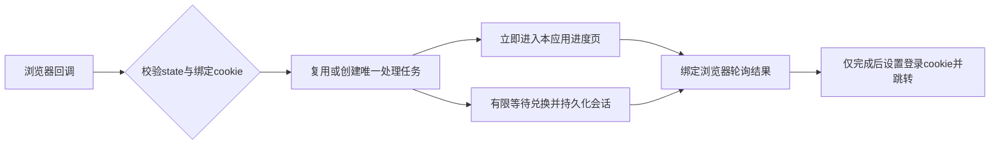

# OAuth回调恢复与登录等待

## Scope & Non-Goals

修复授权页等待及重复回调误报过期，沿用现有Express、mysql2、OAuth与浏览器绑定。不新增第三方登录依赖、不更改数据库结构、不提交推送；按既有SSH授权部署。复用标准HTTP跳转和无脚本刷新页，避免依赖提供方页面的点击逻辑。

## Acceptance Criteria

- [x] HTML回调立即离开授权页，在应用内显示实际处理进度
- [x] 同一浏览器同一state在处理时重复回调不二次兑换或创建会话
- [x] 完成后的重放、错误浏览器、伪造state均不能取得会话
- [x] 登录失败可重新发起，提供方兑换有等待上限且不泄露凭据
- [x] 认证连接与后台维护隔离，锁等待有界，成功仍等待持久化
- [x] OAuth集成、真实MySQL、构建及SSH实际回调验收通过

## Assumptions & Constraints

沿用本聊天参数和SSH权限，固定容器kunqiong-file-transfer-web/8045；保持现有.env、时隙和scanner。认证使用独立的小连接池，业务查询/获取预算沿用；认证客户端单次SQL限10秒；不延长时隙。保留工作区既有改动。

## Baseline Tests

| Item | Command | Baseline result |
| --- | --- | --- |
| 用户截图 | 确认页与二次点击后的首页 | 首次停在提供方页面，随后login=failed并提示状态已过期 |
| 测试服脱敏日志 | docker logs及本账号processlist | session读取超时、kq_write_lock等待；未看到已完成的oauth_callback_failed |
| 上轮回归 | 20261103-104742计划 | 接口与MySQL通过，但未覆盖慢授权回调的浏览器等待和重复点击 |

## Diagram

## Task Checklist

| ID | Task | Owner | Deps | Done |
| --- | --- | --- | --- | --- |
| T1 | 复核截图、代码与锁等待，确定恢复设计 | [main] | - | [x] |
| T2 | 实现浏览器绑定的回调去重、进度页及有限兑换 | [main] | T1 | [x] |
| T3 | 认证连接隔离和锁等待预算 | [main] | T2 | [x] |
| T4 | 慢兑换/重复回调与MySQL回归 | [main] | T2,T3 | [x] |
| T5 | SSH部署和实际请求核验，保存证据 | [main] | T4 | [x] |

## Sub-agent Registry

无委派。

## Risks & Rollback

| Risk | Mitigation | Rollback |
| --- | --- | --- |
| 异步响应先于会话写入 | 仅结果领取成功后设置cookie；保留后续任务及关闭时追踪 | 回退旧镜像 |
| state重复结果导致登录重放 | nonce校验，处理中复用，完成领取后不可重放 | 回退路由 |
| 连接预算变化 | 认证增加2连接，客户端单次SQL10秒；业务预算、MySQL GLOBAL和时隙保持 | 回退镜像 |

## Blockers

无。外部MySQL的物理延迟仍需实测。

## Change Log

| Time | Task ID | File / Task | Change | By |
| --- | --- | --- | --- | --- |
| 11:24 | T1 | 回调与数据库分析 | 当前state在工作前删除，锁等待加8次重试可能长时间阻塞；设计处理中复用及浏览器进度 | main |

| 11:36 | T2 | oauth-callback/admin路由 | 浏览器绑定单次任务与无脚本进度页，进度页不查询数据库；兑换20秒上限 | main |
| 11:36 | T3 | state/relational-request/request-store | 认证独立2连接，认证锁等待4秒、登录提交最多3次；后台补齐仍用业务池 | main |

| 11:36 | T4 | 回归 | 新增及认证入口9项、认证API慢授权/重复点击组、MySQL26项及UI通过；生产构建成功 | main |

| 11:44 | T5 | 首轮测试服验收 | 回调7ms进入进度页，重复交换1次、旧state拒绝、会话落库及清理成功；发现事务SQL等60秒后重试，实际登录68.6秒，继续缩短认证SQL等待 | main |

| 11:46 | T3,T4 | 认证事务尾延迟 | 认证客户端SQL10秒后放弃失响应连接，提交前最多安全重试3次；COMMIT发送后不重放。15项单元及重新运行MySQL26/26通过 | main |

| 11:52 | T5 | 最终发布验收 | oauth-3204479974b3镜像运行；进度7ms、回调落库3045ms、身份170ms；重复交换1次、重放拒绝，测试账号及临时文件清理完成；83文件及公网产物核验 | main |

## Verification Evidence

| 验证 | 结果 |
| --- | --- |
| 本地回归 | 最终单元15/15；MySQL8.0.41隔离库26/26无skip；认证API135项、UI91项通过；Vite构建成功 |
| 浏览器分支 | HTML回调立即302至进度页，meta refresh自动查询；慢兑换时二次回调共用任务，只兑换一次；错误浏览器和完成重放被拒绝 |
| 持久化 | MySQL集成覆盖浏览器进度登录、重启后仍有效、退出后重启仍无效；禁止账号与换设备的回归通过 |
| 测试服首轮 | 去重与持久化成功，但事务查询等60秒后重试，登录68630ms；据此继续调整认证客户端SQL上限 |
| 测试服最终 | 初次回调7ms进入进度页，真实MySQL落库3045ms，身份170ms；只兑换一次；另一浏览器拒绝，完成state拒绝重放；退出及旧cookie匿名校验成功；独立账号清理成功 |
| 版本 | df916af1c71cbf8b04ba998b41ee5115b18b5301-oauth-3204479974b3；镜像sha256:92c6bd24087566f76424f1184241d9cc8790ffde8098ccc0cfe7887efc01d0e2 |
| 来源 | source SHA256 3204479974b3ecd077f8e3cf69401c9bf2e5955855342890800ae31fad5c2148；300源码文件包校验，83个运行文件指纹一致 |
| 公网 | 首页、入口JS、health/live均200；入口JS SHA256 2abbced7323bb68e2ea3e1a6e06449e7e0f76e257f25d97197b192a312dff94e与容器一致 |
| 配置 | 固定kunqiong-file-transfer-web/8045；应用和scanner均healthy；.env仅release变化；GLOBAL15000/session60000ms；业务查询60000/获取30000ms；认证独立2连接、客户端SQL10000ms、锁等待4秒、登录提交最多3次 |
| 守卫与扫描 | 运行时隙仍为2026-11-03 15:13:55 +0800；scanner LF文件SHA256保持38a16f9cc7e87a771f0b55c24f3eaecd5dbf40bbfac21a4dbf93e5181d6bbef2 |
| 证据 | 本地.runtime/oauth-deploy-evidence.json；远程/opt/kunqiong-file-transfer-web/releases/oauth-3204479974b3/deployment-evidence.json及acceptance-result.json，旧首轮证据保留在/opt/kunqiong-file-transfer-web/releases/oauth-5317db7154d8 |

实际服务器验收以独立的提供方响应夹具驱动已安装路由，连接真实测试服MySQL；没有人工操作用户的外部OAuth账号。约3秒为这一次应用回调采样，不包含完整外部授权页面。外部数据库仍会波动：最终退出及旧cookie校验合计4897ms，包含一次只读连接重建。没有放宽授权校验、伪报写入成功或重放COMMIT。部署重启会使此前已打开的旧授权state失效，需从首页新发起授权。

## Bug & Fix Log

| Symptom | Root cause | Fix | Guard |
| --- | --- | --- | --- |
| 二次授权提示已过期 | state开始处理即删除，没有处理中状态 | 回调任务状态机 | 慢兑换与并发回调测试 |

## Completion Summary

已完成授权任务去重、浏览器进度、提供方兑换等待上限和认证连接隔离，并通过SSH发布。首轮实际验收发现事务查询60秒等待后，继续收紧认证客户端单条SQL为10秒，最终独立账号回调约3秒落库且只兑换一次。已验证会话、重放与跨浏览器隔离，清理独立测试数据和临时容器文件；未提交推送。

## Next Steps

无必需剩余实现；用户需关闭旧授权页，从首页重新发起登录，以确认外部登录中心的实际页面体验。

## Reopened 2026-11-03 12:15

用户真实登录回归失败：meta refresh导致卡片跳动；已有用户回调account_load和session_commit超时。此前夹具验收不等同真实账号验收。

复用现有MIT mysql2和Express，新增最小会话事务；资料同步后台处理。取消整页刷新，使用同源nonce绑定状态轮询。保留所有既有资料、套餐、单设备规则、已保存凭据加密、COMMIT不可重放规则。必须SSH发布后使用用户授权真实账号登录、刷新、退出与重登，记录结果。

## Final real-account recovery 2026-11-03 12:28

已取消meta refresh，进度页固定DOM与单次fetch轮询，状态查询不读数据库。既有账号采用共享用户锁和最小会话事务，资料和套餐不在关键路径重写，旧会话批量撤销，保留加密凭据。COMMIT结果不确定时只读确认随机令牌，不重放COMMIT。身份接口读取小字段投影，不读payload/头像/提供方凭据；完整资料用业务池，避免抢占认证池10秒预算；身份刷新不覆盖完整资料缓存。

验证：单元17/17；隔离MySQL28/28无skip（含大头像/套餐保留、并发单设备、重启/退出、身份投影）；认证API135、UI91通过；Docker生产构建通过。

SSH最终发布 df916af1c71cbf8b04ba998b41ee5115b18b5301-oauth-84c3a7d9299e，镜像sha256:9bfc32b849dae76d58bd02a68ce86f85607becf6a0d4aeedca4c111558c09507；300源码输入及82服务端运行文件指纹一致，公网入口JS一致，配置仅release变化。

已在隔离IAB浏览器使用用户明确授权的wzx1真实账号，从登录中心密码登录、授权、进度页自动跳转至账户ID9；刷新、退出、退出后刷新及重新授权均通过。中间版两次回调999ms/3336ms；最终版真实回调1000ms、关键SQL5次（不包含外部输入/授权操作耗时）。最终资料和团队季卡/容量正确。真实密码不写文件或报告。截图位于C:/Users/admin/AppData/Local/Temp/kunqiong-real-account-login-verified.png。

仍存在外部MySQL链路抖动：最终观察到kq_resource后台维护DATABASE_QUERY_TIMEOUT和relational_maintenance_failed；没有据此宣称所有数据库操作零超时。登录/身份路径最终真实验收成功。未提交推送、不进行备份/整库转换、不更改守卫。

最终证据：.runtime/oauth-real-account-evidence.json；服务器/opt/kunqiong-file-transfer-web/releases/oauth-84c3a7d9299e/real-account-deployment-evidence.json。旧Completion Summary及Next Steps为上一轮夹具验收历史，本节覆盖其需要用户代验的结论。
