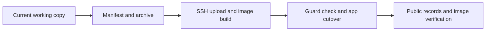

# page-loading-ssh-release - Plan

## Scope & Non-Goals
Deploy the existing local PageLoading and immediate logout changes using the established SSH image workflow. Preserve uncommitted work. No Git commit/push, data backup, data conversion or guard changes.

## Acceptance Criteria
- [x] Public records navigation renders without upper-left loading text.
- [x] Public release, source manifest and running image match the new package.
- [x] Fixed app name/8045 and scanner remain healthy; environment changes only release.

## Assumptions & Constraints
User authorized SSH deployment. Remote current release is oauth-84c3a7d9299e, healthy; panel allows project until 2026-11-03 15:13:55 +0800. Recheck before cutover; never extend slot.

## Baseline Tests
Prior turn: navigation performance 35 checks, auth latency 4 tests, Vite production build and diff checks passed. No new source edits since then. Server app and scanner both healthy on 12:54.

## Diagram

## Task Checklist
| ID | Task | Owner | Deps | Done |
| --- | --- | --- | --- | --- |
| T1 | Reconcile source and package changes | [main] | - | [x] |
| T2 | Upload checksum-verified archive and build image | [main] | T1 | [x] |
| T3 | Guarded cutover preserving app config and scanner | [main] | T2 | [x] |
| T4 | Verify public records navigation, health and manifest | [main] | T3 | [x] |
| T5 | Fix homepage maximum to literal 20 GB for every account | [main] | T4 | [x] |
| T6 | Deploy fixed maximum and verify public homepage | [main] | T5 | [x] |

## Sub-agent Registry
No delegation.

## Risks & Rollback
Save previous image tag and .env with mode 600 in the release folder. On cutover failure restore them with the existing compose app service. Only app is recreated; scanner configuration remains intact.

## Blockers
None.

## Change Log
| Time | Task ID | File / Task | Change | By |
| --- | --- | --- | --- | --- |
| 2026-11-03 12:55 | T1 | Initial reconciliation | Old public release confirmed; local fallback renders only an accessible label and spinner | main |
| 2026-11-03 12:58 | T1 | Package page-ui-b7d2bfd5223f | Exactly six frontend inputs changed from last deployment; no server changes. Archive SHA256 e077a1db0aa708fd926fa69fef70a78d253766535fd7b1bdeda337389d15945f | main |

| 2026-11-03 12:57 | T2 | Remote build | Package SHA and all 300 source hashes passed; Docker production build exited 0; image sha256:cc592b9ec1ceb19af2ec1aad0ca12c02acd82e9794742403d58a1759bd34f7b7 | main |

| 2026-11-03 12:57 | T3 | SSH cutover | New release installed; only KUNQIONG_RELEASE_SHA changed in env; fixed name and port preserved | main |
| 2026-11-03 13:00 | T4 | Public browser acceptance | Logged-in records page rendered eight records with no upper-left loading text; running app and scanner healthy | main |

| 2026-11-03 13:04 | T5 | workspace.jsx | User explicitly requested literal 20 GB independent of account/API; removed presentation prop and conditional dash; updated existing UI expectation | main |

| 2026-11-03 13:12 | T5 | Verification and package | Existing send cancellation/notification UI 110 passed, including guest/account displays and upload boundaries; diff check passed. New package cb1615085ec7 changes only workspace.jsx from prior release | main |

| 2026-11-03 13:15 | T6 | SSH deploy and public acceptance | Final cb1615085ec7 release installed, Docker build and cutover exit 0, 84 runtime files and four public assets verified; homepage shows literal 20 GB, app/scanner healthy | main |

## Verification Evidence
Docker production build exit=0. Runtime verified 84 server/package files. Public health/live HTTP200 matches new release; four entry CSS/JS hashes match image. Browser clicked records from home and displayed eight records, visibleLoadingText=[]; screenshot C:/Users/admin/AppData/Local/Temp/kunqiong-records-deployed.png. Env changed only release; scanner mounted configuration equals packaged LF source. Evidence .runtime/page-ui-deployment-evidence.json and server release folder deployment-evidence.json. No new source edits or test reruns after previously passed targeted checks. Deployment source comparison: src/components/account.jsx, src/components/page-load-boundary.jsx, src/lib/api.js, src/main.jsx, src/pages/workspace.jsx and src/styles/components.css only.

## Bug & Fix Log
| Time | Symptom | Root cause | Fix | Guard |
| --- | --- | --- | --- | --- |
| 2026-11-03 12:55 | Records still shows old upper-left loading text | Prior frontend changes were local only | Deploy updated production build | Public asset hash and browser navigation |

| 2026-11-03 13:04 | Homepage maximum displays dash | Header presentation waited for runtime-config after auth | Render literal 20 GB in SendView for all accounts; actual upload validation preserved | Existing send UI checks and public screenshot |

Final fixed-maximum evidence: release df916af1c71cbf8b04ba998b41ee5115b18b5301-page-ui-cb1615085ec7; image sha256:ec4e22e866974e6bab5e522ff845574d2fb0715579992ce48484cfd1565b6e42; public entry /assets/index-CevhAygV.js, homepage maximum=20 GB. Full Docker build and existing send UI 110 checks passed. Local .runtime/page-ui-deployment-evidence.json and remote release deployment-evidence.json record final checks; screenshot C:/Users/admin/AppData/Local/Temp/kunqiong-fixed-20gb-deployed.png.

## Completion Summary
SSH release df916af1c71cbf8b04ba998b41ee5115b18b5301-page-ui-b7d2bfd5223f is installed and publicly verified. Loading/instant logout changes are now in production assets. Records navigation, records data rendering, exact source/image/assets and both service health checks passed. Git working copy remains intact without commit/push.

Fixed maximum follow-up completed: all visitors/accounts render 20 GB without account or runtime-config dependency. Latest release cb1615085ec7 supersedes b7d2bfd5223f above. Upload enforcement is preserved.

## Next Steps
No remaining work; refresh already open browser pages to load the new release.
