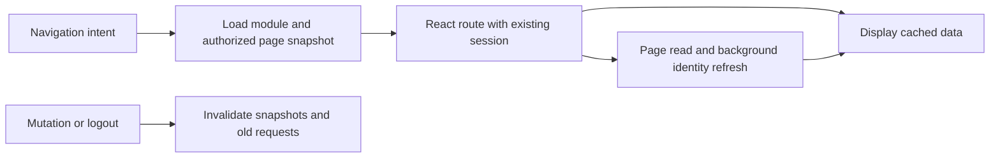

# global-navigation-loading - Plan

## Scope & Non-Goals
Optimize all same-origin UI navigation including collection/share details, management and team invites. Reuse confirmed session and bounded account-scoped query snapshots. Reuse React (MIT) and existing request coordinator instead of introducing another client cache library. Preserve server authorization and upload limits. Do not persist identity/tokens in browser storage, change DB, commit/push or extend server guard.

## Acceptance Criteria
- [x] Collection/share detail navigation retains confirmed header identity; no document reload.
- [x] Confirmed session does not block page data behind slow identity revalidation.
- [x] Revisit records/team/orders reuses short-lived pages; manual refresh and writes invalidate stale pages.
- [x] Logout/account switch/401 clear all private snapshots; stale responses cannot refill them.
- [x] Native external/download/auth/modifier-click behavior and active uploads remain protected.
- [x] Targeted UI/session/page query checks and production build pass; SSH public acceptance completed.

## Assumptions & Constraints
Existing worktree contains many authorized changes, preserved. Current deployed baseline page-ui-cb1615085ec7 is healthy. Same-origin public details previously excluded from isAppRoute; management/message handlers assign location.href and public record handler opens a new document. Backend and OAuth verification remain authoritative.

## Baseline Tests
node scripts/verify-navigation-performance.mjs: 35 passed on current baseline. Previous send UI: 110 passed; last Docker production build exited 0. No need for DB migration or whole-suite baseline.

## Diagram

## Task Checklist
| ID | Task | Owner | Deps | Done |
| --- | --- | --- | --- | --- |
| T1 | Locate route reloads and serial reads; baseline | [main] | - | [x] |
| T2 | Route public details internally and preserve upload/native behavior | [main] | T1 | [x] |
| T3 | Add bounded account query reuse, intent prefetch and nonblocking identity | [main] | T2 | [x] |
| T4 | Verify delayed identity, public navigation, cache invalidation and build | [main] | T3 | [x] |
| T5 | SSH publish and public navigation acceptance | [main] | T4 | [x] |

## Sub-agent Registry
No delegation requested; main performs all tasks.

## Risks & Rollback
Cached pages are display snapshots only; server checks all reads/writes. Cache fresh 30s, stale display at most 5min, bounded to 80 reads. Mutations/401/logout remove entries, generation blocks old-session responses. Public route token changes remount detail components. Build isolated image and keep previous image/config rollback; preserve fixed container/8045, scanner LF config, panel slot.

## Blockers
None.

## Change Log
| Time | Task ID | File / Task | Change | By |
| --- | --- | --- | --- | --- |
| 2026-11-03 13:19 | T1 | Baseline | Existing navigation 35 checks passed; public details excluded, team reads serial and not cached | main |
| 2026-11-03 13:25 | T2 | navigation/main/workspace/public | Include explicit public UI routes, reset token views, internal handlers and broader active upload guard; identity refresh always small view | main |
| 2026-11-03 13:25 | T3 | api/page-loaders/records/team/workspace-page/orders/settings | Bounded query snapshots with write invalidation; prefetch main queries only for known account; cached session first; first records read skips search debounce; team/order/cleanup initialize cache | main |

| 2026-11-03 13:31 | T4 | Regression | Navigation 45, demand pagination 15, orders 56, upload 111, auth/session/dedup API 10 and auth UI 91 passed. Public submit regression found background record save requesting summary; fixed to shared identity. Diff checks clean except CRLF notices | main |
| 2026-11-03 13:35 | T4 | Docker build | Production build exited 0; uploaded archive and all 300 source files SHA256 verified; image 996a5ae9603b created | main |
| 2026-11-03 13:38 | T5 | SSH/public acceptance | Deployed navigation-3264ddaf27e6 within panel slot; app/scanner healthy; 84 runtime files and 4 public assets verified. Existing signed-in browser opened records, collection management, returned records and membership with identity retained | main |

## Verification Evidence
Baseline 35 passed. Final navigation 45, pagination 15, orders 56, upload 111, API 10 and auth UI 91 passed. Logs .runtime/global-navigation-*.log. Docker build exited 0. Release df916af1c71cbf8b04ba998b41ee5115b18b5301-navigation-3264ddaf27e6, image sha256:996a5ae9603b171e48adb780ef05cb3f341c4bd18f91e4fc01154ad15eb4e274. Deployment evidence .runtime/navigation-deployment-evidence.json and remote releases/navigation-3264ddaf27e6/deployment-evidence.json. Application and scanner healthy; environment changed only KUNQIONG_RELEASE_SHA; scanner configuration preserved. Public browser used existing signed-in session: home -> records -> existing closed collection management -> records -> membership, with no repeated checking-login state. Returning records immediately displayed rows. Screenshot C:/Users/admin/AppData/Local/Temp/kunqiong-navigation-verified.png. Current 300 production input files match the deployment manifest. Read-only acceptance; no business data created/deleted/uploaded.

## Bug & Fix Log
| Time | Symptom | Root cause | Fix | Guard |
| --- | --- | --- | --- | --- |
| 2026-11-03 13:19 | Collection details checks login again | Public UI uses full document navigation; memory identity discarded | Same-origin React routing and cached identity | Public route navigation regression |
| 2026-11-03 13:25 | Revisit team/records waits for same queries | Only workspace/pricing reads cached; team awaits identity | Account/page/query cache and parallel refresh | Query and session isolation regressions |

## Completion Summary
Completed global same-origin React navigation, confirmed identity reuse, bounded per-account query snapshots, intent prefetch and nonblocking page requests. Preserved upload guards, native downloads/external links and server authorization. Production Docker build and targeted regressions passed; SSH release and public read-only acceptance completed. First entry still downloads the relevant lazy page bundle and uncached business reads still depend on the network/database; this change does not promise zero network latency. No commit/push, database changes or panel slot extension.

## Next Steps
None; implementation, targeted regressions, SSH release and public acceptance completed.
