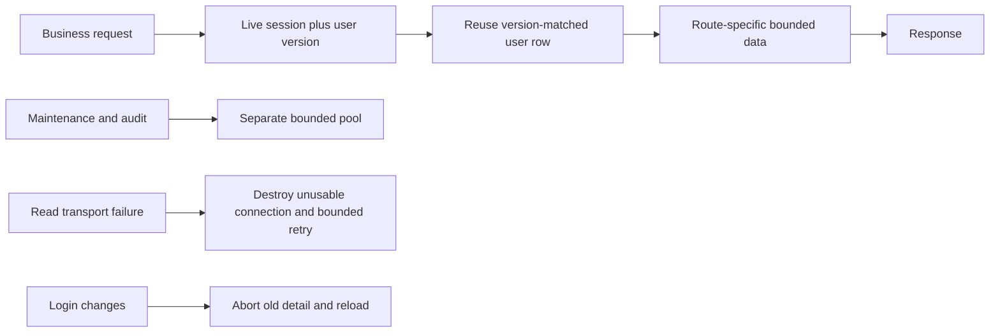

# database-request-recovery - Plan

## Scope & Non-Goals
Fix repeated full-profile transfers, read reconnect recovery, background/foreground pool contention and resource errors that survive login changes. Reuse mysql2 (MIT) idle eviction and existing version-checked cache. No new dependencies, DB migration/backups, ownership changes, auth weakening, commits/push or guard changes.

## Acceptance Criteria
- [ ] Business reads verify live identity/revocation without transferring unchanged full user history every request.
- [ ] Read recovery handles several unusable connections within one total deadline; writes and transactions are not replayed.
- [ ] Background jobs cannot exhaust the foreground query pool.
- [ ] Collection/share errors recover after account change and transient failures offer retry.
- [ ] Owner succeeds and other user remains denied; targeted regressions/build and SSH public verification pass.

## Assumptions & Constraints
Keep fixed container kunqiong-file-transfer-web and port8045. Existing panel slot expires15:13:55; recheck before cutover. Preserve all prior working changes. Existing global/query settings remain unchanged. Screenshot task database owner is706; latest login is229. Do not transfer ownership to bypass403; clarification pending. Current deployed baseline navigation-3264ddaf27e6 healthy but numerous DATABASE_QUERY_TIMEOUT and queue failures.

## Baseline Tests
node --test scripts/auth-session-latency.test.mjs scripts/db/read-reconnect.test.mjs scripts/db/versioned-read-cache.test.mjs:13 passed. Prior production build and navigation45 passed. Real errors pre-exist this task. User row sizes range0.5-56KB; current repeatedly queried profile37KB. Existing session rows329bytes. mysql2 idle removal only enabled when maxIdle < connectionLimit; current defaults leave idle pooled connections.

## Diagram

## Task Checklist
| ID | Task | Owner | Deps | Done |
| --- | --- | --- | --- | --- |
| T1 | Diagnose task ownership, live failures and baseline | [main] | - | [x] |
| T2 | Reduce session transfer and fix connection/pool recovery | [main] | T1 | [x] |
| T3 | Reduce unnecessary route data; recover detail reads across sessions | [main] | T2 | [x] |
| T4 | Ownership, revocation, transport and UI regression checks | [main] | T3 | [x] |
| T5 | Build, SSH deploy and actual public read acceptance | [main] | T4 | [ ] |

## Sub-agent Registry
No delegation; main owns every task.

## Risks & Rollback
Live SQL predicates and versions remain authoritative. No stale auth fallback. Any uncertain database read fails503, never grants access. Keep previous image and environment rollback; replace only application container within guard slot.

## Blockers
None for implementation. Need distinguish screenshot task ownership from current login before claiming403is false.

## Change Log
| Time | Task ID | File / Task | Change | By |
| --- | --- | --- | --- | --- |
| 2026-11-03 13:55 | T1 | Diagnosis | Repeated auth/resource/maintenance timeouts; large duplicate profiles and shared pool; real task owner706 confirmed, no ownership edits | main |
| 2026-11-03 13:58 | T2 | auth-session/versioned-cache/codec/bounded-pool/state/server | Live version-checked profile reuse; SQL user FK authoritative; idle eviction; bounded four-read recovery; separate maintenance pool | main |
| 2026-11-03 13:58 | T3 | relational-request/api/resource-read/public/common | Skip unrelated account data on resource GET/HEAD; one shared transient503read retry; abort/reload resource on session changes; reload controls and correct transient-error titles | main |

## Verification Evidence
26 targeted backend tests passed; 6 auth safety tests passed after adding SQL FK and retry/write denial guards. Navigation49, auth UI91 and demand UI15 passed. Real isolated MySQL+HTTP integration28 passed. git diff --check passed. Own isolated MySQL59123 instance shut down after verification. Production Docker build succeeded; image sha256:5b267b3c54aa11a4da4ba8d8530b160ca46b12d14b9e48ccb502bc2b628edd91; release query-recovery-1edc5bf633d5. Public acceptance pending.

## Bug & Fix Log
| Time | Symptom | Root cause | Fix | Guard |
| --- | --- | --- | --- | --- |
| 2026-11-03 13:58 | Data stalls and old permission errors persist | Large repeated profile reads, idle proxy connections, shared maintenance pool; detail effect ignores session changes | Version-checked reuse, bounded reconnect and isolated jobs; session-aware resource reads | Transport/session/owner regressions pending |

## Completion Summary
Recovery release query-recovery-1edc5bf633d5 deployed and image/runtime/static hashes verified. Owner task and records loaded on actual authorized account; foreign task denied. External MySQL transport still intermittently stalls. User replaced remaining transport work with explicit built-in MySQL migration, preserving business data; continue in plan20261103-140753-server-local-mysql-switch.

## Next Steps
Continue server-local-mysql-switch migration and final business verification.
