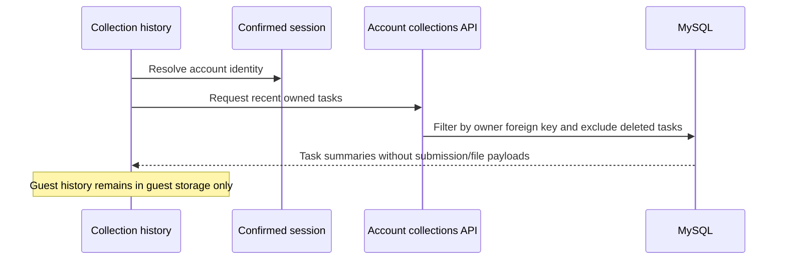

# collection-owner-list-username - Plan

## Scope & Non-Goals
Fix authenticated collection history and username display. Reuse existing mysql2, account-scoped SQL, API singleflight/cache, React and AbortController rather than adding a library. No ownership changes, commit, push or unrelated edits. User now explicitly authorized SSH deployment of this repair. Preserve server-local MySQL and existing storage/scan configuration.

## Acceptance Criteria
- [x] Confirm real task owner and distinguish browser records from database data
- [x] Authenticated history lists only database-owned resources even when local snapshots are stale or cloud-record sync is missing
- [x] Guest refresh responses cannot be written into a newly authenticated account
- [x] Compact and stale sessions preserve current account profiles; UI shows username first
- [x] Correct owner can manage; other accounts and guests cannot access private management
- [x] Focused server/UI tests and build pass
- [x] Top-right phone username shows final four digits; ordinary usernames remain complete
- [x] Cold identity returns bounded third-party avatar URL; cached null avatars cannot erase it and custom avatars remain preferred
- [x] Final SSH release, public assets, real-account task permissions and avatar verified

## Assumptions & Constraints
Existing large working diff must be preserved. No .codegraph directory. Server local MySQL read-only diagnostics authorized by existing task. Task 74dea82a6e / title 11 / manage token 81450d127081e3ec21 belongs to user 706 (wzx12); the screenshot's signed-in username 19211532795 is user 229. Database account record and resource owner agree. Server container disappeared during earlier diagnostics; the user subsequently authorized SSH deployment. Replace only app while preserving scanner and panel runtime slot.

## Baseline Tests
| Item | Command | Baseline result |
| --- | --- | --- |
| Navigation | node scripts/verify-navigation-performance.mjs | 49 passed before edits |
| Git | git status --short; git rev-parse HEAD | df916af; extensive existing uncommitted changes |

## Diagram

## Task Checklist
| ID | Task | Owner | Deps | Done |
| --- | --- | --- | --- | --- |
| T1 | Trace screenshot ownership, local history and compact profile normalization | [main] | - | [x] |
| T2 | Add bounded owner-authoritative database summary API | [main] | T1 | [x] |
| T3 | Load authenticated history from API; prevent guest response/account races | [main] | T2 | [x] |
| T4 | Preserve stored profile over compact session; show username first | [main] | T1 | [x] |
| T5 | Validate isolation, username display, async races and build | [main] | T3,T4 | [x] |
| T6 | Build immutable SSH release, replace app, verify public assets and real ownership/profile APIs | [main] | T5 | [x] |
| T7 | Show phone tail in header and preserve third-party avatar across cold refresh | [main] | T5 | [x] |

## Sub-agent Registry
None; all work sequential in main thread.

## Risks & Rollback
Task management ownership checks stay strict. Remove only this task's edits if rollback is required, preserving all earlier changes. Browser cache remains only for anonymous history; authenticated list failures are explicit and do not fall back to guest data.

## Blockers
No current blocker. SSH release is authorized; final artifact and real-account acceptance are in progress.

## Change Log
| Time | Task ID | File / Task | Change | By |
| --- | --- | --- | --- | --- |
| 2026-11-03 15:27 | T1 | Read-only MySQL and UI investigation | Confirmed wzx12 owns title 11; initial browser records retained across first login | main |
| 2026-11-03 15:34 | T2 | server/db/collection-list.js; server/lib/relational-request.js; server/routes/account.js | Bounded owner-filtered summary with submission counts and no file graph; authenticated API | main |
| 2026-11-03 15:34 | T4 | server/lib/metadata-normalizers.js; server/services/account.js; src/lib/format.js | Stored profile wins over compact/stale sessions, missing profile fields preserved, username display preferred | main |
| 2026-11-03 15:36 | T3 | src/lib/api.js; src/lib/records.js; src/pages/workspace.jsx | Account-scoped summary cache/history, cancellation on identity change, guarded guest writes, correct label | main |

| 2026-11-03 15:38 | T5 | scripts/collection-owner-history.test.mjs; scripts/verify-collection-owner-history-ui.mjs; scripts/db/request-store.integration.test.mjs | Profile, owner summary, cold login, async race, logout and real SQL HTTP regressions pass | main |

## Verification Evidence
| Command | Result | Notes |
| --- | --- | --- |
| node --test scripts/collection-owner-history.test.mjs scripts/auth-session-latency.test.mjs scripts/relational-auth-session.test.mjs | 12 passed | Current profile and provider avatar preserved, safe session identity and username display, bounded owner-filtered summaries |
| node scripts/verify-collection-owner-history-ui.mjs | 19 passed | Phone tail, cold provider avatar, custom avatar, no initial fallback, cold identity, stale guest/account browser caches, guest-login race, logout with pending history, management link and username |
| node scripts/verify-navigation-performance.mjs | 49 passed | Same as initial baseline; existing auth/navigation isolation preserved |
| KUNQIONG_TEST_DB_PORT=62235 node --test scripts/db/request-store.integration.test.mjs | 28 passed | New empty isolated MySQL 8.0.41; real HTTP new task lists, counts, owner success, nonowner 403, anonymous 401; fixture stopped/removed |
| npx vite build | passed | Existing large-chunk advisory only |
| git diff --check | passed | Existing CRLF advisory only |

Initial local port 3307 rejected passwordless root and was not modified; tests were then run against a newly initialized loopback-only fixture. No business task writes, database backup, commit or push performed in this repair. SSH deployment was later authorized and completed as recorded below.

## Bug & Fix Log
| Time | Symptom | Root cause | Fix (files) | Guard added |
| --- | --- | --- | --- | --- |
| 2026-11-03 15:34 | Task visible but manager rejects account | Initial guest local records survived login and mount-only refresh captured guest identity | Owned collection summary API and account-keyed history; cancel stale responses | 14 UI checks and SQL owner checks |
| 2026-11-03 15:34 | Generic account name | Compact session profile overwrote database profile during normalizeAccountUserStore | Current account row wins; username-first format | Profile normalization and username assertions |

## Completion Summary
Authenticated collection history now reads owner-filtered task summaries directly from MySQL, independent of browser/account-record snapshots. Guest history remains separate and stale probes cannot write into another account. Current stored profiles are authoritative over compact or historical sessions; UI and server account labels prefer usernames. All focused tests and production build pass. SSH deployment is complete at release df916af1c71cbf8b04ba998b41ee5115b18b5301-collection-owner-c26695dc322e. The live server uses its existing local MySQL and 60000 ms query timeout.

## Next Steps
None; authorized repair and SSH deployment are complete.

## Deployment Follow-up
- 2026-11-03 15:45: First app cutover succeeded, but runtime hash verification caught server/services/account.js retaining its old username ordering. Do not mark deployed until source mismatch is resolved.
- User requested phone-like usernames in the top-right account button show their final four digits. Reuse AuthButton and formatting helpers, preserve full profile data and ordinary usernames. Include in the same SSH release.

## Final SSH Acceptance
- 2026-11-03 16:03: Release `df916af1c71cbf8b04ba998b41ee5115b18b5301-collection-owner-c26695dc322e`, image `sha256:cf375e78074617c04e6648a521101e43a3ae8aff561cb4bd5543c055b960bf9b`. Build and deploy exits are zero.
- 85 runtime server/package files match the manifest; all 28 public JS/CSS assets match container hashes. App and scanner are healthy; public live endpoint is ready with the same full release.
- Current environment differs from this cutover rollback environment only in KUNQIONG_RELEASE_SHA. Local MySQL remains 192.168.192.1 / kunqiong_file_transfer; live session max_execution_time=60000 ms. Scanner was not recreated and config hash is unchanged.
- Real existing wzx1 session: cold identity 200 (17 ms) and full profile 200 (59 ms) return the same third-party avatar. Own summary 200 (10 ms), own management 200 (31 ms), foreign management 403 (27 ms), anonymous list 401. Accounts 706 and 229 have no current live session; no sessions were fabricated or accounts/ownership changed.
- Local validation: 12 focused unit/client tests, 19 ownership/avatar UI checks, 49 navigation checks and 28 isolated MySQL integration tests passed. Disposable local fixture stopped and removed. Docker production build including manual verification passed; git diff --check passed.
- First image source mismatch traced to equal-sized archived files with zero timestamps and BuildKit context reuse. Refreshing source mtimes fixed it; packaging now preserves source timestamps. Final image passed source checks before cutover and again after deployment.
- Evidence: `.runtime/collection-owner-deployment-evidence.json`, `.runtime/collection-owner-acceptance-evidence.json`; remote release directory holds deployment-evidence.json. No commit or push.
