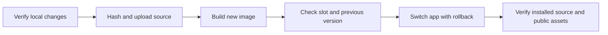

# Test release UI fixes

## Scope & Non-Goals
Deploy the completed collection drag alignment, clipboard feedback, account/team avatar, notification preferences and member contact search fixes, including earlier modal portals. Preserve uncommitted work and exclude unrelated untracked requirements documents. No commit or push requested.

## Acceptance Criteria
- [x] Current application, database endpoint and runtime slot inspected
- [x] Local checks passed and source manifest prepared
- [x] Image built from manifest and application updated
- [x] Runtime source/assets match, health and relevant behavior verified

## Assumptions & Constraints
Continue the subsequently authorized SSH release method used by prior releases; older memory requesting Gitea was superseded by repeated direct SSH instructions and disabled Runs. Keep fixed container name, current local MySQL, 60000 ms query timeout, scanner and guard. No database migration or backup.

## Baseline Tests
Vite production build, collection form and Chromium desktop/mobile layout checks passed in the immediately preceding repair. Existing notification-settings isolated SQL regression passed in prior work. Nine avatar/member unit checks, 21 distribution UI checks and two team avatar UI checks passed during this release preparation. Current test service returns ready/200 at prior release modal-portal-f0bfa4957403.

## Diagram

## Task Checklist
| ID | Task | Owner | Deps | Done |
| --- | --- | --- | --- | --- |
| T1 | Inspect current service and scope | main | - | [x] |
| T2 | Run focused checks and package source | main | T1 | [x] |
| T3 | Upload and build image | main | T2 | [x] |
| T4 | Cut over app and verify source/configuration/runtime | main | T3 | [x] |
| T5 | Record outcome and report | main | T4 | [x] |

## Sub-agent Registry
No delegation.

## Risks & Rollback
Retain current image and restricted rollback.env before switching. If health or cutover assertions fail, restore the previous environment and app image. Respect the runtime slot without extending it or changing the guard. Do not rebuild scanner.

## Blockers
None.

## Change Log
| Time | Task ID | File / Task | Change | By |
| --- | --- | --- | --- | --- |
| 2026-11-05 15:51 | T1 | Remote inspection | App healthy; local MySQL 192.168.192.1:3306; current query timeout 60000 ms; slot allowed through 21:54:19 +0800 | main |
| 2026-11-05 15:54 | T2 | Local checks and source package | 302 files, source digest 87adbe93f3ac9beae81a08bb5972ca6309220b8587af07ac281b3086fa8732a1; archive SHA256 38694f671914fa90b4cf61f514b22fef8c90153ac97da8f4d20ec2089db0b029 | main |

## Verification Evidence
Target release: 5f822a9510629370892ddb63383730a07c4ffbdb-ui-fixes-87adbe93f3ac. Nine unit checks, 21 clipboard/distribution UI checks and provider/custom-avatar team UI checks passed. Relevant collection desktop/mobile checks and Vite build already passed on this exact source. No live business writes performed.

## Bug & Fix Log
No application regression. Initial verification expected dist on the build host, although Docker builds it inside the image; adjusted to compare the build-log asset set against local hashes. Ignored stale retained local dist assets and accounted for intentional per-request SEO HTML generation. All checks then passed.

## Completion Summary
Deployed working-copy release 5f822a9510629370892ddb63383730a07c4ffbdb-ui-fixes-87adbe93f3ac by the authorized SSH method. Build and cutover exited zero; image sha256:f3d4bc5a6c60ed603a1ee6cbcfa6e1619c3cee8a67a89cce86ea62944a5956ee. App and scanner healthy. Public homepage and ready health return 200 at the target release. All 86 runtime source files and 30 built entry/assets match local hashes; all 29 served JS/CSS files match. Existing MySQL endpoint, 60000 ms timeout, compose, scanner ID/config, mount and restart policy unchanged. Only release environment key changed. Deployed Chromium checks use synthetic HTTP fixtures, so no live business writes were made; real authenticated CRUD for unrelated repairs was not repeated.

## Next Steps
None; deployment and verification complete.

## Final Deployment Evidence
- 2026-11-05 15:56: runtime-verification.json on test server reports passed=true, release and image match, ready=true, and only KUNQIONG_RELEASE_SHA changed.
- node .runtime/verify-deployed-collection-layout-20261105.mjs: exit 0 using the publicly served production bundle. Desktop/mobile geometry confirms handle immediately before required checkbox, same control center line, name input left edge equals automatic-naming section and no row overflow. Also verified settings scrolling and confirmation portal controls.
- Existing runtime slot remains unchanged; no commit or push performed, unrelated requirements documents preserved.
