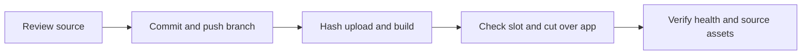

# UI boundaries test release

## Scope & Non-Goals
Commit completed typography, icons, payment logos, mobile layout and collection boundary fixes. Push current branch to GitHub and deploy via SSH. Exclude unrelated requirements documents. No database migrations or backups.

## Acceptance Criteria
- [x] Authorized changes and current test runtime inspected
- [ ] Changes committed and pushed without overwriting remote history
- [ ] Image built and app replaced with fixed container name
- [ ] Ready health, source and publicly served assets match release

## Assumptions & Constraints
Keep kunqiong-file-transfer-web, port 8045, local MySQL, 60000ms query timeout, scanner and guard configuration. Runtime slot allows this project until 2026-11-06 19:51:51 +0800. Remote main diverges from local branch; push current branch without force. No delegation.

## Baseline Tests
Current source: Vite build passed; collection boundary unit tests 5 passed; collection form UI passed; collection field UI 38 passed. Current server release 5f822a9510629370892ddb63383730a07c4ffbdb-ui-fixes-87adbe93f3ac and scanner healthy.

## Diagram

## Task Checklist
| ID | Task | Owner | Deps | Done |
| --- | --- | --- | --- | --- |
| T1 | Inspect source and service | main | - | [x] |
| T2 | Commit and push authorized changes | main | T1 | [ ] |
| T3 | Package upload and build | main | T2 | [ ] |
| T4 | Cut over and verify | main | T3 | [ ] |
| T5 | Record outcome | main | T4 | [ ] |

## Sub-agent Registry
No delegation.

## Risks & Rollback
Preserve previous image and restricted rollback.env; restore on failed cutover. Preserve remote main and unrelated local documents. No guard modifications.

## Blockers
None.

## Change Log
| Time | Task ID | File / Task | Change | By |
| --- | --- | --- | --- | --- |
| 2026-11-06 15:14 | T1 | Scope and SSH inspection | Reconciled working copy; current app and scanner healthy, local DB retained, slot allowed | main |

## Verification Evidence
Unit and UI checks from completed repair passed on unchanged source; deployment verification pending. License for Remix Icon assets included with attribution.

## Bug & Fix Log
No new regression found during deployment preparation.

## Completion Summary
Pending deployment.

## Next Steps
Commit and push current branch, then package source and build image.
