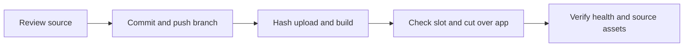

# UI boundaries test release

## Scope & Non-Goals
Commit completed typography, icons, payment logos, mobile layout and collection boundary fixes. Push current branch to GitHub and deploy via SSH. Exclude unrelated requirements documents. No database migrations or backups.

## Acceptance Criteria
- [x] Authorized changes and current test runtime inspected
- [x] Changes committed and pushed without overwriting remote history
- [x] Image built and app replaced with fixed container name
- [x] Ready health, source and publicly served assets match release

## Assumptions & Constraints
Keep kunqiong-file-transfer-web, port 8045, local MySQL, 60000ms query timeout, scanner and guard configuration. Runtime slot allows this project until 2026-11-06 19:51:51 +0800. Remote main diverges from local branch; push current branch without force. No delegation.

## Baseline Tests
Current source: Vite build passed; collection boundary unit tests 5 passed; collection form UI passed; collection field UI 38 passed. Current server release 5f822a9510629370892ddb63383730a07c4ffbdb-ui-fixes-87adbe93f3ac and scanner healthy.

## Diagram

## Task Checklist
| ID | Task | Owner | Deps | Done |
| --- | --- | --- | --- | --- |
| T1 | Inspect source and service | main | - | [x] |
| T2 | Commit and push authorized changes | main | T1 | [x] |
| T3 | Package upload and build | main | T2 | [x] |
| T4 | Cut over and verify | main | T3 | [x] |
| T5 | Record outcome | main | T4 | [x] |

## Sub-agent Registry
No delegation.

## Risks & Rollback
Preserve previous image and restricted rollback.env; restore on failed cutover. Preserve remote main and unrelated local documents. No guard modifications.

## Blockers
None.

## Change Log
| Time | Task ID | File / Task | Change | By |
| --- | --- | --- | --- | --- |
| 2026-11-06 15:14 | T1 | Scope and SSH inspection | Reconciled working copy; current app and scanner healthy, local DB retained, slot allowed | main |

| 2026-11-06 15:19 | T2 | GitHub | Committed 1cc904bd4e948865824b829b27865c50c51936bb and pushed current branch; main preserved | main |

| 2026-11-06 15:16 | T3 | Image build | 307 committed source files verified; archive SHA256 0d124b9af49914367685541a77ef8f3d0b766a654d269699fd4294522baaf743; build exited zero | main |
| 2026-11-06 15:18 | T4 | Runtime verification | Cutover exited zero; app/scanner healthy; 86 runtime and 30 entry/assets match, 29 served JS/CSS match | main |
| 2026-11-06 15:18 | T5 | Release record | Recorded successful SSH deployment and public checks | main |

## Verification Evidence
Unit and UI checks from completed repair passed on unchanged source; deployment verification passed. npx vite build --emptyOutDir passed. Remote verify-runtime.py passed=true at 2026-11-06T07:17:45Z; public homepage and health return 200. Direct client verification confirms new placeholder CSS is served. No live business data writes performed. License for Remix Icon assets included with attribution.

## Bug & Fix Log
Compose recreated the app with its configured unless-stopped restart policy while the baseline runtime used no restart. Restored the stricter baseline policy without changing compose or guard. Verification helper initially replaced its asset filter as well as the asset list; corrected the helper, then all runtime/hash assertions passed.

## Completion Summary
Deployed code commit 1cc904bd4e948865824b829b27865c50c51936bb, release 1cc904bd4e948865824b829b27865c50c51936bb-ui-boundaries-fc909acb8883, image sha256:fa48a265e5b3eb0ad9246d088a0d9bf9f3a903e4d1c6849103cca5745a666142. Pushed GitHub branch deploy/user-file-isolation-20261029; divergent main preserved. Fixed container, port, local MySQL, 60000ms timeout, scanner, storage mounts, compose and baseline restart policy preserved. Only KUNQIONG_RELEASE_SHA environment key changed. Verified source and served assets match, ready health and public homepage succeed. This record-only follow-up does not change deployed runtime code.

## Next Steps
None; deployment complete. Commit this final verification record and push the same branch.
