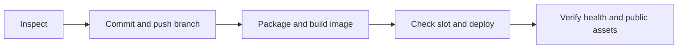

# Plan artwork test release

## Scope & Non-Goals
Commit the five supplied plan images, shared artwork component and removal of duplicate catalog prices. Push GitHub current branch and deploy over SSH. Exclude unrelated requirements documents; no database changes or migration.

## Acceptance Criteria
- [x] Source scope, remote branch and current runtime inspected
- [ ] Authorized changes committed and pushed
- [ ] Image built from committed source and deployed
- [ ] Public health, version and served artwork/price assets verified

## Assumptions & Constraints
Keep container kunqiong-file-transfer-web, port 8045, server-local MySQL and query timeout 60000ms, scanner and storage. Do not alter runtime guard or slot; current slot permits project until 2026-11-06 22:01:10 +0800. Preserve restart=no. No delegation.

## Baseline Tests
npx vite build passed; local catalog screenshot confirms new icons and single price row. git diff --check passed. Existing payment UI suite passes 19 assertions then fails closing-modal abort assertion; reproduced using HEAD workspace source, predates this image change. Previous server release 1cc904bd4e948865824b829b27865c50c51936bb-ui-boundaries-fc909acb8883 and scanner healthy.

## Diagram

## Task Checklist
| ID | Task | Owner | Deps | Done |
| --- | --- | --- | --- | --- |
| T1 | Inspect scope, remote and runtime | main | - | [x] |
| T2 | Commit and push | main | T1 | [ ] |
| T3 | Package upload and build | main | T2 | [ ] |
| T4 | Cut over and verify | main | T3 | [ ] |
| T5 | Record result | main | T4 | [ ] |

## Sub-agent Registry
No delegation.

## Risks & Rollback
Preserve old image and restricted rollback.env; restore if deployment fails. Payment abort assertion is a pre-existing test limitation, no payment behavior changed.

## Blockers
None. Direct GitHub network unavailable; local existing HTTP proxy 127.0.0.1:7897 successfully reads target branch at 795978c.

## Change Log
| Time | Task ID | File / Task | Change | By |
| --- | --- | --- | --- | --- |
| 2026-11-06 16:24 | T1 | Source and SSH inspection | Source scoped; remote branch matches HEAD; app/scanner healthy; runtime slot valid | main |

## Verification Evidence
Local Vite build, screenshot and diff checks passed. Runtime inspection shows expected prior release and preserved database settings.

## Bug & Fix Log
None during deployment so far.

## Completion Summary
Deployment in progress.

## Next Steps
Commit, push, upload committed source, build, cut over and verify.
